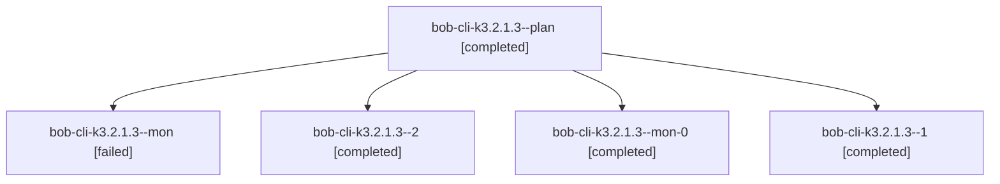

# Session: bob-cli-k3.2.1.3

[Agent Hoods](../README.md) / [bbugyi200](../users/bbugyi200/README.md) / [athena](../users/bbugyi200/machines/athena/README.md) / [bob-cli-k3](../users/bbugyi200/machines/athena/hoods/bob-cli-k3/README.md) / bob-cli-k3.2.1.3

Owner: `bbugyi200.athena` · Hood: `bob-cli-k3` · Members: 5 · Bead: [bob-cli-k3.2.1.3](https://github.com/bobs-org/bob-cli--beads/blob/main/pages/bob-cli-k3/bob-cli-k3.2.1.3.md)

## Lineage

The diagram is an optional enhancement; the ordered table below contains the same lineage in accessible text.

| Role | Agent | State | Model / provider | Timing | Commits | Prompt | Chat |
|---|---|---|---|---|---:|---|---|
| plan | bob-cli-k3.2.1.3--plan | completed | grok-4.6 / grok | 2026-11-11T12:00:07.918613+00:00 → 2026-11-11T12:41:58.169611+00:00 | 0 | [Prompt](../agents/bbugyi200.athena.bob-cli-k3.2.1.3--plan/prompt.md) | [Chat](../agents/bbugyi200.athena.bob-cli-k3.2.1.3--plan/chat.md) |
| mon | bob-cli-k3.2.1.3--mon | failed | grok-4.6 / grok | 2026-11-11T12:40:40.805912+00:00 → 2026-11-11T12:46:01.092165+00:00 | 0 | — | [Chat](../agents/bbugyi200.athena.bob-cli-k3.2.1.3--mon/chat.md) |
| 2 | bob-cli-k3.2.1.3--2 | completed | grok-4.6 / grok | 2026-11-11T13:03:24.168355+00:00 → 2026-11-11T13:18:12.263652+00:00 | [1](../agents/bbugyi200.athena.bob-cli-k3.2.1.3--2/README.md#commits) | [Prompt](../agents/bbugyi200.athena.bob-cli-k3.2.1.3--2/prompt.md) | [Chat](../agents/bbugyi200.athena.bob-cli-k3.2.1.3--2/chat.md) |
| mon-0 | bob-cli-k3.2.1.3--mon-0 | completed | grok-4.6 / grok | 2026-11-11T12:53:13.913621+00:00 → 2026-11-11T13:02:38.192517+00:00 | 0 | — | [Chat](../agents/bbugyi200.athena.bob-cli-k3.2.1.3--mon-0/chat.md) |
| 1 | bob-cli-k3.2.1.3--1 | completed | grok-4.6 / grok | 2026-11-11T12:46:55.892560+00:00 → 2026-11-11T12:54:20.150667+00:00 | 0 | [Prompt](../agents/bbugyi200.athena.bob-cli-k3.2.1.3--1/prompt.md) | [Chat](../agents/bbugyi200.athena.bob-cli-k3.2.1.3--1/chat.md) |

## Commits

| Role | Repo | Commit | Subject | Committed |
|---|---|---|---|---|
| 2 | bob-cli | [`ba9867a`](https://github.com/bobs-org/bob-cli/commit/ba9867a56d0d28b163a480aa9a837e636a2242a2) | feat(albums): add list/check reports, completion, and docs | 2026-11-11 08:17:41 EST |

## Neighbors

| Agent | Relation | State |
|---|---|---|
| [bob-cli-k3.2.1.2](../agents/bbugyi200.athena.bob-cli-k3.2.1.2/README.md) | bob-cli-k3.2.1 hood | completed |
| [bob-cli-k3.2.1.land](../agents/bbugyi200.athena.bob-cli-k3.2.1.land/README.md) | bob-cli-k3.2.1 hood | waiting |
| [bob-cli-k3.10](../agents/bbugyi200.athena.bob-cli-k3.10/README.md) | bob-cli-k3 hood | waiting |
| [bob-cli-k3.11](../agents/bbugyi200.athena.bob-cli-k3.11/README.md) | bob-cli-k3 hood | waiting |
| [bob-cli-k3.4](../agents/bbugyi200.athena.bob-cli-k3.4/README.md) | bob-cli-k3 hood | waiting |
| [bob-cli-k3.5](../agents/bbugyi200.athena.bob-cli-k3.5/README.md) | bob-cli-k3 hood | waiting |
| [bob-cli-k3.6](../agents/bbugyi200.athena.bob-cli-k3.6/README.md) | bob-cli-k3 hood | waiting |
| [bob-cli-k3.7](../agents/bbugyi200.athena.bob-cli-k3.7/README.md) | bob-cli-k3 hood | waiting |
| [bob-cli-k3.8](../agents/bbugyi200.athena.bob-cli-k3.8/README.md) | bob-cli-k3 hood | waiting |
| [bob-cli-k3.9](../agents/bbugyi200.athena.bob-cli-k3.9/README.md) | bob-cli-k3 hood | waiting |
| [bob-cli-k3.land](../agents/bbugyi200.athena.bob-cli-k3.land/README.md) | bob-cli-k3 hood | waiting |
