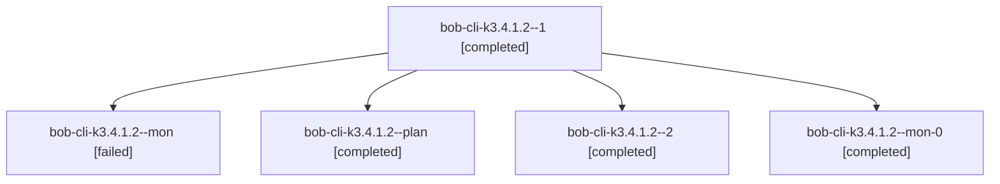

# Session: bob-cli-k3.4.1.2

[Agent Hoods](../README.md) / [bbugyi200](../users/bbugyi200/README.md) / [athena](../users/bbugyi200/machines/athena/README.md) / [bob-cli-k3](../users/bbugyi200/machines/athena/hoods/bob-cli-k3/README.md) / bob-cli-k3.4.1.2

Owner: `bbugyi200.athena` · Hood: `bob-cli-k3` · Members: 5 · Bead: [bob-cli-k3.4.1.2](https://github.com/bobs-org/bob-cli--beads/blob/main/pages/bob-cli-k3/bob-cli-k3.4.1.2.md)

## Lineage

The diagram is an optional enhancement; the ordered table below contains the same lineage in accessible text.

| Role | Agent | State | Model / provider | Timing | Commits | Prompt | Chat |
|---|---|---|---|---|---:|---|---|
| 1 | bob-cli-k3.4.1.2--1 | completed | grok-4.6 / grok | 2026-11-11T15:46:40.423697+00:00 → 2026-11-11T15:55:50.506961+00:00 | 0 | [Prompt](../agents/bbugyi200.athena.bob-cli-k3.4.1.2--1/prompt.md) | [Chat](../agents/bbugyi200.athena.bob-cli-k3.4.1.2--1/chat.md) |
| mon | bob-cli-k3.4.1.2--mon | failed | grok-4.6 / grok | 2026-11-11T15:37:11.159887+00:00 → 2026-11-11T15:45:07.467709+00:00 | 0 | — | [Chat](../agents/bbugyi200.athena.bob-cli-k3.4.1.2--mon/chat.md) |
| plan | bob-cli-k3.4.1.2--plan | completed | grok-4.6 / grok | 2026-11-11T14:55:28.544463+00:00 → 2026-11-11T15:38:11.594134+00:00 | 0 | [Prompt](../agents/bbugyi200.athena.bob-cli-k3.4.1.2--plan/prompt.md) | [Chat](../agents/bbugyi200.athena.bob-cli-k3.4.1.2--plan/chat.md) |
| 2 | bob-cli-k3.4.1.2--2 | completed | grok-4.6 / grok | 2026-11-11T16:06:04.214771+00:00 → 2026-11-11T16:20:35.155880+00:00 | [1](../agents/bbugyi200.athena.bob-cli-k3.4.1.2--2/README.md#commits) | [Prompt](../agents/bbugyi200.athena.bob-cli-k3.4.1.2--2/prompt.md) | [Chat](../agents/bbugyi200.athena.bob-cli-k3.4.1.2--2/chat.md) |
| mon-0 | bob-cli-k3.4.1.2--mon-0 | completed | grok-4.6 / grok | 2026-11-11T15:54:51.498120+00:00 → 2026-11-11T16:04:48.484658+00:00 | 0 | — | [Chat](../agents/bbugyi200.athena.bob-cli-k3.4.1.2--mon-0/chat.md) |

## Commits

| Role | Repo | Commit | Subject | Committed |
|---|---|---|---|---|
| 2 | bob-cli | [`c36e6e7`](https://github.com/bobs-org/bob-cli/commit/c36e6e752d36828f6bd73e09cb095d7c70d25498) | feat(records): add album-aware records commands and membership checks | 2026-11-11 11:19:55 EST |

## Neighbors

| Agent | Relation | State |
|---|---|---|
| [bob-cli-k3.4](bbugyi200.athena.bob-cli-k3.4.md) (session · 3) | ancestor | active 1, completed 2 |
| [bob-cli-k3.4.1.1](../agents/bbugyi200.athena.bob-cli-k3.4.1.1/README.md) | bob-cli-k3.4.1 hood | completed |
| [bob-cli-k3.4.1.3](../agents/bbugyi200.athena.bob-cli-k3.4.1.3/README.md) | bob-cli-k3.4.1 hood | completed |
| [bob-cli-k3.4.1.4](../agents/bbugyi200.athena.bob-cli-k3.4.1.4/README.md) | bob-cli-k3.4.1 hood | completed |
| [bob-cli-k3.4.1.land](bbugyi200.athena.bob-cli-k3.4.1.land.md) (session · 3) | bob-cli-k3.4.1 hood | completed 3 |
| [bob-cli-k3.10](../agents/bbugyi200.athena.bob-cli-k3.10/README.md) | bob-cli-k3 hood | waiting |
| [bob-cli-k3.11](../agents/bbugyi200.athena.bob-cli-k3.11/README.md) | bob-cli-k3 hood | waiting |
| [bob-cli-k3.2.1.2](../agents/bbugyi200.athena.bob-cli-k3.2.1.2/README.md) | bob-cli-k3 hood | completed |
| [bob-cli-k3.2.1.3](bbugyi200.athena.bob-cli-k3.2.1.3.md) (session · 5) | bob-cli-k3 hood | completed 4, failed 1 |
| [bob-cli-k3.2.1.land](bbugyi200.athena.bob-cli-k3.2.1.land.md) (session · 3) | bob-cli-k3 hood | completed 3 |
| [bob-cli-k3.5](bbugyi200.athena.bob-cli-k3.5.md) (session · 3) | bob-cli-k3 hood | active 1, completed 2 |
| [bob-cli-k3.5.1.1](../agents/bbugyi200.athena.bob-cli-k3.5.1.1/README.md) | bob-cli-k3 hood | completed |
| [bob-cli-k3.5.1.2](../agents/bbugyi200.athena.bob-cli-k3.5.1.2/README.md) | bob-cli-k3 hood | completed |
| [bob-cli-k3.5.1.3](../agents/bbugyi200.athena.bob-cli-k3.5.1.3/README.md) | bob-cli-k3 hood | waiting |
| [bob-cli-k3.5.1.land](../agents/bbugyi200.athena.bob-cli-k3.5.1.land/README.md) | bob-cli-k3 hood | waiting |
| [bob-cli-k3.6](../agents/bbugyi200.athena.bob-cli-k3.6/README.md) | bob-cli-k3 hood | waiting |
| [bob-cli-k3.7](../agents/bbugyi200.athena.bob-cli-k3.7/README.md) | bob-cli-k3 hood | waiting |
| [bob-cli-k3.8](bbugyi200.athena.bob-cli-k3.8.md) (session · 3) | bob-cli-k3 hood | completed 3 |
| [bob-cli-k3.9](../agents/bbugyi200.athena.bob-cli-k3.9/README.md) | bob-cli-k3 hood | waiting |
| [bob-cli-k3.land](../agents/bbugyi200.athena.bob-cli-k3.land/README.md) | bob-cli-k3 hood | waiting |
