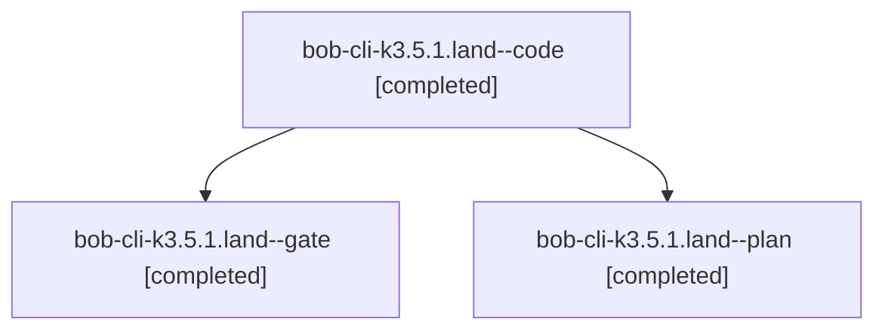

# Session: bob-cli-k3.5.1.land

[Agent Hoods](../README.md) / [bbugyi200](../users/bbugyi200/README.md) / [athena](../users/bbugyi200/machines/athena/README.md) / [bob-cli-k3](../users/bbugyi200/machines/athena/hoods/bob-cli-k3/README.md) / bob-cli-k3.5.1.land

Owner: `bbugyi200.athena` · Hood: `bob-cli-k3` · Members: 3 · Bead: [bob-cli-k3.5.1](https://github.com/bobs-org/bob-cli--beads/blob/main/pages/bob-cli-k3/bob-cli-k3.5.1.md)

## Lineage



The diagram is an optional enhancement; the ordered table below contains the same lineage in accessible text.

| Role | Agent | State | Model / provider | Timing | Commits | Prompt | Chat |
|---|---|---|---|---|---:|---|---|
| <a id="member-code"></a>code | bob-cli-k3.5.1.land--code | completed | muse-spark-1.3-contributor / muse | 2026-11-11T22:48:55.305515+00:00 → 2026-11-11T23:21:07.571725+00:00 | [1](../agents/bbugyi200.athena.bob-cli-k3.5.1.land--code/README.md#commits) | — | [Chat](../agents/bbugyi200.athena.bob-cli-k3.5.1.land--code/chat.md) |
| <a id="member-gate"></a>gate | bob-cli-k3.5.1.land--gate | completed | gpt-6-astra / codex | 2026-11-11T22:45:20.167910+00:00 → 2026-11-11T22:48:38.128073+00:00 | 0 | — | [Chat](../agents/bbugyi200.athena.bob-cli-k3.5.1.land--gate/chat.md) |
| <a id="member-plan"></a>plan | bob-cli-k3.5.1.land--plan | completed | gpt-6-astra / codex | 2026-11-11T22:24:56.496622+00:00 → 2026-11-11T23:21:07.571725+00:00 | 0 | [Prompt](../agents/bbugyi200.athena.bob-cli-k3.5.1.land--plan/prompt.md) | [Chat](../agents/bbugyi200.athena.bob-cli-k3.5.1.land--plan/chat.md) |

## Commits

| Role | Repo | Commit | Subject | Committed |
|---|---|---|---|---|
| code | bob-cli | [`300a6e8`](https://github.com/bobs-org/bob-cli/commit/300a6e81005263311408fac024038a12a50fd62d) | feat(albums): finish index write safety and preview parity | 2026-11-11 18:19:33 EST |

## Variables

| Role | Variable | Value |
|---|---|---|
| plan | `artifacts` | \[{bead: bob-cli-k3.5.1, kind: file, label: Album index landing regression reproducer, path: /home/bryan/.sase/artifacts/agents/gh\_bobs-org\_\_bob-cli/20261111135042/bob-k351-repro-72ad52060feb.py, ref:… |

#### artifacts

**Role:** `plan`

```yaml
- bead: bob-cli-k3.5.1
  kind: file
  label: Album index landing regression reproducer
  path: /home/bryan/.sase/artifacts/agents/gh_bobs-org__bob-cli/20261111135042/bob-k351-repro-72ad52060feb.py
  ref: file:explicit:061f2ab2ef1ce5bfc4660e3b
  source_path: /tmp/bob-k351-repro.py
- bead: bob-cli-k3.5.1
  kind: file
  label: Album index landing edge-case reproduction results on bc3983d3
  path: /home/bryan/.sase/artifacts/agents/gh_bobs-org__bob-cli/20261111135042/results-13c0b2986345.json
  ref: file:explicit:5353c7f0e5bab132ebba1cc7
  source_path: /home/bryan/.cache/sase/tmp/agent-tmp/gh_bobs-org__bob-cli-ws0-261111_135042/bob-k351-review-rogy94w9/results.json
- bead: bob-cli-k3.5.1
  kind: file
  label: Album index landing end-to-end walkthrough on bc3983d3
  path: /home/bryan/.sase/artifacts/agents/gh_bobs-org__bob-cli/20261111135042/transcript-5444668f5062.json
  ref: file:explicit:653de3c666f7c5264ea02ada
  source_path: /home/bryan/.cache/sase/tmp/agent-tmp/gh_bobs-org__bob-cli-ws0-261111_135042/bob-k351-walkthrough-zpyj4f6u/transcript.json
```

Values are truncated for display; see each member's agent meta.json for the full values.

## Neighbors

| Agent | Relation | State |
|---|---|---|
| [bob-cli-k3.5](bbugyi200.athena.bob-cli-k3.5.md) (session · 3) | ancestor | active 1, completed 2 |
| [bob-cli-k3.5.1.1](../agents/bbugyi200.athena.bob-cli-k3.5.1.1/README.md) | bob-cli-k3.5.1 hood | completed |
| [bob-cli-k3.5.1.2](../agents/bbugyi200.athena.bob-cli-k3.5.1.2/README.md) | bob-cli-k3.5.1 hood | completed |
| [bob-cli-k3.5.1.3](../agents/bbugyi200.athena.bob-cli-k3.5.1.3/README.md) | bob-cli-k3.5.1 hood | completed |
| [bob-cli-k3.10](../agents/bbugyi200.athena.bob-cli-k3.10/README.md) | bob-cli-k3 hood | waiting |
| [bob-cli-k3.11](../agents/bbugyi200.athena.bob-cli-k3.11/README.md) | bob-cli-k3 hood | waiting |
| [bob-cli-k3.2.1.2](../agents/bbugyi200.athena.bob-cli-k3.2.1.2/README.md) | bob-cli-k3 hood | completed |
| [bob-cli-k3.2.1.3](bbugyi200.athena.bob-cli-k3.2.1.3.md) (session · 5) | bob-cli-k3 hood | completed 4, failed 1 |
| [bob-cli-k3.2.1.land](bbugyi200.athena.bob-cli-k3.2.1.land.md) (session · 3) | bob-cli-k3 hood | completed 3 |
| [bob-cli-k3.4](bbugyi200.athena.bob-cli-k3.4.md) (session · 3) | bob-cli-k3 hood | active 1, completed 2 |
| [bob-cli-k3.4.1.1](../agents/bbugyi200.athena.bob-cli-k3.4.1.1/README.md) | bob-cli-k3 hood | completed |
| [bob-cli-k3.4.1.2](bbugyi200.athena.bob-cli-k3.4.1.2.md) (session · 5) | bob-cli-k3 hood | completed 4, failed 1 |
| [bob-cli-k3.4.1.3](../agents/bbugyi200.athena.bob-cli-k3.4.1.3/README.md) | bob-cli-k3 hood | completed |
| [bob-cli-k3.4.1.4](../agents/bbugyi200.athena.bob-cli-k3.4.1.4/README.md) | bob-cli-k3 hood | completed |
| [bob-cli-k3.4.1.land](bbugyi200.athena.bob-cli-k3.4.1.land.md) (session · 3) | bob-cli-k3 hood | completed 3 |
| [bob-cli-k3.6](bbugyi200.athena.bob-cli-k3.6.md) (session · 3) | bob-cli-k3 hood | active 1, completed 2 |
| [bob-cli-k3.6.1.1](../agents/bbugyi200.athena.bob-cli-k3.6.1.1/README.md) | bob-cli-k3 hood | completed |
| [bob-cli-k3.6.1.2](../agents/bbugyi200.athena.bob-cli-k3.6.1.2/README.md) | bob-cli-k3 hood | completed |
| [bob-cli-k3.6.1.3](../agents/bbugyi200.athena.bob-cli-k3.6.1.3/README.md) | bob-cli-k3 hood | completed |
| [bob-cli-k3.6.1.land](../agents/bbugyi200.athena.bob-cli-k3.6.1.land/README.md) | bob-cli-k3 hood | waiting |
| [bob-cli-k3.7](../agents/bbugyi200.athena.bob-cli-k3.7/README.md) | bob-cli-k3 hood | waiting |
| [bob-cli-k3.8](bbugyi200.athena.bob-cli-k3.8.md) (session · 3) | bob-cli-k3 hood | completed 3 |
| [bob-cli-k3.9](../agents/bbugyi200.athena.bob-cli-k3.9/README.md) | bob-cli-k3 hood | waiting |
| [bob-cli-k3.land](../agents/bbugyi200.athena.bob-cli-k3.land/README.md) | bob-cli-k3 hood | waiting |
