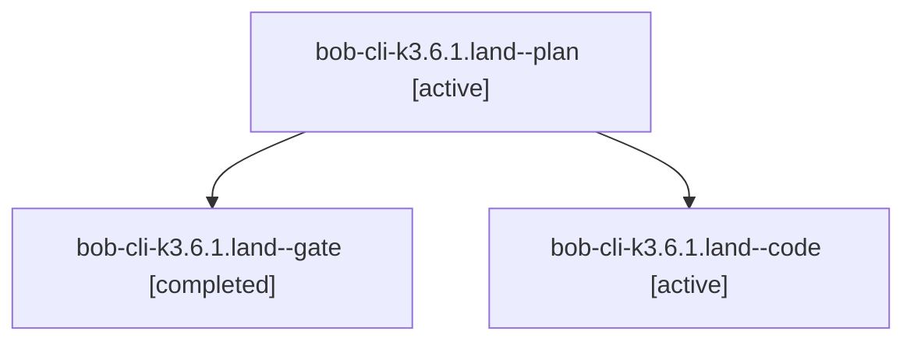

# Session: bob-cli-k3.6.1.land

[Agent Hoods](../README.md) / [bbugyi200](../users/bbugyi200/README.md) / [athena](../users/bbugyi200/machines/athena/README.md) / [bob-cli-k3](../users/bbugyi200/machines/athena/hoods/bob-cli-k3/README.md) / bob-cli-k3.6.1.land

Owner: `bbugyi200.athena` · Hood: `bob-cli-k3` · Members: 3 · Bead: [bob-cli-k3.6.1](https://github.com/bobs-org/bob-cli--beads/blob/main/pages/bob-cli-k3/bob-cli-k3.6.1.md)

## Lineage

The diagram is an optional enhancement; the ordered table below contains the same lineage in accessible text.

| Role | Agent | State | Model / provider | Timing | Commits | Prompt | Chat |
|---|---|---|---|---|---:|---|---|
| plan | bob-cli-k3.6.1.land--plan | active | gpt-6-astra / codex | 2026-11-12T03:03:16.627288+00:00 | 0 | [Prompt](../agents/bbugyi200.athena.bob-cli-k3.6.1.land--plan/prompt.md) | [Chat](../agents/bbugyi200.athena.bob-cli-k3.6.1.land--plan/chat.md) |
| gate | bob-cli-k3.6.1.land--gate | completed | gpt-6-astra / codex | 2026-11-12T03:21:13.494660+00:00 → 2026-11-12T03:22:35.267496+00:00 | 0 | — | [Chat](../agents/bbugyi200.athena.bob-cli-k3.6.1.land--gate/chat.md) |
| code | bob-cli-k3.6.1.land--code | active | grok-4.6 / grok | 2026-11-12T03:23:10.491896+00:00 | 0 | — | — |

## Neighbors

| Agent | Relation | State |
|---|---|---|
| [bob-cli-k3.6](bbugyi200.athena.bob-cli-k3.6.md) (session · 3) | ancestor | active 1, completed 2 |
| [bob-cli-k3.6.1.1](../agents/bbugyi200.athena.bob-cli-k3.6.1.1/README.md) | bob-cli-k3.6.1 hood | completed |
| [bob-cli-k3.6.1.2](../agents/bbugyi200.athena.bob-cli-k3.6.1.2/README.md) | bob-cli-k3.6.1 hood | completed |
| [bob-cli-k3.6.1.3](../agents/bbugyi200.athena.bob-cli-k3.6.1.3/README.md) | bob-cli-k3.6.1 hood | completed |
| [bob-cli-k3.10](../agents/bbugyi200.athena.bob-cli-k3.10/README.md) | bob-cli-k3 hood | waiting |
| [bob-cli-k3.11](../agents/bbugyi200.athena.bob-cli-k3.11/README.md) | bob-cli-k3 hood | waiting |
| [bob-cli-k3.2.1.2](../agents/bbugyi200.athena.bob-cli-k3.2.1.2/README.md) | bob-cli-k3 hood | completed |
| [bob-cli-k3.2.1.3](bbugyi200.athena.bob-cli-k3.2.1.3.md) (session · 5) | bob-cli-k3 hood | completed 4, failed 1 |
| [bob-cli-k3.2.1.land](bbugyi200.athena.bob-cli-k3.2.1.land.md) (session · 3) | bob-cli-k3 hood | completed 3 |
| [bob-cli-k3.4](bbugyi200.athena.bob-cli-k3.4.md) (session · 3) | bob-cli-k3 hood | active 1, completed 2 |
| [bob-cli-k3.4.1.1](../agents/bbugyi200.athena.bob-cli-k3.4.1.1/README.md) | bob-cli-k3 hood | completed |
| [bob-cli-k3.4.1.2](bbugyi200.athena.bob-cli-k3.4.1.2.md) (session · 5) | bob-cli-k3 hood | completed 4, failed 1 |
| [bob-cli-k3.4.1.3](../agents/bbugyi200.athena.bob-cli-k3.4.1.3/README.md) | bob-cli-k3 hood | completed |
| [bob-cli-k3.4.1.4](../agents/bbugyi200.athena.bob-cli-k3.4.1.4/README.md) | bob-cli-k3 hood | completed |
| [bob-cli-k3.4.1.land](bbugyi200.athena.bob-cli-k3.4.1.land.md) (session · 3) | bob-cli-k3 hood | completed 3 |
| [bob-cli-k3.5](bbugyi200.athena.bob-cli-k3.5.md) (session · 3) | bob-cli-k3 hood | active 1, completed 2 |
| [bob-cli-k3.5.1.1](../agents/bbugyi200.athena.bob-cli-k3.5.1.1/README.md) | bob-cli-k3 hood | completed |
| [bob-cli-k3.5.1.2](../agents/bbugyi200.athena.bob-cli-k3.5.1.2/README.md) | bob-cli-k3 hood | completed |
| [bob-cli-k3.5.1.3](../agents/bbugyi200.athena.bob-cli-k3.5.1.3/README.md) | bob-cli-k3 hood | completed |
| [bob-cli-k3.5.1.land](bbugyi200.athena.bob-cli-k3.5.1.land.md) (session · 3) | bob-cli-k3 hood | completed 3 |
| [bob-cli-k3.7](../agents/bbugyi200.athena.bob-cli-k3.7/README.md) | bob-cli-k3 hood | waiting |
| [bob-cli-k3.8](bbugyi200.athena.bob-cli-k3.8.md) (session · 3) | bob-cli-k3 hood | completed 3 |
| [bob-cli-k3.9](../agents/bbugyi200.athena.bob-cli-k3.9/README.md) | bob-cli-k3 hood | waiting |
| [bob-cli-k3.land](../agents/bbugyi200.athena.bob-cli-k3.land/README.md) | bob-cli-k3 hood | waiting |
