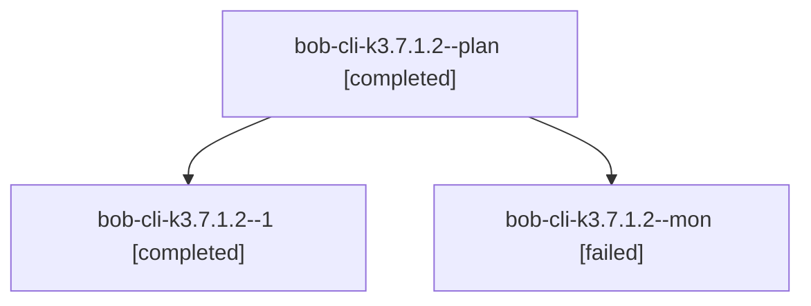

# Session: bob-cli-k3.7.1.2

[Agent Hoods](../README.md) / [bbugyi200](../users/bbugyi200/README.md) / [athena](../users/bbugyi200/machines/athena/README.md) / [bob-cli-k3](../users/bbugyi200/machines/athena/hoods/bob-cli-k3/README.md) / bob-cli-k3.7.1.2

Owner: `bbugyi200.athena` · Hood: `bob-cli-k3` · Members: 3 · Bead: [bob-cli-k3.7.1.2](https://github.com/bobs-org/bob-cli--beads/blob/main/pages/bob-cli-k3/bob-cli-k3.7.1.2.md)

## Lineage



The diagram is an optional enhancement; the ordered table below contains the same lineage in accessible text.

| Role | Agent | State | Model / provider | Timing | Commits | Prompt | Chat |
|---|---|---|---|---|---:|---|---|
| <a id="member-plan"></a>plan | bob-cli-k3.7.1.2--plan | completed | gpt-6-astra / codex | 2026-11-12T11:40:07.350071+00:00 → 2026-11-12T12:02:09.061121+00:00 | 0 | [Prompt](../agents/bbugyi200.athena.bob-cli-k3.7.1.2--plan/prompt.md) | [Chat](../agents/bbugyi200.athena.bob-cli-k3.7.1.2--plan/chat.md) |
| <a id="member-1"></a>1 | bob-cli-k3.7.1.2--1 | completed | gpt-6-astra / codex | 2026-11-12T12:21:14.066823+00:00 → 2026-11-12T12:32:03.919375+00:00 | 0 | [Prompt](../agents/bbugyi200.athena.bob-cli-k3.7.1.2--1/prompt.md) | [Chat](../agents/bbugyi200.athena.bob-cli-k3.7.1.2--1/chat.md) |
| <a id="member-mon"></a>mon | bob-cli-k3.7.1.2--mon | failed | gpt-6-astra / codex | 2026-11-12T12:01:02.593020+00:00 → 2026-11-12T12:19:23.472158+00:00 | 0 | — | [Chat](../agents/bbugyi200.athena.bob-cli-k3.7.1.2--mon/chat.md) |

## Variables

| Role | Variable | Value |
|---|---|---|
| 1 | `artifacts` | \[{bead: bob-cli-k3.7.1.2, kind: file, label: Owner album cards final verification and clean-base comparisons, path: /home/bryan/.sase/artifacts/agents/gh\_bobs-org\_\_bob-cli/20261112071822/verification… |

#### artifacts

**Role:** `1`

```yaml
- bead: bob-cli-k3.7.1.2
  kind: file
  label: Owner album cards final verification and clean-base comparisons
  path: /home/bryan/.sase/artifacts/agents/gh_bobs-org__bob-cli/20261112071822/verification-evidence-ee7da5824ccd.json
  ref: file:explicit:2f4376800ebd97798470fde7
  source_path: /home/bryan/.local/state/sase/workspaces/bobs-org/bob-cli/bob-cli_11/sase/repos/linked/bob-plugins/.git/album-owner-verification/verification-evidence.json
```

Values are truncated for display; see each member's agent meta.json for the full values.

## Neighbors

| Agent | Relation | State |
|---|---|---|
| [bob-cli-k3.7](bbugyi200.athena.bob-cli-k3.7.md) (session · 3) | ancestor | active 1, completed 2 |
| [bob-cli-k3.7.1.1](../agents/bbugyi200.athena.bob-cli-k3.7.1.1/README.md) | bob-cli-k3.7.1 hood | completed |
| [bob-cli-k3.7.1.3](../agents/bbugyi200.athena.bob-cli-k3.7.1.3/README.md) | bob-cli-k3.7.1 hood | completed |
| [bob-cli-k3.7.1.4](bbugyi200.athena.bob-cli-k3.7.1.4.md) (session · 5) | bob-cli-k3.7.1 hood | completed 3, failed 2 |
| [bob-cli-k3.7.1.5](../agents/bbugyi200.athena.bob-cli-k3.7.1.5/README.md) | bob-cli-k3.7.1 hood | completed |
| [bob-cli-k3.7.1.land](../agents/bbugyi200.athena.bob-cli-k3.7.1.land/README.md) | bob-cli-k3.7.1 hood | waiting |
| [bob-cli-k3.10](../agents/bbugyi200.athena.bob-cli-k3.10/README.md) | bob-cli-k3 hood | dismissed |
| [bob-cli-k3.11](../agents/bbugyi200.athena.bob-cli-k3.11/README.md) | bob-cli-k3 hood | waiting |
| [bob-cli-k3.2.1.2](../agents/bbugyi200.athena.bob-cli-k3.2.1.2/README.md) | bob-cli-k3 hood | completed |
| [bob-cli-k3.2.1.3](bbugyi200.athena.bob-cli-k3.2.1.3.md) (session · 5) | bob-cli-k3 hood | completed 4, failed 1 |
| [bob-cli-k3.2.1.land](bbugyi200.athena.bob-cli-k3.2.1.land.md) (session · 3) | bob-cli-k3 hood | completed 3 |
| [bob-cli-k3.4](bbugyi200.athena.bob-cli-k3.4.md) (session · 3) | bob-cli-k3 hood | active 1, completed 2 |
| [bob-cli-k3.4.1.1](../agents/bbugyi200.athena.bob-cli-k3.4.1.1/README.md) | bob-cli-k3 hood | completed |
| [bob-cli-k3.4.1.2](bbugyi200.athena.bob-cli-k3.4.1.2.md) (session · 5) | bob-cli-k3 hood | completed 4, failed 1 |
| [bob-cli-k3.4.1.3](../agents/bbugyi200.athena.bob-cli-k3.4.1.3/README.md) | bob-cli-k3 hood | completed |
| [bob-cli-k3.4.1.4](../agents/bbugyi200.athena.bob-cli-k3.4.1.4/README.md) | bob-cli-k3 hood | completed |
| [bob-cli-k3.4.1.land](bbugyi200.athena.bob-cli-k3.4.1.land.md) (session · 3) | bob-cli-k3 hood | completed 3 |
| [bob-cli-k3.5](bbugyi200.athena.bob-cli-k3.5.md) (session · 3) | bob-cli-k3 hood | active 1, completed 2 |
| [bob-cli-k3.5.1.1](../agents/bbugyi200.athena.bob-cli-k3.5.1.1/README.md) | bob-cli-k3 hood | completed |
| [bob-cli-k3.5.1.2](../agents/bbugyi200.athena.bob-cli-k3.5.1.2/README.md) | bob-cli-k3 hood | completed |
| [bob-cli-k3.5.1.3](../agents/bbugyi200.athena.bob-cli-k3.5.1.3/README.md) | bob-cli-k3 hood | completed |
| [bob-cli-k3.5.1.land](bbugyi200.athena.bob-cli-k3.5.1.land.md) (session · 3) | bob-cli-k3 hood | completed 3 |
| [bob-cli-k3.6](bbugyi200.athena.bob-cli-k3.6.md) (session · 3) | bob-cli-k3 hood | active 1, completed 2 |
| [bob-cli-k3.6.1.1](../agents/bbugyi200.athena.bob-cli-k3.6.1.1/README.md) | bob-cli-k3 hood | completed |
| [bob-cli-k3.6.1.2](../agents/bbugyi200.athena.bob-cli-k3.6.1.2/README.md) | bob-cli-k3 hood | completed |
| [bob-cli-k3.6.1.3](../agents/bbugyi200.athena.bob-cli-k3.6.1.3/README.md) | bob-cli-k3 hood | completed |
| [bob-cli-k3.6.1.land](bbugyi200.athena.bob-cli-k3.6.1.land.md) (session · 3) | bob-cli-k3 hood | completed 3 |
| [bob-cli-k3.8](bbugyi200.athena.bob-cli-k3.8.md) (session · 3) | bob-cli-k3 hood | completed 3 |
| [bob-cli-k3.9](bbugyi200.athena.bob-cli-k3.9.md) (session · 6) | bob-cli-k3 hood | completed 4, failed 2 |
| [bob-cli-k3.land](../agents/bbugyi200.athena.bob-cli-k3.land/README.md) | bob-cli-k3 hood | waiting |
