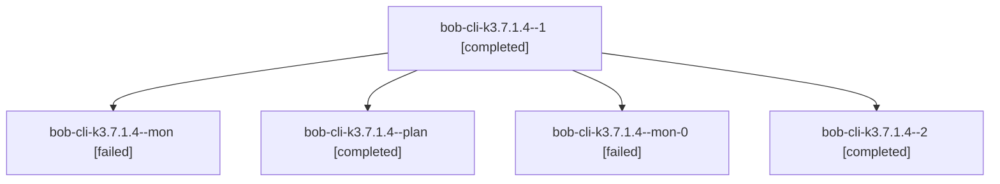

# Session: bob-cli-k3.7.1.4

[Agent Hoods](../README.md) / [bbugyi200](../users/bbugyi200/README.md) / [athena](../users/bbugyi200/machines/athena/README.md) / [bob-cli-k3](../users/bbugyi200/machines/athena/hoods/bob-cli-k3/README.md) / bob-cli-k3.7.1.4

Owner: `bbugyi200.athena` · Hood: `bob-cli-k3` · Members: 5 · Bead: [bob-cli-k3.7.1.4](https://github.com/bobs-org/bob-cli--beads/blob/main/pages/bob-cli-k3/bob-cli-k3.7.1.4.md)

## Lineage

The diagram is an optional enhancement; the ordered table below contains the same lineage in accessible text.

| Role | Agent | State | Model / provider | Timing | Commits | Prompt | Chat |
|---|---|---|---|---|---:|---|---|
| 1 | bob-cli-k3.7.1.4--1 | completed | gpt-6-luna / codex | 2026-11-12T14:24:25.161180+00:00 → 2026-11-12T14:29:23.219391+00:00 | 0 | [Prompt](../agents/bbugyi200.athena.bob-cli-k3.7.1.4--1/prompt.md) | [Chat](../agents/bbugyi200.athena.bob-cli-k3.7.1.4--1/chat.md) |
| mon | bob-cli-k3.7.1.4--mon | failed | gpt-6-luna / codex | 2026-11-12T14:17:34.689136+00:00 → 2026-11-12T14:21:45.768586+00:00 | 0 | — | [Chat](../agents/bbugyi200.athena.bob-cli-k3.7.1.4--mon/chat.md) |
| plan | bob-cli-k3.7.1.4--plan | completed | gpt-6-luna / codex | 2026-11-12T13:51:31.524507+00:00 → 2026-11-12T14:18:57.405085+00:00 | 0 | [Prompt](../agents/bbugyi200.athena.bob-cli-k3.7.1.4--plan/prompt.md) | [Chat](../agents/bbugyi200.athena.bob-cli-k3.7.1.4--plan/chat.md) |
| mon-0 | bob-cli-k3.7.1.4--mon-0 | failed | gpt-6-luna / codex | 2026-11-12T14:28:30.878170+00:00 → 2026-11-12T14:32:15.679394+00:00 | 0 | — | [Chat](../agents/bbugyi200.athena.bob-cli-k3.7.1.4--mon-0/chat.md) |
| 2 | bob-cli-k3.7.1.4--2 | completed | gpt-6-luna / codex | 2026-11-12T14:34:09.887581+00:00 → 2026-11-12T14:46:57.895657+00:00 | 0 | [Prompt](../agents/bbugyi200.athena.bob-cli-k3.7.1.4--2/prompt.md) | [Chat](../agents/bbugyi200.athena.bob-cli-k3.7.1.4--2/chat.md) |

## Neighbors

| Agent | Relation | State |
|---|---|---|
| [bob-cli-k3.7](bbugyi200.athena.bob-cli-k3.7.md) (session · 3) | ancestor | active 1, completed 2 |
| [bob-cli-k3.7.1.1](../agents/bbugyi200.athena.bob-cli-k3.7.1.1/README.md) | bob-cli-k3.7.1 hood | completed |
| [bob-cli-k3.7.1.2](bbugyi200.athena.bob-cli-k3.7.1.2.md) (session · 3) | bob-cli-k3.7.1 hood | completed 2, failed 1 |
| [bob-cli-k3.7.1.3](../agents/bbugyi200.athena.bob-cli-k3.7.1.3/README.md) | bob-cli-k3.7.1 hood | completed |
| [bob-cli-k3.7.1.5](../agents/bbugyi200.athena.bob-cli-k3.7.1.5/README.md) | bob-cli-k3.7.1 hood | waiting |
| [bob-cli-k3.7.1.land](../agents/bbugyi200.athena.bob-cli-k3.7.1.land/README.md) | bob-cli-k3.7.1 hood | waiting |
| [bob-cli-k3.10](../agents/bbugyi200.athena.bob-cli-k3.10/README.md) | bob-cli-k3 hood | dismissed |
| [bob-cli-k3.11](../agents/bbugyi200.athena.bob-cli-k3.11/README.md) | bob-cli-k3 hood | waiting |
| [bob-cli-k3.2.1.2](../agents/bbugyi200.athena.bob-cli-k3.2.1.2/README.md) | bob-cli-k3 hood | completed |
| [bob-cli-k3.2.1.3](bbugyi200.athena.bob-cli-k3.2.1.3.md) (session · 5) | bob-cli-k3 hood | completed 4, failed 1 |
| [bob-cli-k3.2.1.land](bbugyi200.athena.bob-cli-k3.2.1.land.md) (session · 3) | bob-cli-k3 hood | completed 3 |
| [bob-cli-k3.4](bbugyi200.athena.bob-cli-k3.4.md) (session · 3) | bob-cli-k3 hood | active 1, completed 2 |
| [bob-cli-k3.4.1.1](../agents/bbugyi200.athena.bob-cli-k3.4.1.1/README.md) | bob-cli-k3 hood | completed |
| [bob-cli-k3.4.1.2](bbugyi200.athena.bob-cli-k3.4.1.2.md) (session · 5) | bob-cli-k3 hood | completed 4, failed 1 |
| [bob-cli-k3.4.1.3](../agents/bbugyi200.athena.bob-cli-k3.4.1.3/README.md) | bob-cli-k3 hood | completed |
| [bob-cli-k3.4.1.4](../agents/bbugyi200.athena.bob-cli-k3.4.1.4/README.md) | bob-cli-k3 hood | completed |
| [bob-cli-k3.4.1.land](bbugyi200.athena.bob-cli-k3.4.1.land.md) (session · 3) | bob-cli-k3 hood | completed 3 |
| [bob-cli-k3.5](bbugyi200.athena.bob-cli-k3.5.md) (session · 3) | bob-cli-k3 hood | active 1, completed 2 |
| [bob-cli-k3.5.1.1](../agents/bbugyi200.athena.bob-cli-k3.5.1.1/README.md) | bob-cli-k3 hood | completed |
| [bob-cli-k3.5.1.2](../agents/bbugyi200.athena.bob-cli-k3.5.1.2/README.md) | bob-cli-k3 hood | completed |
| [bob-cli-k3.5.1.3](../agents/bbugyi200.athena.bob-cli-k3.5.1.3/README.md) | bob-cli-k3 hood | completed |
| [bob-cli-k3.5.1.land](bbugyi200.athena.bob-cli-k3.5.1.land.md) (session · 3) | bob-cli-k3 hood | completed 3 |
| [bob-cli-k3.6](bbugyi200.athena.bob-cli-k3.6.md) (session · 3) | bob-cli-k3 hood | active 1, completed 2 |
| [bob-cli-k3.6.1.1](../agents/bbugyi200.athena.bob-cli-k3.6.1.1/README.md) | bob-cli-k3 hood | completed |
| [bob-cli-k3.6.1.2](../agents/bbugyi200.athena.bob-cli-k3.6.1.2/README.md) | bob-cli-k3 hood | completed |
| [bob-cli-k3.6.1.3](../agents/bbugyi200.athena.bob-cli-k3.6.1.3/README.md) | bob-cli-k3 hood | completed |
| [bob-cli-k3.6.1.land](bbugyi200.athena.bob-cli-k3.6.1.land.md) (session · 3) | bob-cli-k3 hood | completed 3 |
| [bob-cli-k3.8](bbugyi200.athena.bob-cli-k3.8.md) (session · 3) | bob-cli-k3 hood | completed 3 |
| [bob-cli-k3.9](bbugyi200.athena.bob-cli-k3.9.md) (session · 6) | bob-cli-k3 hood | completed 4, failed 2 |
| [bob-cli-k3.land](../agents/bbugyi200.athena.bob-cli-k3.land/README.md) | bob-cli-k3 hood | waiting |
