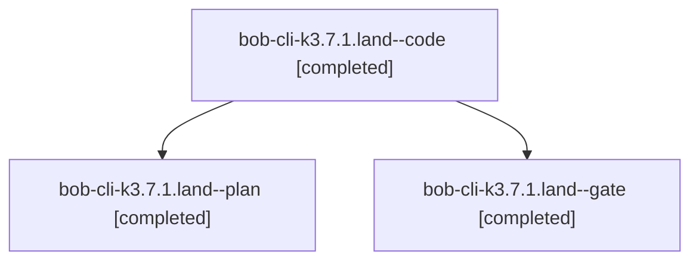

# Session: bob-cli-k3.7.1.land

[Agent Hoods](../README.md) / [bbugyi200](../users/bbugyi200/README.md) / [athena](../users/bbugyi200/machines/athena/README.md) / [bob-cli-k3](../users/bbugyi200/machines/athena/hoods/bob-cli-k3/README.md) / bob-cli-k3.7.1.land

Owner: `bbugyi200.athena` · Hood: `bob-cli-k3` · Members: 3 · Bead: [bob-cli-k3.7.1](https://github.com/bobs-org/bob-cli--beads/blob/main/pages/bob-cli-k3/bob-cli-k3.7.1.md)

## Lineage



The diagram is an optional enhancement; the ordered table below contains the same lineage in accessible text.

| Role | Agent | State | Model / provider | Timing | Commits | Prompt | Chat |
|---|---|---|---|---|---:|---|---|
| <a id="member-code"></a>code | bob-cli-k3.7.1.land--code | completed | muse-spark-1.3-contributor / muse | 2026-11-12T15:42:45.217250+00:00 → 2026-11-12T16:25:45.929113+00:00 | [1](../agents/bbugyi200.athena.bob-cli-k3.7.1.land--code/README.md#commits) | — | [Chat](../agents/bbugyi200.athena.bob-cli-k3.7.1.land--code/chat.md) |
| <a id="member-plan"></a>plan | bob-cli-k3.7.1.land--plan | completed | opus / claude | 2026-11-12T15:17:16.109017+00:00 → 2026-11-12T16:25:45.929113+00:00 | 0 | [Prompt](../agents/bbugyi200.athena.bob-cli-k3.7.1.land--plan/prompt.md) | [Chat](../agents/bbugyi200.athena.bob-cli-k3.7.1.land--plan/chat.md) |
| <a id="member-gate"></a>gate | bob-cli-k3.7.1.land--gate | completed | opus / claude | 2026-11-12T15:41:21.593877+00:00 → 2026-11-12T15:42:11.614257+00:00 | 0 | — | [Chat](../agents/bbugyi200.athena.bob-cli-k3.7.1.land--gate/chat.md) |

## Commits

| Role | Repo | Commit | Subject | Committed |
|---|---|---|---|---|
| code | bob-cli | [`8cef0d5`](https://github.com/bobs-org/bob-cli/commit/8cef0d56c8c987de0d0acbc31d260b72c6c37953) | docs(records): link albums section to Obsidian Album cards page | 2026-11-12 11:22:46 EST |

## Variables

| Role | Variable | Value |
|---|---|---|
| code | `artifacts` | \[{kind: file, label: Album UI acceptance: real-Obsidian e2e report (35 checks pass), path: /home/bryan/.sase/artifacts/agents/gh\_bobs-org\_\_bob-cli/20261112104217/album-e2e-report-217bbce2d914.json, r… |

#### artifacts

**Role:** `code`

```yaml
- kind: file
  label: Album UI acceptance: real-Obsidian e2e report (35 checks pass)
  path: /home/bryan/.sase/artifacts/agents/gh_bobs-org__bob-cli/20261112104217/album-e2e-report-217bbce2d914.json
  ref: file:explicit:9ae486976c079f219df059bc
  source_path: /tmp/album-e2e-report.json
- kind: image
  label: Album UI acceptance: owner card Reading view
  path: /home/bryan/.sase/artifacts/agents/gh_bobs-org__bob-cli/20261112104217/album-owner-owner-reading-b6b4fef6e11d.png
  ref: file:explicit:6230ce612ee64dca3dd635e6
  source_path: /tmp/album-e2e-out/album-owner-owner-reading.png
- kind: image
  label: Album UI acceptance: record index Reading view with header
  path: /home/bryan/.sase/artifacts/agents/gh_bobs-org__bob-cli/20261112104217/album-records-reading-71c04de21f8d.png
  ref: file:explicit:6d8b063162070659a9595460
  source_path: /tmp/album-e2e-out/album-records-reading.png
- kind: image
  label: Album UI acceptance: owner card narrow 375px wrap
  path: /home/bryan/.sase/artifacts/agents/gh_bobs-org__bob-cli/20261112104217/album-owner-375-078e16ea62a8.png
  ref: file:explicit:87c126a8a0998ec9a98e7798
  source_path: /tmp/album-e2e-out/album-owner-375.png
- kind: image
  label: Album UI acceptance: owner card dark theme
  path: /home/bryan/.sase/artifacts/agents/gh_bobs-org__bob-cli/20261112104217/album-owner-dark-d7810457ab0e.png
  ref: file:explicit:f9dffba616cbfcd014d78646
  source_path: /tmp/album-e2e-out/album-owner-dark.png
- kind: image
  label: Album UI acceptance: album header and schema Live Preview
  path: /home/bryan/.sase/artifacts/agents/gh_bobs-org__bob-cli/20261112104217/album-records-live-05eeb3f33e9c.png
  ref: file:explicit:447ce6ff62f89f134cf87d73
  source_path: /tmp/album-e2e-out/album-records-live.png
```

Values are truncated for display; see each member's agent meta.json for the full values.

## Neighbors

| Agent | Relation | State |
|---|---|---|
| [bob-cli-k3.7](bbugyi200.athena.bob-cli-k3.7.md) (session · 3) | ancestor | active 1, completed 2 |
| [bob-cli-k3.7.1.1](../agents/bbugyi200.athena.bob-cli-k3.7.1.1/README.md) | bob-cli-k3.7.1 hood | completed |
| [bob-cli-k3.7.1.2](bbugyi200.athena.bob-cli-k3.7.1.2.md) (session · 3) | bob-cli-k3.7.1 hood | completed 2, failed 1 |
| [bob-cli-k3.7.1.3](../agents/bbugyi200.athena.bob-cli-k3.7.1.3/README.md) | bob-cli-k3.7.1 hood | completed |
| [bob-cli-k3.7.1.4](bbugyi200.athena.bob-cli-k3.7.1.4.md) (session · 5) | bob-cli-k3.7.1 hood | completed 3, failed 2 |
| [bob-cli-k3.7.1.5](../agents/bbugyi200.athena.bob-cli-k3.7.1.5/README.md) | bob-cli-k3.7.1 hood | completed |
| [bob-cli-k3.10](../agents/bbugyi200.athena.bob-cli-k3.10/README.md) | bob-cli-k3 hood | dismissed |
| [bob-cli-k3.11](../agents/bbugyi200.athena.bob-cli-k3.11/README.md) | bob-cli-k3 hood | completed |
| [bob-cli-k3.2.1.2](../agents/bbugyi200.athena.bob-cli-k3.2.1.2/README.md) | bob-cli-k3 hood | completed |
| [bob-cli-k3.2.1.3](bbugyi200.athena.bob-cli-k3.2.1.3.md) (session · 5) | bob-cli-k3 hood | completed 4, failed 1 |
| [bob-cli-k3.2.1.land](bbugyi200.athena.bob-cli-k3.2.1.land.md) (session · 3) | bob-cli-k3 hood | completed 3 |
| [bob-cli-k3.4](bbugyi200.athena.bob-cli-k3.4.md) (session · 3) | bob-cli-k3 hood | active 1, completed 2 |
| [bob-cli-k3.4.1.1](../agents/bbugyi200.athena.bob-cli-k3.4.1.1/README.md) | bob-cli-k3 hood | completed |
| [bob-cli-k3.4.1.2](bbugyi200.athena.bob-cli-k3.4.1.2.md) (session · 5) | bob-cli-k3 hood | completed 4, failed 1 |
| [bob-cli-k3.4.1.3](../agents/bbugyi200.athena.bob-cli-k3.4.1.3/README.md) | bob-cli-k3 hood | completed |
| [bob-cli-k3.4.1.4](../agents/bbugyi200.athena.bob-cli-k3.4.1.4/README.md) | bob-cli-k3 hood | completed |
| [bob-cli-k3.4.1.land](bbugyi200.athena.bob-cli-k3.4.1.land.md) (session · 3) | bob-cli-k3 hood | completed 3 |
| [bob-cli-k3.5](bbugyi200.athena.bob-cli-k3.5.md) (session · 3) | bob-cli-k3 hood | active 1, completed 2 |
| [bob-cli-k3.5.1.1](../agents/bbugyi200.athena.bob-cli-k3.5.1.1/README.md) | bob-cli-k3 hood | completed |
| [bob-cli-k3.5.1.2](../agents/bbugyi200.athena.bob-cli-k3.5.1.2/README.md) | bob-cli-k3 hood | completed |
| [bob-cli-k3.5.1.3](../agents/bbugyi200.athena.bob-cli-k3.5.1.3/README.md) | bob-cli-k3 hood | completed |
| [bob-cli-k3.5.1.land](bbugyi200.athena.bob-cli-k3.5.1.land.md) (session · 3) | bob-cli-k3 hood | completed 3 |
| [bob-cli-k3.6](bbugyi200.athena.bob-cli-k3.6.md) (session · 3) | bob-cli-k3 hood | active 1, completed 2 |
| [bob-cli-k3.6.1.1](../agents/bbugyi200.athena.bob-cli-k3.6.1.1/README.md) | bob-cli-k3 hood | completed |
| [bob-cli-k3.6.1.2](../agents/bbugyi200.athena.bob-cli-k3.6.1.2/README.md) | bob-cli-k3 hood | completed |
| [bob-cli-k3.6.1.3](../agents/bbugyi200.athena.bob-cli-k3.6.1.3/README.md) | bob-cli-k3 hood | completed |
| [bob-cli-k3.6.1.land](bbugyi200.athena.bob-cli-k3.6.1.land.md) (session · 3) | bob-cli-k3 hood | completed 3 |
| [bob-cli-k3.8](bbugyi200.athena.bob-cli-k3.8.md) (session · 3) | bob-cli-k3 hood | completed 3 |
| [bob-cli-k3.9](bbugyi200.athena.bob-cli-k3.9.md) (session · 6) | bob-cli-k3 hood | completed 4, failed 2 |
| [bob-cli-k3.land](../agents/bbugyi200.athena.bob-cli-k3.land/README.md) | bob-cli-k3 hood | waiting |
