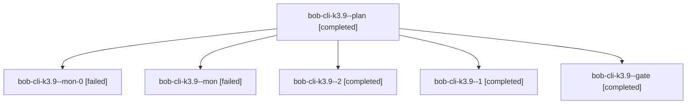

# Session: bob-cli-k3.9

[Agent Hoods](../README.md) / [bbugyi200](../users/bbugyi200/README.md) / [athena](../users/bbugyi200/machines/athena/README.md) / [bob-cli-k3](../users/bbugyi200/machines/athena/hoods/bob-cli-k3/README.md) / bob-cli-k3.9

Owner: `bbugyi200.athena` · Hood: `bob-cli-k3` · Members: 6 · Bead: [bob-cli-k3.9](https://github.com/bobs-org/bob-cli--beads/blob/main/pages/bob-cli-k3/bob-cli-k3.9.md)

## Lineage



The diagram is an optional enhancement; the ordered table below contains the same lineage in accessible text.

| Role | Agent | State | Model / provider | Timing | Commits | Prompt | Chat |
|---|---|---|---|---|---:|---|---|
| <a id="member-plan"></a>plan | bob-cli-k3.9--plan | completed | gpt-6-astra / codex | 2026-11-12T10:26:18.210394+00:00 → 2026-11-12T10:41:59.157864+00:00 | 0 | [Prompt](../agents/bbugyi200.athena.bob-cli-k3.9--plan/prompt.md) | [Chat](../agents/bbugyi200.athena.bob-cli-k3.9--plan/chat.md) |
| <a id="member-mon-0"></a>mon-0 | bob-cli-k3.9--mon-0 | failed | gpt-6-astra / codex | 2026-11-12T10:52:08.510373+00:00 → 2026-11-12T10:58:30.302932+00:00 | 0 | — | — |
| <a id="member-mon"></a>mon | bob-cli-k3.9--mon | failed | gpt-6-astra / codex | 2026-11-12T10:40:04.015309+00:00 → 2026-11-12T10:43:28.741012+00:00 | 0 | — | [Chat](../agents/bbugyi200.athena.bob-cli-k3.9--mon/chat.md) |
| <a id="member-2"></a>2 | bob-cli-k3.9--2 | completed | gpt-6-astra / codex | 2026-11-12T11:08:25.001083+00:00 → 2026-11-12T11:12:20.839558+00:00 | 0 | [Prompt](../agents/bbugyi200.athena.bob-cli-k3.9--2/prompt.md) | [Chat](../agents/bbugyi200.athena.bob-cli-k3.9--2/chat.md) |
| <a id="member-1"></a>1 | bob-cli-k3.9--1 | completed | gpt-6-astra / codex | 2026-11-12T10:48:48.810313+00:00 → 2026-11-12T11:01:49.462583+00:00 | 0 | [Prompt](../agents/bbugyi200.athena.bob-cli-k3.9--1/prompt.md) | [Chat](../agents/bbugyi200.athena.bob-cli-k3.9--1/chat.md) |
| <a id="member-gate"></a>gate | bob-cli-k3.9--gate | completed | gpt-6-astra / codex | 2026-11-12T11:03:00.351301+00:00 → 2026-11-12T11:05:02.284731+00:00 | 0 | — | [Chat](../agents/bbugyi200.athena.bob-cli-k3.9--gate/chat.md) |

## Variables

| Role | Variable | Value |
|---|---|---|
| plan | `artifacts` | \[{bead: bob-cli-k3.9, kind: file, label: Album vault cutover verification and post-commit application checkpoint, path: /home/bryan/.sase/artifacts/agents/gh\_bobs-org\_\_bob-cli/20261112052359/cutover-… |

#### artifacts

**Role:** `plan`

```yaml
- bead: bob-cli-k3.9
  kind: file
  label: Album vault cutover verification and post-commit application checkpoint
  path: /home/bryan/.sase/artifacts/agents/gh_bobs-org__bob-cli/20261112052359/cutover-report-62d7da6662f8.json
  ref: file:explicit:9dfa795e4e06a2c375d040f2
  source_path: /tmp/bob-k3.9-evidence/cutover-report.json
- bead: bob-cli-k3.9
  kind: file
  label: Repeatable before-after wiki-link audit used for album cutover
  path: /home/bryan/.sase/artifacts/agents/gh_bobs-org__bob-cli/20261112052359/bob-k3.9-link-audit-514bf3f74bc8.py
  ref: file:explicit:28d1b09bf9fc7469f9e9416f
  source_path: /tmp/bob-k3.9-link-audit.py
```

Values are truncated for display; see each member's agent meta.json for the full values.

## Neighbors

| Agent | Relation | State |
|---|---|---|
| [bob-cli-k3.10](../agents/bbugyi200.athena.bob-cli-k3.10/README.md) | bob-cli-k3 hood | dismissed |
| [bob-cli-k3.11](../agents/bbugyi200.athena.bob-cli-k3.11/README.md) | bob-cli-k3 hood | completed |
| [bob-cli-k3.2.1.2](../agents/bbugyi200.athena.bob-cli-k3.2.1.2/README.md) | bob-cli-k3 hood | completed |
| [bob-cli-k3.2.1.3](bbugyi200.athena.bob-cli-k3.2.1.3.md) (session · 5) | bob-cli-k3 hood | completed 4, failed 1 |
| [bob-cli-k3.2.1.land](bbugyi200.athena.bob-cli-k3.2.1.land.md) (session · 3) | bob-cli-k3 hood | completed 3 |
| [bob-cli-k3.4](bbugyi200.athena.bob-cli-k3.4.md) (session · 3) | bob-cli-k3 hood | active 1, completed 2 |
| [bob-cli-k3.4.1.1](../agents/bbugyi200.athena.bob-cli-k3.4.1.1/README.md) | bob-cli-k3 hood | completed |
| [bob-cli-k3.4.1.2](bbugyi200.athena.bob-cli-k3.4.1.2.md) (session · 5) | bob-cli-k3 hood | completed 4, failed 1 |
| [bob-cli-k3.4.1.3](../agents/bbugyi200.athena.bob-cli-k3.4.1.3/README.md) | bob-cli-k3 hood | completed |
| [bob-cli-k3.4.1.4](../agents/bbugyi200.athena.bob-cli-k3.4.1.4/README.md) | bob-cli-k3 hood | completed |
| [bob-cli-k3.4.1.land](bbugyi200.athena.bob-cli-k3.4.1.land.md) (session · 3) | bob-cli-k3 hood | completed 3 |
| [bob-cli-k3.5](bbugyi200.athena.bob-cli-k3.5.md) (session · 3) | bob-cli-k3 hood | active 1, completed 2 |
| [bob-cli-k3.5.1.1](../agents/bbugyi200.athena.bob-cli-k3.5.1.1/README.md) | bob-cli-k3 hood | completed |
| [bob-cli-k3.5.1.2](../agents/bbugyi200.athena.bob-cli-k3.5.1.2/README.md) | bob-cli-k3 hood | completed |
| [bob-cli-k3.5.1.3](../agents/bbugyi200.athena.bob-cli-k3.5.1.3/README.md) | bob-cli-k3 hood | completed |
| [bob-cli-k3.5.1.land](bbugyi200.athena.bob-cli-k3.5.1.land.md) (session · 3) | bob-cli-k3 hood | completed 3 |
| [bob-cli-k3.6](bbugyi200.athena.bob-cli-k3.6.md) (session · 3) | bob-cli-k3 hood | active 1, completed 2 |
| [bob-cli-k3.6.1.1](../agents/bbugyi200.athena.bob-cli-k3.6.1.1/README.md) | bob-cli-k3 hood | completed |
| [bob-cli-k3.6.1.2](../agents/bbugyi200.athena.bob-cli-k3.6.1.2/README.md) | bob-cli-k3 hood | completed |
| [bob-cli-k3.6.1.3](../agents/bbugyi200.athena.bob-cli-k3.6.1.3/README.md) | bob-cli-k3 hood | completed |
| [bob-cli-k3.6.1.land](bbugyi200.athena.bob-cli-k3.6.1.land.md) (session · 3) | bob-cli-k3 hood | completed 3 |
| [bob-cli-k3.7](bbugyi200.athena.bob-cli-k3.7.md) (session · 3) | bob-cli-k3 hood | active 1, completed 2 |
| [bob-cli-k3.7.1.1](../agents/bbugyi200.athena.bob-cli-k3.7.1.1/README.md) | bob-cli-k3 hood | completed |
| [bob-cli-k3.7.1.2](bbugyi200.athena.bob-cli-k3.7.1.2.md) (session · 3) | bob-cli-k3 hood | completed 2, failed 1 |
| [bob-cli-k3.7.1.3](../agents/bbugyi200.athena.bob-cli-k3.7.1.3/README.md) | bob-cli-k3 hood | completed |
| [bob-cli-k3.7.1.4](bbugyi200.athena.bob-cli-k3.7.1.4.md) (session · 5) | bob-cli-k3 hood | completed 3, failed 2 |
| [bob-cli-k3.7.1.5](../agents/bbugyi200.athena.bob-cli-k3.7.1.5/README.md) | bob-cli-k3 hood | completed |
| [bob-cli-k3.7.1.land](bbugyi200.athena.bob-cli-k3.7.1.land.md) (session · 3) | bob-cli-k3 hood | completed 3 |
| [bob-cli-k3.8](bbugyi200.athena.bob-cli-k3.8.md) (session · 3) | bob-cli-k3 hood | completed 3 |
| [bob-cli-k3.land](bbugyi200.athena.bob-cli-k3.land.md) (session · 3) | bob-cli-k3 hood | completed 3 |
