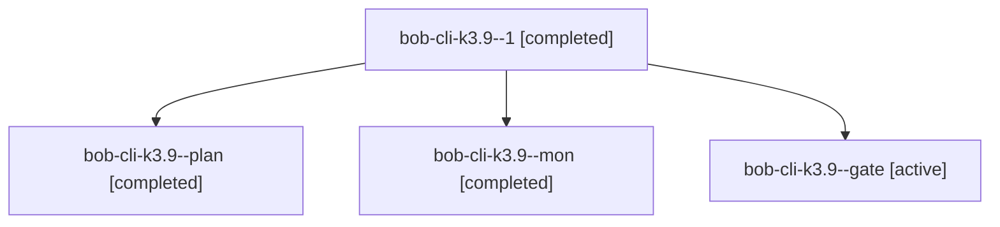

# Session: bob-cli-k3.9

[Agent Hoods](../README.md) / [bbugyi200](../users/bbugyi200/README.md) / [athena](../users/bbugyi200/machines/athena/README.md) / [bob-cli-k3](../users/bbugyi200/machines/athena/hoods/bob-cli-k3/README.md) / bob-cli-k3.9

Owner: `bbugyi200.athena` · Hood: `bob-cli-k3` · Members: 4 · Bead: [bob-cli-k3.9](https://github.com/bobs-org/bob-cli--beads/blob/main/pages/bob-cli-k3/bob-cli-k3.9.md)

## Lineage

The diagram is an optional enhancement; the ordered table below contains the same lineage in accessible text.

| Role | Agent | State | Model / provider | Timing | Commits | Prompt | Chat |
|---|---|---|---|---|---:|---|---|
| 1 | bob-cli-k3.9--1 | completed | gpt-6-luna / codex | 2026-11-12T04:19:33.733392+00:00 → 2026-11-12T04:25:08.332231+00:00 | 0 | [Prompt](../agents/bbugyi200.athena.bob-cli-k3.9--1/prompt.md) | [Chat](../agents/bbugyi200.athena.bob-cli-k3.9--1/chat.md) |
| plan | bob-cli-k3.9--plan | completed | gpt-6-luna / codex | 2026-11-12T03:59:32.667118+00:00 → 2026-11-12T04:09:13.496527+00:00 | 0 | [Prompt](../agents/bbugyi200.athena.bob-cli-k3.9--plan/prompt.md) | [Chat](../agents/bbugyi200.athena.bob-cli-k3.9--plan/chat.md) |
| mon | bob-cli-k3.9--mon | completed | gpt-6-luna / codex | 2026-11-12T04:08:21.398508+00:00 → 2026-11-12T04:17:35.982865+00:00 | 0 | — | [Chat](../agents/bbugyi200.athena.bob-cli-k3.9--mon/chat.md) |
| gate | bob-cli-k3.9--gate | active | gpt-6-luna / codex | 2026-11-12T04:25:06.233285+00:00 | 0 | — | — |

## Neighbors

| Agent | Relation | State |
|---|---|---|
| [bob-cli-k3.10](../agents/bbugyi200.athena.bob-cli-k3.10/README.md) | bob-cli-k3 hood | waiting |
| [bob-cli-k3.11](../agents/bbugyi200.athena.bob-cli-k3.11/README.md) | bob-cli-k3 hood | waiting |
| [bob-cli-k3.2.1.2](../agents/bbugyi200.athena.bob-cli-k3.2.1.2/README.md) | bob-cli-k3 hood | completed |
| [bob-cli-k3.2.1.3](bbugyi200.athena.bob-cli-k3.2.1.3.md) (session · 5) | bob-cli-k3 hood | completed 4, failed 1 |
| [bob-cli-k3.2.1.land](bbugyi200.athena.bob-cli-k3.2.1.land.md) (session · 3) | bob-cli-k3 hood | completed 3 |
| [bob-cli-k3.4](bbugyi200.athena.bob-cli-k3.4.md) (session · 3) | bob-cli-k3 hood | active 1, completed 2 |
| [bob-cli-k3.4.1.1](../agents/bbugyi200.athena.bob-cli-k3.4.1.1/README.md) | bob-cli-k3 hood | completed |
| [bob-cli-k3.4.1.2](bbugyi200.athena.bob-cli-k3.4.1.2.md) (session · 5) | bob-cli-k3 hood | completed 4, failed 1 |
| [bob-cli-k3.4.1.3](../agents/bbugyi200.athena.bob-cli-k3.4.1.3/README.md) | bob-cli-k3 hood | completed |
| [bob-cli-k3.4.1.4](../agents/bbugyi200.athena.bob-cli-k3.4.1.4/README.md) | bob-cli-k3 hood | completed |
| [bob-cli-k3.4.1.land](bbugyi200.athena.bob-cli-k3.4.1.land.md) (session · 3) | bob-cli-k3 hood | completed 3 |
| [bob-cli-k3.5](bbugyi200.athena.bob-cli-k3.5.md) (session · 3) | bob-cli-k3 hood | active 1, completed 2 |
| [bob-cli-k3.5.1.1](../agents/bbugyi200.athena.bob-cli-k3.5.1.1/README.md) | bob-cli-k3 hood | completed |
| [bob-cli-k3.5.1.2](../agents/bbugyi200.athena.bob-cli-k3.5.1.2/README.md) | bob-cli-k3 hood | completed |
| [bob-cli-k3.5.1.3](../agents/bbugyi200.athena.bob-cli-k3.5.1.3/README.md) | bob-cli-k3 hood | completed |
| [bob-cli-k3.5.1.land](bbugyi200.athena.bob-cli-k3.5.1.land.md) (session · 3) | bob-cli-k3 hood | completed 3 |
| [bob-cli-k3.6](bbugyi200.athena.bob-cli-k3.6.md) (session · 3) | bob-cli-k3 hood | active 1, completed 2 |
| [bob-cli-k3.6.1.1](../agents/bbugyi200.athena.bob-cli-k3.6.1.1/README.md) | bob-cli-k3 hood | completed |
| [bob-cli-k3.6.1.2](../agents/bbugyi200.athena.bob-cli-k3.6.1.2/README.md) | bob-cli-k3 hood | completed |
| [bob-cli-k3.6.1.3](../agents/bbugyi200.athena.bob-cli-k3.6.1.3/README.md) | bob-cli-k3 hood | completed |
| [bob-cli-k3.6.1.land](bbugyi200.athena.bob-cli-k3.6.1.land.md) (session · 3) | bob-cli-k3 hood | completed 3 |
| [bob-cli-k3.7](bbugyi200.athena.bob-cli-k3.7.md) (session · 3) | bob-cli-k3 hood | active 1, completed 2 |
| [bob-cli-k3.7.1.1](../agents/bbugyi200.athena.bob-cli-k3.7.1.1/README.md) | bob-cli-k3 hood | completed |
| [bob-cli-k3.7.1.2](../agents/bbugyi200.athena.bob-cli-k3.7.1.2/README.md) | bob-cli-k3 hood | active |
| [bob-cli-k3.7.1.3](../agents/bbugyi200.athena.bob-cli-k3.7.1.3/README.md) | bob-cli-k3 hood | waiting |
| [bob-cli-k3.7.1.4](../agents/bbugyi200.athena.bob-cli-k3.7.1.4/README.md) | bob-cli-k3 hood | waiting |
| [bob-cli-k3.7.1.5](../agents/bbugyi200.athena.bob-cli-k3.7.1.5/README.md) | bob-cli-k3 hood | waiting |
| [bob-cli-k3.7.1.land](../agents/bbugyi200.athena.bob-cli-k3.7.1.land/README.md) | bob-cli-k3 hood | waiting |
| [bob-cli-k3.8](bbugyi200.athena.bob-cli-k3.8.md) (session · 3) | bob-cli-k3 hood | completed 3 |
| [bob-cli-k3.land](../agents/bbugyi200.athena.bob-cli-k3.land/README.md) | bob-cli-k3 hood | waiting |
