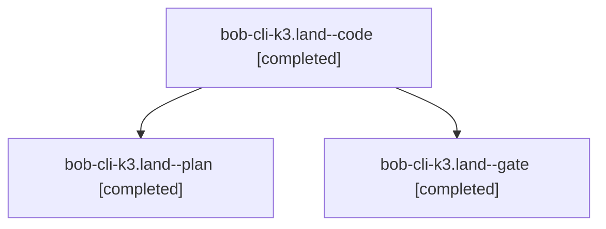

# Session: bob-cli-k3.land

[Agent Hoods](../README.md) / [bbugyi200](../users/bbugyi200/README.md) / [athena](../users/bbugyi200/machines/athena/README.md) / [bob-cli-k3](../users/bbugyi200/machines/athena/hoods/bob-cli-k3/README.md) / bob-cli-k3.land

Owner: `bbugyi200.athena` · Hood: `bob-cli-k3` · Members: 3 · Bead: [bob-cli-k3](https://github.com/bobs-org/bob-cli--beads/blob/main/pages/bob-cli-k3/README.md)

## Lineage

The diagram is an optional enhancement; the ordered table below contains the same lineage in accessible text.

| Role | Agent | State | Model / provider | Timing | Commits | Prompt | Chat |
|---|---|---|---|---|---:|---|---|
| code | bob-cli-k3.land--code | completed | muse-spark-1.3-contributor / muse | 2026-11-12T18:59:21.533471+00:00 → 2026-11-12T20:15:23.873278+00:00 | [1](../agents/bbugyi200.athena.bob-cli-k3.land--code/README.md#commits) | — | [Chat](../agents/bbugyi200.athena.bob-cli-k3.land--code/chat.md) |
| plan | bob-cli-k3.land--plan | completed | opus / claude | 2026-11-12T18:37:43.199035+00:00 → 2026-11-12T20:15:23.873278+00:00 | 0 | [Prompt](../agents/bbugyi200.athena.bob-cli-k3.land--plan/prompt.md) | [Chat](../agents/bbugyi200.athena.bob-cli-k3.land--plan/chat.md) |
| gate | bob-cli-k3.land--gate | completed | opus / claude | 2026-11-12T18:57:40.098227+00:00 → 2026-11-12T18:59:01.962033+00:00 | 0 | — | [Chat](../agents/bbugyi200.athena.bob-cli-k3.land--gate/chat.md) |

## Commits

| Role | Repo | Commit | Subject | Committed |
|---|---|---|---|---|
| code | bob-cli | [`b04120b`](https://github.com/bobs-org/bob-cli/commit/b04120b0e2d633a63f98b5a7ee75ba4edeb28fc2) | feat(albums): singular record counts and retired config-reader gate | 2026-11-12 15:11:56 EST |

## Neighbors

| Agent | Relation | State |
|---|---|---|
| [bob-cli-k3.10](../agents/bbugyi200.athena.bob-cli-k3.10/README.md) | bob-cli-k3 hood | dismissed |
| [bob-cli-k3.11](../agents/bbugyi200.athena.bob-cli-k3.11/README.md) | bob-cli-k3 hood | completed |
| [bob-cli-k3.2.1.2](../agents/bbugyi200.athena.bob-cli-k3.2.1.2/README.md) | bob-cli-k3 hood | completed |
| [bob-cli-k3.2.1.3](bbugyi200.athena.bob-cli-k3.2.1.3.md) (session · 5) | bob-cli-k3 hood | completed 4, failed 1 |
| [bob-cli-k3.2.1.land](bbugyi200.athena.bob-cli-k3.2.1.land.md) (session · 3) | bob-cli-k3 hood | completed 3 |
| [bob-cli-k3.4](bbugyi200.athena.bob-cli-k3.4.md) (session · 3) | bob-cli-k3 hood | active 1, completed 2 |
| [bob-cli-k3.4.1.1](../agents/bbugyi200.athena.bob-cli-k3.4.1.1/README.md) | bob-cli-k3 hood | completed |
| [bob-cli-k3.4.1.2](bbugyi200.athena.bob-cli-k3.4.1.2.md) (session · 5) | bob-cli-k3 hood | completed 4, failed 1 |
| [bob-cli-k3.4.1.3](../agents/bbugyi200.athena.bob-cli-k3.4.1.3/README.md) | bob-cli-k3 hood | completed |
| [bob-cli-k3.4.1.4](../agents/bbugyi200.athena.bob-cli-k3.4.1.4/README.md) | bob-cli-k3 hood | completed |
| [bob-cli-k3.4.1.land](bbugyi200.athena.bob-cli-k3.4.1.land.md) (session · 3) | bob-cli-k3 hood | completed 3 |
| [bob-cli-k3.5](bbugyi200.athena.bob-cli-k3.5.md) (session · 3) | bob-cli-k3 hood | active 1, completed 2 |
| [bob-cli-k3.5.1.1](../agents/bbugyi200.athena.bob-cli-k3.5.1.1/README.md) | bob-cli-k3 hood | completed |
| [bob-cli-k3.5.1.2](../agents/bbugyi200.athena.bob-cli-k3.5.1.2/README.md) | bob-cli-k3 hood | completed |
| [bob-cli-k3.5.1.3](../agents/bbugyi200.athena.bob-cli-k3.5.1.3/README.md) | bob-cli-k3 hood | completed |
| [bob-cli-k3.5.1.land](bbugyi200.athena.bob-cli-k3.5.1.land.md) (session · 3) | bob-cli-k3 hood | completed 3 |
| [bob-cli-k3.6](bbugyi200.athena.bob-cli-k3.6.md) (session · 3) | bob-cli-k3 hood | active 1, completed 2 |
| [bob-cli-k3.6.1.1](../agents/bbugyi200.athena.bob-cli-k3.6.1.1/README.md) | bob-cli-k3 hood | completed |
| [bob-cli-k3.6.1.2](../agents/bbugyi200.athena.bob-cli-k3.6.1.2/README.md) | bob-cli-k3 hood | completed |
| [bob-cli-k3.6.1.3](../agents/bbugyi200.athena.bob-cli-k3.6.1.3/README.md) | bob-cli-k3 hood | completed |
| [bob-cli-k3.6.1.land](bbugyi200.athena.bob-cli-k3.6.1.land.md) (session · 3) | bob-cli-k3 hood | completed 3 |
| [bob-cli-k3.7](bbugyi200.athena.bob-cli-k3.7.md) (session · 3) | bob-cli-k3 hood | active 1, completed 2 |
| [bob-cli-k3.7.1.1](../agents/bbugyi200.athena.bob-cli-k3.7.1.1/README.md) | bob-cli-k3 hood | completed |
| [bob-cli-k3.7.1.2](bbugyi200.athena.bob-cli-k3.7.1.2.md) (session · 3) | bob-cli-k3 hood | completed 2, failed 1 |
| [bob-cli-k3.7.1.3](../agents/bbugyi200.athena.bob-cli-k3.7.1.3/README.md) | bob-cli-k3 hood | completed |
| [bob-cli-k3.7.1.4](bbugyi200.athena.bob-cli-k3.7.1.4.md) (session · 5) | bob-cli-k3 hood | completed 3, failed 2 |
| [bob-cli-k3.7.1.5](../agents/bbugyi200.athena.bob-cli-k3.7.1.5/README.md) | bob-cli-k3 hood | completed |
| [bob-cli-k3.7.1.land](bbugyi200.athena.bob-cli-k3.7.1.land.md) (session · 3) | bob-cli-k3 hood | completed 3 |
| [bob-cli-k3.8](bbugyi200.athena.bob-cli-k3.8.md) (session · 3) | bob-cli-k3 hood | completed 3 |
| [bob-cli-k3.9](bbugyi200.athena.bob-cli-k3.9.md) (session · 6) | bob-cli-k3 hood | completed 4, failed 2 |
