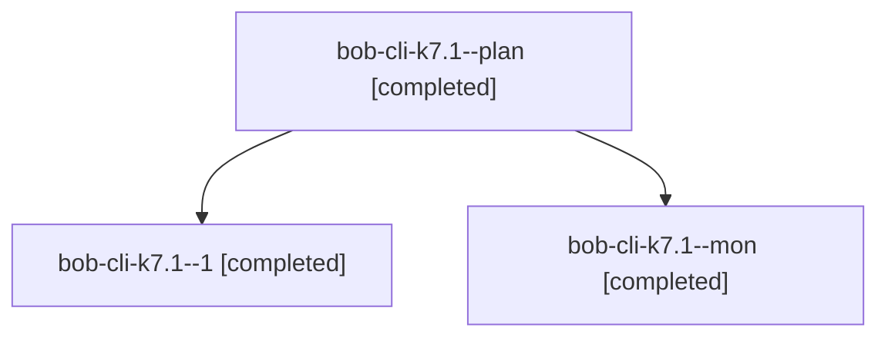

# Session: bob-cli-k7.1

[Agent Hoods](../README.md) / [bbugyi200](../users/bbugyi200/README.md) / [athena](../users/bbugyi200/machines/athena/README.md) / [bob-cli-k7](../users/bbugyi200/machines/athena/hoods/bob-cli-k7/README.md) / bob-cli-k7.1

Owner: `bbugyi200.athena` · Hood: `bob-cli-k7` · Members: 3 · Bead: [bob-cli-k7.1](https://github.com/bobs-org/bob-cli--beads/blob/main/pages/bob-cli-k7/bob-cli-k7.1.md)

## Lineage

The diagram is an optional enhancement; the ordered table below contains the same lineage in accessible text.

| Role | Agent | State | Model / provider | Timing | Commits | Prompt | Chat |
|---|---|---|---|---|---:|---|---|
| plan | bob-cli-k7.1--plan | completed | grok-4.6 / grok | 2026-11-11T13:00:42.387255+00:00 → 2026-11-11T13:24:26.195517+00:00 | 0 | [Prompt](../agents/bbugyi200.athena.bob-cli-k7.1--plan/prompt.md) | [Chat](../agents/bbugyi200.athena.bob-cli-k7.1--plan/chat.md) |
| 1 | bob-cli-k7.1--1 | completed | grok-4.6 / grok | 2026-11-11T13:31:30.157412+00:00 → 2026-11-11T13:45:12.759965+00:00 | [1](../agents/bbugyi200.athena.bob-cli-k7.1--1/README.md#commits) | [Prompt](../agents/bbugyi200.athena.bob-cli-k7.1--1/prompt.md) | [Chat](../agents/bbugyi200.athena.bob-cli-k7.1--1/chat.md) |
| mon | bob-cli-k7.1--mon | completed | grok-4.6 / grok | 2026-11-11T13:23:23.139133+00:00 → 2026-11-11T13:30:32.103015+00:00 | 0 | — | [Chat](../agents/bbugyi200.athena.bob-cli-k7.1--mon/chat.md) |

## Commits

| Role | Repo | Commit | Subject | Committed |
|---|---|---|---|---|
| 1 | bob-cli | [`b2c3697`](https://github.com/bobs-org/bob-cli/commit/b2c3697e8c57c5c2091b1df207d9bed3b38382f3) | feat(keep-moving): skip only umbrella projects, not every root | 2026-11-11 08:44:49 EST |

## Neighbors

| Agent | Relation | State |
|---|---|---|
| [bob-cli-k7.2](../agents/bbugyi200.athena.bob-cli-k7.2/README.md) | bob-cli-k7 hood | completed |
| [bob-cli-k7.3](../agents/bbugyi200.athena.bob-cli-k7.3/README.md) | bob-cli-k7 hood | completed |
| [bob-cli-k7.4](bbugyi200.athena.bob-cli-k7.4.md) (session · 9) | bob-cli-k7 hood | completed 7, failed 2 |
| [bob-cli-k7.5](../agents/bbugyi200.athena.bob-cli-k7.5/README.md) | bob-cli-k7 hood | completed |
| [bob-cli-k7.6](../agents/bbugyi200.athena.bob-cli-k7.6/README.md) | bob-cli-k7 hood | waiting |
| [bob-cli-k7.land](../agents/bbugyi200.athena.bob-cli-k7.land/README.md) | bob-cli-k7 hood | waiting |
