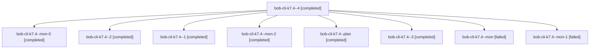

# Session: bob-cli-k7.4

[Agent Hoods](../README.md) / [bbugyi200](../users/bbugyi200/README.md) / [athena](../users/bbugyi200/machines/athena/README.md) / [bob-cli-k7](../users/bbugyi200/machines/athena/hoods/bob-cli-k7/README.md) / bob-cli-k7.4

Owner: `bbugyi200.athena` · Hood: `bob-cli-k7` · Members: 9 · Bead: [bob-cli-k7.4](https://github.com/bobs-org/bob-cli--beads/blob/main/pages/bob-cli-k7/bob-cli-k7.4.md)

## Lineage

The diagram is an optional enhancement; the ordered table below contains the same lineage in accessible text.

| Role | Agent | State | Model / provider | Timing | Commits | Prompt | Chat |
|---|---|---|---|---|---:|---|---|
| 4 | bob-cli-k7.4--4 | completed | gpt-6-luna / codex | 2026-11-11T15:20:22.049826+00:00 → 2026-11-11T15:23:45.622948+00:00 | 0 | [Prompt](../agents/bbugyi200.athena.bob-cli-k7.4--4/prompt.md) | [Chat](../agents/bbugyi200.athena.bob-cli-k7.4--4/chat.md) |
| mon-0 | bob-cli-k7.4--mon-0 | completed | gpt-6-luna / codex | 2026-11-11T14:58:25.220619+00:00 → 2026-11-11T15:00:46.609727+00:00 | 0 | — | [Chat](../agents/bbugyi200.athena.bob-cli-k7.4--mon-0/chat.md) |
| 2 | bob-cli-k7.4--2 | completed | gpt-6-luna / codex | 2026-11-11T15:02:03.723189+00:00 → 2026-11-11T15:04:45.499558+00:00 | 0 | [Prompt](../agents/bbugyi200.athena.bob-cli-k7.4--2/prompt.md) | [Chat](../agents/bbugyi200.athena.bob-cli-k7.4--2/chat.md) |
| 1 | bob-cli-k7.4--1 | completed | gpt-6-luna / codex | 2026-11-11T14:52:46.666836+00:00 → 2026-11-11T14:59:14.854041+00:00 | 0 | [Prompt](../agents/bbugyi200.athena.bob-cli-k7.4--1/prompt.md) | [Chat](../agents/bbugyi200.athena.bob-cli-k7.4--1/chat.md) |
| mon-2 | bob-cli-k7.4--mon-2 | completed | gpt-6-luna / codex | 2026-11-11T15:16:16.952207+00:00 → 2026-11-11T15:19:06.000863+00:00 | 0 | — | [Chat](../agents/bbugyi200.athena.bob-cli-k7.4--mon-2/chat.md) |
| plan | bob-cli-k7.4--plan | completed | gpt-6-luna / codex | 2026-11-11T13:59:16.674708+00:00 → 2026-11-11T14:49:17.250875+00:00 | 0 | [Prompt](../agents/bbugyi200.athena.bob-cli-k7.4--plan/prompt.md) | [Chat](../agents/bbugyi200.athena.bob-cli-k7.4--plan/chat.md) |
| 3 | bob-cli-k7.4--3 | completed | gpt-6-luna / codex | 2026-11-11T15:09:18.852230+00:00 → 2026-11-11T15:17:02.304652+00:00 | 0 | [Prompt](../agents/bbugyi200.athena.bob-cli-k7.4--3/prompt.md) | [Chat](../agents/bbugyi200.athena.bob-cli-k7.4--3/chat.md) |
| mon | bob-cli-k7.4--mon | failed | gpt-6-luna / codex | 2026-11-11T14:48:32.056872+00:00 → 2026-11-11T14:51:46.286755+00:00 | 0 | — | [Chat](../agents/bbugyi200.athena.bob-cli-k7.4--mon/chat.md) |
| mon-1 | bob-cli-k7.4--mon-1 | failed | gpt-6-luna / codex | 2026-11-11T15:04:04.645062+00:00 → 2026-11-11T15:07:48.220068+00:00 | 0 | — | [Chat](../agents/bbugyi200.athena.bob-cli-k7.4--mon-1/chat.md) |

## Neighbors

| Agent | Relation | State |
|---|---|---|
| [bob-cli-k7.1](bbugyi200.athena.bob-cli-k7.1.md) (session · 3) | bob-cli-k7 hood | completed 3 |
| [bob-cli-k7.2](../agents/bbugyi200.athena.bob-cli-k7.2/README.md) | bob-cli-k7 hood | completed |
| [bob-cli-k7.3](../agents/bbugyi200.athena.bob-cli-k7.3/README.md) | bob-cli-k7 hood | completed |
| [bob-cli-k7.5](../agents/bbugyi200.athena.bob-cli-k7.5/README.md) | bob-cli-k7 hood | completed |
| [bob-cli-k7.6](../agents/bbugyi200.athena.bob-cli-k7.6/README.md) | bob-cli-k7 hood | waiting |
| [bob-cli-k7.land](../agents/bbugyi200.athena.bob-cli-k7.land/README.md) | bob-cli-k7 hood | waiting |
