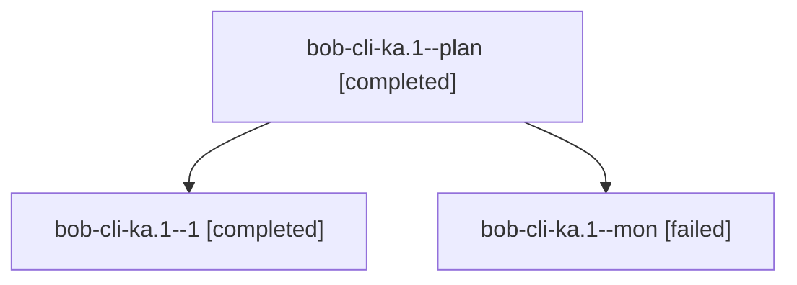

# Session: bob-cli-ka.1

[Agent Hoods](../README.md) / [bbugyi200](../users/bbugyi200/README.md) / [athena](../users/bbugyi200/machines/athena/README.md) / [bob-cli-ka](../users/bbugyi200/machines/athena/hoods/bob-cli-ka/README.md) / bob-cli-ka.1

Owner: `bbugyi200.athena` · Hood: `bob-cli-ka` · Members: 3 · Bead: [bob-cli-ka.1](https://github.com/bobs-org/bob-cli--beads/blob/main/pages/bob-cli-ka/bob-cli-ka.1.md)

## Lineage

The diagram is an optional enhancement; the ordered table below contains the same lineage in accessible text.

| Role | Agent | State | Model / provider | Timing | Commits | Prompt | Chat |
|---|---|---|---|---|---:|---|---|
| plan | bob-cli-ka.1--plan | completed | grok-4.6 / grok | 2026-11-11T14:25:46.582648+00:00 → 2026-11-11T15:05:36.599964+00:00 | 0 | [Prompt](../agents/bbugyi200.athena.bob-cli-ka.1--plan/prompt.md) | [Chat](../agents/bbugyi200.athena.bob-cli-ka.1--plan/chat.md) |
| 1 | bob-cli-ka.1--1 | completed | grok-4.6 / grok | 2026-11-11T15:13:27.774905+00:00 → 2026-11-11T15:27:03.516836+00:00 | [1](../agents/bbugyi200.athena.bob-cli-ka.1--1/README.md#commits) | [Prompt](../agents/bbugyi200.athena.bob-cli-ka.1--1/prompt.md) | [Chat](../agents/bbugyi200.athena.bob-cli-ka.1--1/chat.md) |
| mon | bob-cli-ka.1--mon | failed | grok-4.6 / grok | 2026-11-11T15:04:38.403921+00:00 → 2026-11-11T15:12:00.252798+00:00 | 0 | — | [Chat](../agents/bbugyi200.athena.bob-cli-ka.1--mon/chat.md) |

## Commits

| Role | Repo | Commit | Subject | Committed |
|---|---|---|---|---|
| 1 | bob-cli | [`f9d998c`](https://github.com/bobs-org/bob-cli/commit/f9d998c179a37bb1f1f3df8b590c472a3f5eff00) | feat(capture): resolve notebook sections with staged draft view | 2026-11-11 10:26:20 EST |

## Neighbors

| Agent | Relation | State |
|---|---|---|
| [bob-cli-ka.2](bbugyi200.athena.bob-cli-ka.2.md) (session · 5) | bob-cli-ka hood | completed 5 |
| [bob-cli-ka.3](../agents/bbugyi200.athena.bob-cli-ka.3/README.md) | bob-cli-ka hood | completed |
| [bob-cli-ka.4](../agents/bbugyi200.athena.bob-cli-ka.4/README.md) | bob-cli-ka hood | waiting |
| [bob-cli-ka.5](../agents/bbugyi200.athena.bob-cli-ka.5/README.md) | bob-cli-ka hood | waiting |
| [bob-cli-ka.6](../agents/bbugyi200.athena.bob-cli-ka.6/README.md) | bob-cli-ka hood | waiting |
| [bob-cli-ka.land](../agents/bbugyi200.athena.bob-cli-ka.land/README.md) | bob-cli-ka hood | waiting |
