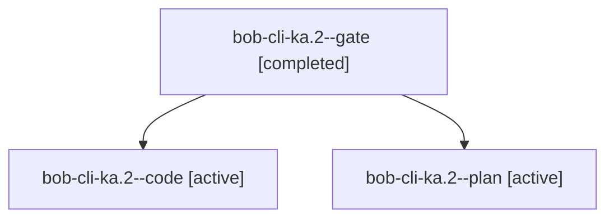

# Session: bob-cli-ka.2

[Agent Hoods](../README.md) / [bbugyi200](../users/bbugyi200/README.md) / [athena](../users/bbugyi200/machines/athena/README.md) / [bob-cli-ka](../users/bbugyi200/machines/athena/hoods/bob-cli-ka/README.md) / bob-cli-ka.2

Owner: `bbugyi200.athena` · Hood: `bob-cli-ka` · Members: 3 · Bead: [bob-cli-ka.2](https://github.com/bobs-org/bob-cli--beads/blob/main/pages/bob-cli-ka/bob-cli-ka.2.md)

## Lineage

The diagram is an optional enhancement; the ordered table below contains the same lineage in accessible text.

| Role | Agent | State | Model / provider | Timing | Commits | Prompt | Chat |
|---|---|---|---|---|---:|---|---|
| gate | bob-cli-ka.2--gate | completed | gpt-6-astra / codex | 2026-11-11T15:34:10.545838+00:00 → 2026-11-11T15:34:43.121295+00:00 | 0 | — | [Chat](../agents/bbugyi200.athena.bob-cli-ka.2--gate/chat.md) |
| code | bob-cli-ka.2--code | active | grok-4.6 / grok | 2026-11-11T15:35:17.984648+00:00 | 0 | — | — |
| plan | bob-cli-ka.2--plan | active | gpt-6-astra / codex | 2026-11-11T15:27:41.345666+00:00 | 0 | [Prompt](../agents/bbugyi200.athena.bob-cli-ka.2--plan/prompt.md) | [Chat](../agents/bbugyi200.athena.bob-cli-ka.2--plan/chat.md) |

## Neighbors

| Agent | Relation | State |
|---|---|---|
| [bob-cli-ka.1](bbugyi200.athena.bob-cli-ka.1.md) (session · 3) | bob-cli-ka hood | completed 2, failed 1 |
| [bob-cli-ka.3](../agents/bbugyi200.athena.bob-cli-ka.3/README.md) | bob-cli-ka hood | waiting |
| [bob-cli-ka.4](../agents/bbugyi200.athena.bob-cli-ka.4/README.md) | bob-cli-ka hood | waiting |
| [bob-cli-ka.5](../agents/bbugyi200.athena.bob-cli-ka.5/README.md) | bob-cli-ka hood | waiting |
| [bob-cli-ka.6](../agents/bbugyi200.athena.bob-cli-ka.6/README.md) | bob-cli-ka hood | waiting |
| [bob-cli-ka.land](../agents/bbugyi200.athena.bob-cli-ka.land/README.md) | bob-cli-ka hood | waiting |
