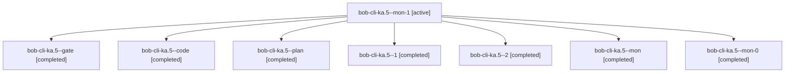

# Session: bob-cli-ka.5

[Agent Hoods](../README.md) / [bbugyi200](../users/bbugyi200/README.md) / [athena](../users/bbugyi200/machines/athena/README.md) / [bob-cli-ka](../users/bbugyi200/machines/athena/hoods/bob-cli-ka/README.md) / bob-cli-ka.5

Owner: `bbugyi200.athena` · Hood: `bob-cli-ka` · Members: 8 · Bead: [bob-cli-ka.5](https://github.com/bobs-org/bob-cli--beads/blob/main/pages/bob-cli-ka/bob-cli-ka.5.md)

## Lineage

The diagram is an optional enhancement; the ordered table below contains the same lineage in accessible text.

| Role | Agent | State | Model / provider | Timing | Commits | Prompt | Chat |
|---|---|---|---|---|---:|---|---|
| mon-1 | bob-cli-ka.5--mon-1 | active | grok-4.6 / grok | 2026-11-11T21:09:10.544535+00:00 | 0 | — | — |
| gate | bob-cli-ka.5--gate | completed | gpt-6-astra / codex | 2026-11-11T19:38:01.240458+00:00 → 2026-11-11T19:39:34.736565+00:00 | 0 | — | [Chat](../agents/bbugyi200.athena.bob-cli-ka.5--gate/chat.md) |
| code | bob-cli-ka.5--code | completed | gpt-6-luna / codex | 2026-11-11T19:40:20.747634+00:00 → 2026-11-11T20:26:47.337822+00:00 | 0 | — | [Chat](../agents/bbugyi200.athena.bob-cli-ka.5--code/chat.md) |
| plan | bob-cli-ka.5--plan | completed | gpt-6-astra / codex | 2026-11-11T19:27:46.450544+00:00 → 2026-11-11T20:26:47.337822+00:00 | 0 | [Prompt](../agents/bbugyi200.athena.bob-cli-ka.5--plan/prompt.md) | [Chat](../agents/bbugyi200.athena.bob-cli-ka.5--plan/chat.md) |
| 1 | bob-cli-ka.5--1 | completed | gpt-6-luna / codex | 2026-11-11T20:33:52.659232+00:00 → 2026-11-11T20:37:49.255294+00:00 | 0 | [Prompt](../agents/bbugyi200.athena.bob-cli-ka.5--1/prompt.md) | [Chat](../agents/bbugyi200.athena.bob-cli-ka.5--1/chat.md) |
| 2 | bob-cli-ka.5--2 | completed | grok-4.6 / grok | 2026-11-11T20:44:31.483380+00:00 → 2026-11-11T21:10:58.301453+00:00 | 0 | [Prompt](../agents/bbugyi200.athena.bob-cli-ka.5--2/prompt.md) | [Chat](../agents/bbugyi200.athena.bob-cli-ka.5--2/chat.md) |
| mon | bob-cli-ka.5--mon | completed | gpt-6-luna / codex | 2026-11-11T20:24:25.525658+00:00 → 2026-11-11T20:31:30.686487+00:00 | 0 | — | [Chat](../agents/bbugyi200.athena.bob-cli-ka.5--mon/chat.md) |
| mon-0 | bob-cli-ka.5--mon-0 | completed | gpt-6-luna / codex | 2026-11-11T20:37:03.100377+00:00 → 2026-11-11T20:44:02.849463+00:00 | 0 | — | [Chat](../agents/bbugyi200.athena.bob-cli-ka.5--mon-0/chat.md) |

## Neighbors

| Agent | Relation | State |
|---|---|---|
| [bob-cli-ka.1](bbugyi200.athena.bob-cli-ka.1.md) (session · 3) | bob-cli-ka hood | completed 2, failed 1 |
| [bob-cli-ka.2](bbugyi200.athena.bob-cli-ka.2.md) (session · 5) | bob-cli-ka hood | completed 5 |
| [bob-cli-ka.3](../agents/bbugyi200.athena.bob-cli-ka.3/README.md) | bob-cli-ka hood | completed |
| [bob-cli-ka.4](../agents/bbugyi200.athena.bob-cli-ka.4/README.md) | bob-cli-ka hood | completed |
| [bob-cli-ka.6](../agents/bbugyi200.athena.bob-cli-ka.6/README.md) | bob-cli-ka hood | completed |
| [bob-cli-ka.land](../agents/bbugyi200.athena.bob-cli-ka.land/README.md) | bob-cli-ka hood | waiting |
