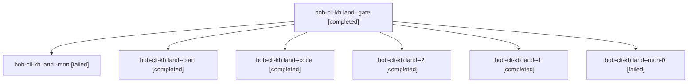

# Session: bob-cli-kb.land

[Agent Hoods](../README.md) / [bbugyi200](../users/bbugyi200/README.md) / [athena](../users/bbugyi200/machines/athena/README.md) / [bob-cli-kb](../users/bbugyi200/machines/athena/hoods/bob-cli-kb/README.md) / bob-cli-kb.land

Owner: `bbugyi200.athena` · Hood: `bob-cli-kb` · Members: 7 · Bead: [bob-cli-kb](https://github.com/bobs-org/bob-cli--beads/blob/main/pages/bob-cli-kb/README.md)

## Lineage



The diagram is an optional enhancement; the ordered table below contains the same lineage in accessible text.

| Role | Agent | State | Model / provider | Timing | Commits | Prompt | Chat |
|---|---|---|---|---|---:|---|---|
| <a id="member-gate"></a>gate | bob-cli-kb.land--gate | completed | gpt-6-astra / codex | 2026-11-12T15:46:09.178062+00:00 → 2026-11-12T15:47:07.090871+00:00 | 0 | — | [Chat](../agents/bbugyi200.athena.bob-cli-kb.land--gate/chat.md) |
| <a id="member-mon"></a>mon | bob-cli-kb.land--mon | failed | gpt-6-luna / codex | 2026-11-12T16:25:55.892333+00:00 → 2026-11-12T16:29:50.522161+00:00 | 0 | — | [Chat](../agents/bbugyi200.athena.bob-cli-kb.land--mon/chat.md) |
| <a id="member-plan"></a>plan | bob-cli-kb.land--plan | completed | gpt-6-astra / codex | 2026-11-12T15:32:03.787860+00:00 → 2026-11-12T16:26:53.024743+00:00 | 0 | [Prompt](../agents/bbugyi200.athena.bob-cli-kb.land--plan/prompt.md) | [Chat](../agents/bbugyi200.athena.bob-cli-kb.land--plan/chat.md) |
| <a id="member-code"></a>code | bob-cli-kb.land--code | completed | gpt-6-luna / codex | 2026-11-12T15:48:00.499824+00:00 → 2026-11-12T16:26:53.024743+00:00 | 0 | — | [Chat](../agents/bbugyi200.athena.bob-cli-kb.land--code/chat.md) |
| <a id="member-2"></a>2 | bob-cli-kb.land--2 | completed | muse-spark-1.3-contributor / muse | 2026-11-12T16:52:20.582713+00:00 → 2026-11-12T17:39:52.738880+00:00 | 0 | [Prompt](../agents/bbugyi200.athena.bob-cli-kb.land--2/prompt.md) | [Chat](../agents/bbugyi200.athena.bob-cli-kb.land--2/chat.md) |
| <a id="member-1"></a>1 | bob-cli-kb.land--1 | completed | gpt-6-luna / codex | 2026-11-12T16:32:09.049879+00:00 → 2026-11-12T16:39:56.784020+00:00 | 0 | [Prompt](../agents/bbugyi200.athena.bob-cli-kb.land--1/prompt.md) | [Chat](../agents/bbugyi200.athena.bob-cli-kb.land--1/chat.md) |
| <a id="member-mon-0"></a>mon-0 | bob-cli-kb.land--mon-0 | failed | gpt-6-luna / codex | 2026-11-12T16:38:45.944238+00:00 → 2026-11-12T16:50:21.437911+00:00 | 0 | — | [Chat](../agents/bbugyi200.athena.bob-cli-kb.land--mon-0/chat.md) |

## Variables

| Role | Variable | Value |
|---|---|---|
| 2 | `artifacts` | \[{bead: bob-cli-kb, kind: file, label: Bob Vim Yank Flash recovery e2e report (full pass 63/66, 3 explicit skips, 8 screenshots), path: /home/bryan/.sase/artifacts/agents/gh\_bobs-org\_\_bob-cli/2026111… |

#### artifacts

**Role:** `2`

```yaml
- bead: bob-cli-kb
  kind: file
  label: Bob Vim Yank Flash recovery e2e report (full pass 63/66, 3 explicit skips, 8 screenshots)
  path: /home/bryan/.sase/artifacts/agents/gh_bobs-org__bob-cli/20261112114920/bob-yank-flash-recovery-final-8b83defcc1fb.json
  ref: file:explicit:40043e68d7042d82a2439055
  source_path: /tmp/bob-yank-flash-recovery-final.json
```

Values are truncated for display; see each member's agent meta.json for the full values.

## Neighbors

| Agent | Relation | State |
|---|---|---|
| [bob-cli-kb.1](../agents/bbugyi200.athena.bob-cli-kb.1/README.md) | bob-cli-kb hood | completed |
| [bob-cli-kb.2](../agents/bbugyi200.athena.bob-cli-kb.2/README.md) | bob-cli-kb hood | completed |
