# Session: bob-cli-kc.3

[Agent Hoods](../README.md) / [bbugyi200](../users/bbugyi200/README.md) / [athena](../users/bbugyi200/machines/athena/README.md) / [bob-cli-kc](../users/bbugyi200/machines/athena/hoods/bob-cli-kc/README.md) / bob-cli-kc.3

Owner: `bbugyi200.athena` · Hood: `bob-cli-kc` · Members: 17 · Bead: [bob-cli-kc.3](https://github.com/bobs-org/bob-cli--beads/blob/main/pages/bob-cli-kc/bob-cli-kc.3.md)

## Lineage

```mermaid
flowchart TD
  n0["bob-cli-kc.3--mon-1 [completed]"]
  n1["bob-cli-kc.3--plan [completed]"]
  n0 --> n1
  n2["bob-cli-kc.3--3 [completed]"]
  n0 --> n2
  n3["bob-cli-kc.3--2 [completed]"]
  n0 --> n3
  n4["bob-cli-kc.3--mon-2 [completed]"]
  n0 --> n4
  n5["bob-cli-kc.3--mon-4 [completed]"]
  n0 --> n5
  n6["bob-cli-kc.3--7 [completed]"]
  n0 --> n6
  n7["bob-cli-kc.3--6 [completed]"]
  n0 --> n7
  n8["bob-cli-kc.3--mon-3 [completed]"]
  n0 --> n8
  n9["bob-cli-kc.3--mon-6 [failed]"]
  n0 --> n9
  n10["bob-cli-kc.3--mon-5 [completed]"]
  n0 --> n10
  n11["bob-cli-kc.3--mon-0 [failed]"]
  n0 --> n11
  n12["bob-cli-kc.3--1 [completed]"]
  n0 --> n12
  n13["bob-cli-kc.3--4 [completed]"]
  n0 --> n13
  n14["bob-cli-kc.3--mon [failed]"]
  n0 --> n14
  n15["bob-cli-kc.3--5 [completed]"]
  n0 --> n15
  n16["bob-cli-kc.3--8 [completed]"]
  n0 --> n16
```

The diagram is an optional enhancement; the ordered table below contains the same lineage in accessible text.

| Role | Agent | State | Model / provider | Timing | Commits | Prompt | Chat |
|---|---|---|---|---|---:|---|---|
| mon-1 | bob-cli-kc.3--mon-1 | completed | gpt-6-luna / codex | 2026-11-11T17:51:48.549186+00:00 → 2026-11-11T17:55:09.258456+00:00 | 0 | — | [Chat](../agents/bbugyi200.athena.bob-cli-kc.3--mon-1/chat.md) |
| plan | bob-cli-kc.3--plan | completed | gpt-6-luna / codex | 2026-11-11T17:01:22.228619+00:00 → 2026-11-11T17:24:09.221757+00:00 | 0 | [Prompt](../agents/bbugyi200.athena.bob-cli-kc.3--plan/prompt.md) | [Chat](../agents/bbugyi200.athena.bob-cli-kc.3--plan/chat.md) |
| 3 | bob-cli-kc.3--3 | completed | gpt-6-luna / codex | 2026-11-11T17:57:27.052647+00:00 → 2026-11-11T18:02:58.638568+00:00 | 0 | [Prompt](../agents/bbugyi200.athena.bob-cli-kc.3--3/prompt.md) | [Chat](../agents/bbugyi200.athena.bob-cli-kc.3--3/chat.md) |
| 2 | bob-cli-kc.3--2 | completed | gpt-6-luna / codex | 2026-11-11T17:41:28.773512+00:00 → 2026-11-11T17:52:51.454171+00:00 | 0 | [Prompt](../agents/bbugyi200.athena.bob-cli-kc.3--2/prompt.md) | [Chat](../agents/bbugyi200.athena.bob-cli-kc.3--2/chat.md) |
| mon-2 | bob-cli-kc.3--mon-2 | completed | gpt-6-luna / codex | 2026-11-11T18:01:48.777514+00:00 → 2026-11-11T18:25:36.370154+00:00 | 0 | — | [Chat](../agents/bbugyi200.athena.bob-cli-kc.3--mon-2/chat.md) |
| mon-4 | bob-cli-kc.3--mon-4 | completed | gpt-6-luna / codex | 2026-11-11T19:02:04.060913+00:00 → 2026-11-11T19:11:53.757097+00:00 | 0 | — | [Chat](../agents/bbugyi200.athena.bob-cli-kc.3--mon-4/chat.md) |
| 7 | bob-cli-kc.3--7 | completed | gpt-6-luna / codex | 2026-11-11T19:29:25.328885+00:00 → 2026-11-11T19:32:12.759906+00:00 | 0 | [Prompt](../agents/bbugyi200.athena.bob-cli-kc.3--7/prompt.md) | [Chat](../agents/bbugyi200.athena.bob-cli-kc.3--7/chat.md) |
| 6 | bob-cli-kc.3--6 | completed | gpt-6-luna / codex | 2026-11-11T19:17:30.867695+00:00 → 2026-11-11T19:22:47.060660+00:00 | 0 | [Prompt](../agents/bbugyi200.athena.bob-cli-kc.3--6/prompt.md) | [Chat](../agents/bbugyi200.athena.bob-cli-kc.3--6/chat.md) |
| mon-3 | bob-cli-kc.3--mon-3 | completed | gpt-6-luna / codex | 2026-11-11T18:30:20.909665+00:00 → 2026-11-11T18:41:17.645444+00:00 | 0 | — | [Chat](../agents/bbugyi200.athena.bob-cli-kc.3--mon-3/chat.md) |
| mon-6 | bob-cli-kc.3--mon-6 | failed | gpt-6-luna / codex | 2026-11-11T19:31:04.232031+00:00 → 2026-11-11T21:33:46.659811+00:00 | 0 | — | [Chat](../agents/bbugyi200.athena.bob-cli-kc.3--mon-6/chat.md) |
| mon-5 | bob-cli-kc.3--mon-5 | completed | gpt-6-luna / codex | 2026-11-11T19:20:14.522408+00:00 → 2026-11-11T19:25:44.458303+00:00 | 0 | — | [Chat](../agents/bbugyi200.athena.bob-cli-kc.3--mon-5/chat.md) |
| mon-0 | bob-cli-kc.3--mon-0 | failed | gpt-6-luna / codex | 2026-11-11T17:35:40.293592+00:00 → 2026-11-11T17:39:42.559295+00:00 | 0 | — | [Chat](../agents/bbugyi200.athena.bob-cli-kc.3--mon-0/chat.md) |
| 1 | bob-cli-kc.3--1 | completed | gpt-6-luna / codex | 2026-11-11T17:28:50.314701+00:00 → 2026-11-11T17:36:31.858782+00:00 | 0 | [Prompt](../agents/bbugyi200.athena.bob-cli-kc.3--1/prompt.md) | [Chat](../agents/bbugyi200.athena.bob-cli-kc.3--1/chat.md) |
| 4 | bob-cli-kc.3--4 | completed | gpt-6-luna / codex | 2026-11-11T18:27:57.286699+00:00 → 2026-11-11T18:31:27.254536+00:00 | 0 | [Prompt](../agents/bbugyi200.athena.bob-cli-kc.3--4/prompt.md) | [Chat](../agents/bbugyi200.athena.bob-cli-kc.3--4/chat.md) |
| mon | bob-cli-kc.3--mon | failed | gpt-6-luna / codex | 2026-11-11T17:23:06.714875+00:00 → 2026-11-11T17:27:33.002965+00:00 | 0 | — | [Chat](../agents/bbugyi200.athena.bob-cli-kc.3--mon/chat.md) |
| 5 | bob-cli-kc.3--5 | completed | gpt-6-luna / codex | 2026-11-11T18:58:32.569634+00:00 → 2026-11-11T19:03:14.133654+00:00 | 0 | [Prompt](../agents/bbugyi200.athena.bob-cli-kc.3--5/prompt.md) | [Chat](../agents/bbugyi200.athena.bob-cli-kc.3--5/chat.md) |
| 8 | bob-cli-kc.3--8 | completed | gpt-6-luna / codex | 2026-11-11T21:36:33.002685+00:00 → 2026-11-11T21:48:29.166480+00:00 | 0 | [Prompt](../agents/bbugyi200.athena.bob-cli-kc.3--8/prompt.md) | [Chat](../agents/bbugyi200.athena.bob-cli-kc.3--8/chat.md) |

## Neighbors

| Agent | Relation | State |
|---|---|---|
| [bob-cli-kc.1](../agents/bbugyi200.athena.bob-cli-kc.1/README.md) | bob-cli-kc hood | completed |
| [bob-cli-kc.2](../agents/bbugyi200.athena.bob-cli-kc.2/README.md) | bob-cli-kc hood | completed |
| [bob-cli-kc.4](../agents/bbugyi200.athena.bob-cli-kc.4/README.md) | bob-cli-kc hood | completed |
| [bob-cli-kc.land](../agents/bbugyi200.athena.bob-cli-kc.land/README.md) | bob-cli-kc hood | waiting |
