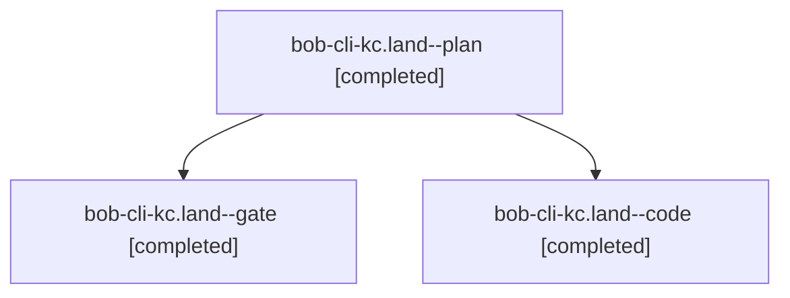

# Session: bob-cli-kc.land

[Agent Hoods](../README.md) / [bbugyi200](../users/bbugyi200/README.md) / [athena](../users/bbugyi200/machines/athena/README.md) / [bob-cli-kc](../users/bbugyi200/machines/athena/hoods/bob-cli-kc/README.md) / bob-cli-kc.land

Owner: `bbugyi200.athena` · Hood: `bob-cli-kc` · Members: 3 · Bead: [bob-cli-kc](https://github.com/bobs-org/bob-cli--beads/blob/main/pages/bob-cli-kc/README.md)

## Lineage



The diagram is an optional enhancement; the ordered table below contains the same lineage in accessible text.

| Role | Agent | State | Model / provider | Timing | Commits | Prompt | Chat |
|---|---|---|---|---|---:|---|---|
| <a id="member-plan"></a>plan | bob-cli-kc.land--plan | completed | gpt-6-astra / codex | 2026-11-11T22:00:29.067116+00:00 → 2026-11-11T23:13:53.957117+00:00 | 0 | [Prompt](../agents/bbugyi200.athena.bob-cli-kc.land--plan/prompt.md) | [Chat](../agents/bbugyi200.athena.bob-cli-kc.land--plan/chat.md) |
| <a id="member-gate"></a>gate | bob-cli-kc.land--gate | completed | gpt-6-astra / codex | 2026-11-11T22:20:19.867586+00:00 → 2026-11-11T22:21:49.890974+00:00 | 0 | — | [Chat](../agents/bbugyi200.athena.bob-cli-kc.land--gate/chat.md) |
| <a id="member-code"></a>code | bob-cli-kc.land--code | completed | grok-4.6 / grok | 2026-11-11T22:22:04.859399+00:00 → 2026-11-11T23:13:53.957117+00:00 | 0 | — | [Chat](../agents/bbugyi200.athena.bob-cli-kc.land--code/chat.md) |

## Variables

| Role | Variable | Value |
|---|---|---|
| code | `artifacts` | \[{bead: bob-cli-kc, kind: file, label: Copy card landing repairs real-Obsidian e2e report (Linux Ctrl+Y), path: /home/bryan/.sase/artifacts/agents/gh\_bobs-org\_\_bob-cli/20261111172154/report-0352e198f… |

#### artifacts

**Role:** `code`

```yaml
- bead: bob-cli-kc
  kind: file
  label: Copy card landing repairs real-Obsidian e2e report (Linux Ctrl+Y)
  path: /home/bryan/.sase/artifacts/agents/gh_bobs-org__bob-cli/20261111172154/report-0352e198f098.json
  ref: file:explicit:df5f52dc2e75c4caa6d1c879
  source_path: /tmp/bob-copy-card-e2e-repairs-1794437426/report.json
- bead: bob-cli-kc
  kind: file
  label: Copy card landing repairs e2e screenshots (14 light/dark PNGs)
  path: /home/bryan/.sase/artifacts/agents/gh_bobs-org__bob-cli/20261111172154/bob-copy-card-e2e-repairs.tar-edad512e7bf7.gz
  ref: file:explicit:c5fe138f6bdc28c20de1a40f
  source_path: /tmp/bob-copy-card-e2e-repairs.tar.gz
- bead: bob-cli-kc
  kind: image
  label: Copy card overflow refusal (light)
  path: /home/bryan/.sase/artifacts/agents/gh_bobs-org__bob-cli/20261111172154/copy-card-visible-refusal-light-715ef3b07c95.png
  ref: file:explicit:f83da980d7f71f1ddc4d33d1
  source_path: /tmp/bob-copy-card-e2e-repairs-1794437426/copy-card-visible-refusal-light.png
- bead: bob-cli-kc
  kind: image
  label: Copy card long list (light)
  path: /home/bryan/.sase/artifacts/agents/gh_bobs-org__bob-cli/20261111172154/copy-card-long-list-light-c9ac12cfb451.png
  ref: file:explicit:80d719192c713e8d4e9929ea
  source_path: /tmp/bob-copy-card-e2e-repairs-1794437426/copy-card-long-list-light.png
- bead: bob-cli-kc
  kind: image
  label: Copy card identified task (dark)
  path: /home/bryan/.sase/artifacts/agents/gh_bobs-org__bob-cli/20261111172154/copy-card-identified-task-dark-022318e803d0.png
  ref: file:explicit:62d26843ee7fe02042cd45fc
  source_path: /tmp/bob-copy-card-e2e-repairs-1794437426/copy-card-identified-task-dark.png
```

Values are truncated for display; see each member's agent meta.json for the full values.

## Neighbors

| Agent | Relation | State |
|---|---|---|
| [bob-cli-kc.1](../agents/bbugyi200.athena.bob-cli-kc.1/README.md) | bob-cli-kc hood | completed |
| [bob-cli-kc.2](../agents/bbugyi200.athena.bob-cli-kc.2/README.md) | bob-cli-kc hood | completed |
| [bob-cli-kc.3](bbugyi200.athena.bob-cli-kc.3.md) (session · 17) | bob-cli-kc hood | completed 14, failed 3 |
| [bob-cli-kc.4](../agents/bbugyi200.athena.bob-cli-kc.4/README.md) | bob-cli-kc hood | completed |
