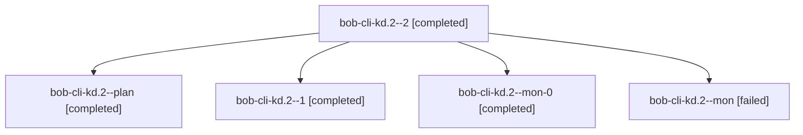

# Session: bob-cli-kd.2

[Agent Hoods](../README.md) / [bbugyi200](../users/bbugyi200/README.md) / [athena](../users/bbugyi200/machines/athena/README.md) / [bob-cli-kd](../users/bbugyi200/machines/athena/hoods/bob-cli-kd/README.md) / bob-cli-kd.2

Owner: `bbugyi200.athena` · Hood: `bob-cli-kd` · Members: 5 · Bead: [bob-cli-kd.2](https://github.com/bobs-org/bob-cli--beads/blob/main/pages/bob-cli-kd/bob-cli-kd.2.md)

## Lineage

The diagram is an optional enhancement; the ordered table below contains the same lineage in accessible text.

| Role | Agent | State | Model / provider | Timing | Commits | Prompt | Chat |
|---|---|---|---|---|---:|---|---|
| 2 | bob-cli-kd.2--2 | completed | grok-4.6 / grok | 2026-11-11T17:44:41.220248+00:00 → 2026-11-11T17:59:11.940903+00:00 | [1](../agents/bbugyi200.athena.bob-cli-kd.2--2/README.md#commits) | [Prompt](../agents/bbugyi200.athena.bob-cli-kd.2--2/prompt.md) | [Chat](../agents/bbugyi200.athena.bob-cli-kd.2--2/chat.md) |
| plan | bob-cli-kd.2--plan | completed | grok-4.6 / grok | 2026-11-11T16:27:41.558014+00:00 → 2026-11-11T17:17:42.413226+00:00 | 0 | [Prompt](../agents/bbugyi200.athena.bob-cli-kd.2--plan/prompt.md) | [Chat](../agents/bbugyi200.athena.bob-cli-kd.2--plan/chat.md) |
| 1 | bob-cli-kd.2--1 | completed | grok-4.6 / grok | 2026-11-11T17:23:45.496438+00:00 → 2026-11-11T17:35:52.667939+00:00 | 0 | [Prompt](../agents/bbugyi200.athena.bob-cli-kd.2--1/prompt.md) | [Chat](../agents/bbugyi200.athena.bob-cli-kd.2--1/chat.md) |
| mon-0 | bob-cli-kd.2--mon-0 | completed | grok-4.6 / grok | 2026-11-11T17:34:15.848537+00:00 → 2026-11-11T17:43:03.935662+00:00 | 0 | — | [Chat](../agents/bbugyi200.athena.bob-cli-kd.2--mon-0/chat.md) |
| mon | bob-cli-kd.2--mon | failed | grok-4.6 / grok | 2026-11-11T17:16:35.914105+00:00 → 2026-11-11T17:22:05.366004+00:00 | 0 | — | [Chat](../agents/bbugyi200.athena.bob-cli-kd.2--mon/chat.md) |

## Commits

| Role | Repo | Commit | Subject | Committed |
|---|---|---|---|---|
| 2 | bob-cli | [`07f1c74`](https://github.com/bobs-org/bob-cli/commit/07f1c7442bb24d50658167856fb5816312199423) | feat(bank): add bank grammar, month notes, and read-only bob bank check | 2026-11-11 12:58:45 EST |

## Neighbors

| Agent | Relation | State |
|---|---|---|
| [bob-cli-kd.1](../agents/bbugyi200.athena.bob-cli-kd.1/README.md) | bob-cli-kd hood | completed |
| [bob-cli-kd.3](../agents/bbugyi200.athena.bob-cli-kd.3/README.md) | bob-cli-kd hood | completed |
| [bob-cli-kd.4](bbugyi200.athena.bob-cli-kd.4.md) (session · 3) | bob-cli-kd hood | active 1, completed 2 |
| [bob-cli-kd.4.1.1](../agents/bbugyi200.athena.bob-cli-kd.4.1.1/README.md) | bob-cli-kd hood | completed |
| [bob-cli-kd.4.1.2](../agents/bbugyi200.athena.bob-cli-kd.4.1.2/README.md) | bob-cli-kd hood | completed |
| [bob-cli-kd.4.1.3](../agents/bbugyi200.athena.bob-cli-kd.4.1.3/README.md) | bob-cli-kd hood | waiting |
| [bob-cli-kd.4.1.4](../agents/bbugyi200.athena.bob-cli-kd.4.1.4/README.md) | bob-cli-kd hood | active |
| [bob-cli-kd.4.1.land](../agents/bbugyi200.athena.bob-cli-kd.4.1.land/README.md) | bob-cli-kd hood | waiting |
| [bob-cli-kd.5](../agents/bbugyi200.athena.bob-cli-kd.5/README.md) | bob-cli-kd hood | waiting |
| [bob-cli-kd.6](bbugyi200.athena.bob-cli-kd.6.md) (session · 3) | bob-cli-kd hood | active 1, completed 2 |
| [bob-cli-kd.6.1.1](../agents/bbugyi200.athena.bob-cli-kd.6.1.1/README.md) | bob-cli-kd hood | completed |
| [bob-cli-kd.6.1.2](../agents/bbugyi200.athena.bob-cli-kd.6.1.2/README.md) | bob-cli-kd hood | completed |
| [bob-cli-kd.6.1.3](../agents/bbugyi200.athena.bob-cli-kd.6.1.3/README.md) | bob-cli-kd hood | waiting |
| [bob-cli-kd.6.1.4](../agents/bbugyi200.athena.bob-cli-kd.6.1.4/README.md) | bob-cli-kd hood | waiting |
| [bob-cli-kd.6.1.5](../agents/bbugyi200.athena.bob-cli-kd.6.1.5/README.md) | bob-cli-kd hood | waiting |
| [bob-cli-kd.6.1.land](../agents/bbugyi200.athena.bob-cli-kd.6.1.land/README.md) | bob-cli-kd hood | waiting |
| [bob-cli-kd.7](../agents/bbugyi200.athena.bob-cli-kd.7/README.md) | bob-cli-kd hood | waiting |
| [bob-cli-kd.land](../agents/bbugyi200.athena.bob-cli-kd.land/README.md) | bob-cli-kd hood | waiting |
