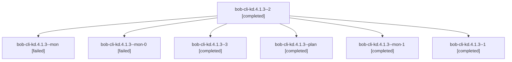

# Session: bob-cli-kd.4.1.3

[Agent Hoods](../README.md) / [bbugyi200](../users/bbugyi200/README.md) / [athena](../users/bbugyi200/machines/athena/README.md) / [bob-cli-kd](../users/bbugyi200/machines/athena/hoods/bob-cli-kd/README.md) / bob-cli-kd.4.1.3

Owner: `bbugyi200.athena` · Hood: `bob-cli-kd` · Members: 7 · Bead: [bob-cli-kd.4.1.3](https://github.com/bobs-org/bob-cli--beads/blob/main/pages/bob-cli-kd/bob-cli-kd.4.1.3.md)

## Lineage

The diagram is an optional enhancement; the ordered table below contains the same lineage in accessible text.

| Role | Agent | State | Model / provider | Timing | Commits | Prompt | Chat |
|---|---|---|---|---|---:|---|---|
| 2 | bob-cli-kd.4.1.3--2 | completed | gpt-6-luna / codex | 2026-11-11T23:23:45.898688+00:00 → 2026-11-11T23:35:34.806670+00:00 | 0 | [Prompt](../agents/bbugyi200.athena.bob-cli-kd.4.1.3--2/prompt.md) | [Chat](../agents/bbugyi200.athena.bob-cli-kd.4.1.3--2/chat.md) |
| mon | bob-cli-kd.4.1.3--mon | failed | gpt-6-luna / codex | 2026-11-11T22:30:58.980513+00:00 → 2026-11-11T22:35:45.160446+00:00 | 0 | — | [Chat](../agents/bbugyi200.athena.bob-cli-kd.4.1.3--mon/chat.md) |
| mon-0 | bob-cli-kd.4.1.3--mon-0 | failed | gpt-6-luna / codex | 2026-11-11T22:58:37.707399+00:00 → 2026-11-11T23:21:05.987034+00:00 | 0 | — | [Chat](../agents/bbugyi200.athena.bob-cli-kd.4.1.3--mon-0/chat.md) |
| 3 | bob-cli-kd.4.1.3--3 | completed | gpt-6-luna / codex | 2026-11-11T23:48:06.372182+00:00 → 2026-11-12T00:22:24.369354+00:00 | [1](../agents/bbugyi200.athena.bob-cli-kd.4.1.3--3/README.md#commits) | [Prompt](../agents/bbugyi200.athena.bob-cli-kd.4.1.3--3/prompt.md) | [Chat](../agents/bbugyi200.athena.bob-cli-kd.4.1.3--3/chat.md) |
| plan | bob-cli-kd.4.1.3--plan | completed | gpt-6-luna / codex | 2026-11-11T21:42:02.458494+00:00 → 2026-11-11T22:31:48.659343+00:00 | 0 | [Prompt](../agents/bbugyi200.athena.bob-cli-kd.4.1.3--plan/prompt.md) | [Chat](../agents/bbugyi200.athena.bob-cli-kd.4.1.3--plan/chat.md) |
| mon-1 | bob-cli-kd.4.1.3--mon-1 | completed | gpt-6-luna / codex | 2026-11-11T23:34:33.337137+00:00 → 2026-11-11T23:45:22.019536+00:00 | 0 | — | [Chat](../agents/bbugyi200.athena.bob-cli-kd.4.1.3--mon-1/chat.md) |
| 1 | bob-cli-kd.4.1.3--1 | completed | gpt-6-luna / codex | 2026-11-11T22:54:48.860990+00:00 → 2026-11-11T23:00:41.610630+00:00 | 0 | [Prompt](../agents/bbugyi200.athena.bob-cli-kd.4.1.3--1/prompt.md) | [Chat](../agents/bbugyi200.athena.bob-cli-kd.4.1.3--1/chat.md) |

## Commits

| Role | Repo | Commit | Subject | Committed |
|---|---|---|---|---|
| 3 | bob-cli | [`d9f0539`](https://github.com/bobs-org/bob-cli/commit/d9f0539f61830be7296f311f086496c1fd491cbb) | feat(bank): add guarded import command and recovery | 2026-11-11 19:20:43 EST |

## Neighbors

| Agent | Relation | State |
|---|---|---|
| [bob-cli-kd.4](bbugyi200.athena.bob-cli-kd.4.md) (session · 3) | ancestor | active 1, completed 2 |
| [bob-cli-kd.4.1.1](../agents/bbugyi200.athena.bob-cli-kd.4.1.1/README.md) | bob-cli-kd.4.1 hood | completed |
| [bob-cli-kd.4.1.2](../agents/bbugyi200.athena.bob-cli-kd.4.1.2/README.md) | bob-cli-kd.4.1 hood | completed |
| [bob-cli-kd.4.1.4](../agents/bbugyi200.athena.bob-cli-kd.4.1.4/README.md) | bob-cli-kd.4.1 hood | completed |
| [bob-cli-kd.4.1.land](bbugyi200.athena.bob-cli-kd.4.1.land.md) (session · 5) | bob-cli-kd.4.1 hood | completed 4, failed 1 |
| [bob-cli-kd.1](../agents/bbugyi200.athena.bob-cli-kd.1/README.md) | bob-cli-kd hood | completed |
| [bob-cli-kd.2](bbugyi200.athena.bob-cli-kd.2.md) (session · 5) | bob-cli-kd hood | completed 4, failed 1 |
| [bob-cli-kd.3](../agents/bbugyi200.athena.bob-cli-kd.3/README.md) | bob-cli-kd hood | completed |
| [bob-cli-kd.5](../agents/bbugyi200.athena.bob-cli-kd.5/README.md) | bob-cli-kd hood | waiting |
| [bob-cli-kd.6](bbugyi200.athena.bob-cli-kd.6.md) (session · 3) | bob-cli-kd hood | active 1, completed 2 |
| [bob-cli-kd.6.1.1](../agents/bbugyi200.athena.bob-cli-kd.6.1.1/README.md) | bob-cli-kd hood | completed |
| [bob-cli-kd.6.1.2](../agents/bbugyi200.athena.bob-cli-kd.6.1.2/README.md) | bob-cli-kd hood | completed |
| [bob-cli-kd.6.1.3](bbugyi200.athena.bob-cli-kd.6.1.3.md) (session · 10) | bob-cli-kd hood | active 1, completed 6, failed 3 |
| [bob-cli-kd.6.1.4](../agents/bbugyi200.athena.bob-cli-kd.6.1.4/README.md) | bob-cli-kd hood | waiting |
| [bob-cli-kd.6.1.5](../agents/bbugyi200.athena.bob-cli-kd.6.1.5/README.md) | bob-cli-kd hood | waiting |
| [bob-cli-kd.6.1.land](../agents/bbugyi200.athena.bob-cli-kd.6.1.land/README.md) | bob-cli-kd hood | waiting |
| [bob-cli-kd.7](../agents/bbugyi200.athena.bob-cli-kd.7/README.md) | bob-cli-kd hood | waiting |
| [bob-cli-kd.land](../agents/bbugyi200.athena.bob-cli-kd.land/README.md) | bob-cli-kd hood | waiting |
