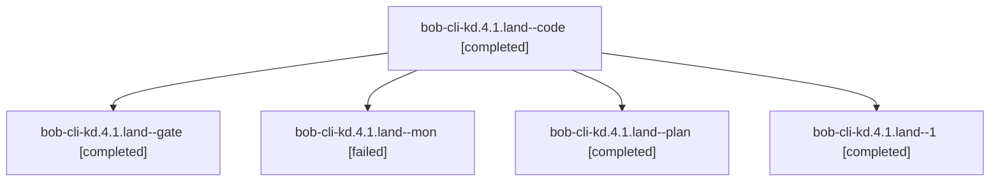

# Session: bob-cli-kd.4.1.land

[Agent Hoods](../README.md) / [bbugyi200](../users/bbugyi200/README.md) / [athena](../users/bbugyi200/machines/athena/README.md) / [bob-cli-kd](../users/bbugyi200/machines/athena/hoods/bob-cli-kd/README.md) / bob-cli-kd.4.1.land

Owner: `bbugyi200.athena` · Hood: `bob-cli-kd` · Members: 5 · Bead: [bob-cli-kd.4.1](https://github.com/bobs-org/bob-cli--beads/blob/main/pages/bob-cli-kd/bob-cli-kd.4.1.md)

## Lineage



The diagram is an optional enhancement; the ordered table below contains the same lineage in accessible text.

| Role | Agent | State | Model / provider | Timing | Commits | Prompt | Chat |
|---|---|---|---|---|---:|---|---|
| <a id="member-code"></a>code | bob-cli-kd.4.1.land--code | completed | gpt-6-luna / codex | 2026-11-12T02:10:22.484211+00:00 → 2026-11-12T02:54:09.900677+00:00 | 0 | — | [Chat](../agents/bbugyi200.athena.bob-cli-kd.4.1.land--code/chat.md) |
| <a id="member-gate"></a>gate | bob-cli-kd.4.1.land--gate | completed | gpt-6-astra / codex | 2026-11-12T02:07:46.706881+00:00 → 2026-11-12T02:09:13.053032+00:00 | 0 | — | [Chat](../agents/bbugyi200.athena.bob-cli-kd.4.1.land--gate/chat.md) |
| <a id="member-mon"></a>mon | bob-cli-kd.4.1.land--mon | failed | gpt-6-luna / codex | 2026-11-12T02:53:05.505430+00:00 → 2026-11-12T03:02:12.709532+00:00 | 0 | — | [Chat](../agents/bbugyi200.athena.bob-cli-kd.4.1.land--mon/chat.md) |
| <a id="member-plan"></a>plan | bob-cli-kd.4.1.land--plan | completed | gpt-6-astra / codex | 2026-11-12T01:32:05.885077+00:00 → 2026-11-12T02:54:09.900677+00:00 | 0 | [Prompt](../agents/bbugyi200.athena.bob-cli-kd.4.1.land--plan/prompt.md) | [Chat](../agents/bbugyi200.athena.bob-cli-kd.4.1.land--plan/chat.md) |
| <a id="member-1"></a>1 | bob-cli-kd.4.1.land--1 | completed | gpt-6-luna / codex | 2026-11-12T03:04:37.471166+00:00 → 2026-11-12T03:09:01.718496+00:00 | [1](../agents/bbugyi200.athena.bob-cli-kd.4.1.land--1/README.md#commits) | [Prompt](../agents/bbugyi200.athena.bob-cli-kd.4.1.land--1/prompt.md) | [Chat](../agents/bbugyi200.athena.bob-cli-kd.4.1.land--1/chat.md) |

## Commits

| Role | Repo | Commit | Subject | Committed |
|---|---|---|---|---|
| 1 | bob-cli | [`ae6a28d`](https://github.com/bobs-org/bob-cli/commit/ae6a28d07c023ab7ee8bd518d0fcff26739e4178) | fix(bank): harden import planning and recovery | 2026-11-11 22:08:28 EST |

## Variables

| Role | Variable | Value |
|---|---|---|
| plan | `artifacts` | \[{bead: bob-cli-kd.4.1, kind: file, label: Synthetic import landing reproduction script, path: /home/bryan/.sase/artifacts/agents/gh\_bobs-org\_\_bob-cli/20261111142625/bank-import-landing-probe-2b106f2… |

#### artifacts

**Role:** `plan`

```yaml
- bead: bob-cli-kd.4.1
  kind: file
  label: Synthetic import landing reproduction script
  path: /home/bryan/.sase/artifacts/agents/gh_bobs-org__bob-cli/20261111142625/bank-import-landing-probe-2b106f25da01.py
  ref: file:explicit:f1a42eafbd40c70d5d0a8f74
  source_path: /tmp/bank-import-landing-probe.py
- bead: bob-cli-kd.4.1
  kind: file
  label: Synthetic import landing probe results
  path: /home/bryan/.sase/artifacts/agents/gh_bobs-org__bob-cli/20261111142625/bank-import-landing-probe-output-557f060cb4a1.txt
  ref: file:explicit:0f0772d7cfd9fab573bd4a19
  source_path: /tmp/bank-import-landing-probe-output.txt
```

Values are truncated for display; see each member's agent meta.json for the full values.

## Neighbors

| Agent | Relation | State |
|---|---|---|
| [bob-cli-kd.4](bbugyi200.athena.bob-cli-kd.4.md) (session · 3) | ancestor | active 1, completed 2 |
| [bob-cli-kd.4.1.1](../agents/bbugyi200.athena.bob-cli-kd.4.1.1/README.md) | bob-cli-kd.4.1 hood | completed |
| [bob-cli-kd.4.1.2](../agents/bbugyi200.athena.bob-cli-kd.4.1.2/README.md) | bob-cli-kd.4.1 hood | completed |
| [bob-cli-kd.4.1.3](bbugyi200.athena.bob-cli-kd.4.1.3.md) (session · 7) | bob-cli-kd.4.1 hood | completed 5, failed 2 |
| [bob-cli-kd.4.1.4](../agents/bbugyi200.athena.bob-cli-kd.4.1.4/README.md) | bob-cli-kd.4.1 hood | completed |
| [bob-cli-kd.1](../agents/bbugyi200.athena.bob-cli-kd.1/README.md) | bob-cli-kd hood | completed |
| [bob-cli-kd.2](bbugyi200.athena.bob-cli-kd.2.md) (session · 5) | bob-cli-kd hood | completed 4, failed 1 |
| [bob-cli-kd.3](../agents/bbugyi200.athena.bob-cli-kd.3/README.md) | bob-cli-kd hood | completed |
| [bob-cli-kd.5](../agents/bbugyi200.athena.bob-cli-kd.5/README.md) | bob-cli-kd hood | waiting |
| [bob-cli-kd.6](bbugyi200.athena.bob-cli-kd.6.md) (session · 3) | bob-cli-kd hood | active 1, completed 2 |
| [bob-cli-kd.6.1.1](../agents/bbugyi200.athena.bob-cli-kd.6.1.1/README.md) | bob-cli-kd hood | completed |
| [bob-cli-kd.6.1.2](../agents/bbugyi200.athena.bob-cli-kd.6.1.2/README.md) | bob-cli-kd hood | completed |
| [bob-cli-kd.6.1.3](bbugyi200.athena.bob-cli-kd.6.1.3.md) (session · 10) | bob-cli-kd hood | active 1, completed 6, failed 3 |
| [bob-cli-kd.6.1.4](../agents/bbugyi200.athena.bob-cli-kd.6.1.4/README.md) | bob-cli-kd hood | waiting |
| [bob-cli-kd.6.1.5](../agents/bbugyi200.athena.bob-cli-kd.6.1.5/README.md) | bob-cli-kd hood | waiting |
| [bob-cli-kd.6.1.land](../agents/bbugyi200.athena.bob-cli-kd.6.1.land/README.md) | bob-cli-kd hood | waiting |
| [bob-cli-kd.7](../agents/bbugyi200.athena.bob-cli-kd.7/README.md) | bob-cli-kd hood | waiting |
| [bob-cli-kd.land](../agents/bbugyi200.athena.bob-cli-kd.land/README.md) | bob-cli-kd hood | waiting |
