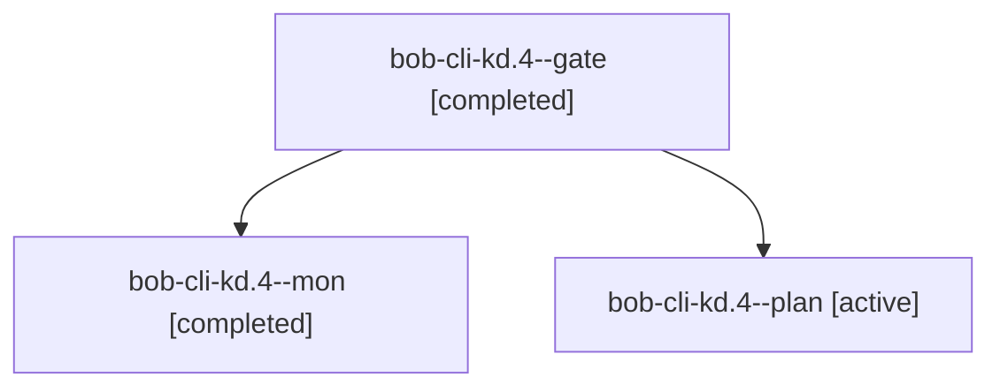

# Session: bob-cli-kd.4

[Agent Hoods](../README.md) / [bbugyi200](../users/bbugyi200/README.md) / [athena](../users/bbugyi200/machines/athena/README.md) / [bob-cli-kd](../users/bbugyi200/machines/athena/hoods/bob-cli-kd/README.md) / bob-cli-kd.4

Owner: `bbugyi200.athena` · Hood: `bob-cli-kd` · Members: 3 · Bead: [bob-cli-kd.4](https://github.com/bobs-org/bob-cli--beads/blob/main/pages/bob-cli-kd/bob-cli-kd.4.md)

## Lineage

The diagram is an optional enhancement; the ordered table below contains the same lineage in accessible text.

| Role | Agent | State | Model / provider | Timing | Commits | Prompt | Chat |
|---|---|---|---|---|---:|---|---|
| gate | bob-cli-kd.4--gate | completed | gpt-6-astra / codex | 2026-11-11T19:21:52.572646+00:00 → 2026-11-11T19:24:00.945530+00:00 | 0 | — | [Chat](../agents/bbugyi200.athena.bob-cli-kd.4--gate/chat.md) |
| mon | bob-cli-kd.4--mon | completed | gpt-6-astra / codex | 2026-11-11T19:23:59.271309+00:00 → 2026-11-11T19:27:37.711794+00:00 | 0 | — | [Chat](../agents/bbugyi200.athena.bob-cli-kd.4--mon/chat.md) |
| plan | bob-cli-kd.4--plan | active | gpt-6-astra / codex | 2026-11-11T19:10:48.141090+00:00 → 2026-11-11T19:24:11.803327+00:00 | 0 | [Prompt](../agents/bbugyi200.athena.bob-cli-kd.4--plan/prompt.md) | [Chat](../agents/bbugyi200.athena.bob-cli-kd.4--plan/chat.md) |

## Neighbors

| Agent | Relation | State |
|---|---|---|
| [bob-cli-kd.4.1.1](../agents/bbugyi200.athena.bob-cli-kd.4.1.1/README.md) | descendant | completed |
| [bob-cli-kd.4.1.2](../agents/bbugyi200.athena.bob-cli-kd.4.1.2/README.md) | descendant | completed |
| [bob-cli-kd.4.1.3](bbugyi200.athena.bob-cli-kd.4.1.3.md) (session · 7) | descendant | completed 5, failed 2 |
| [bob-cli-kd.4.1.4](../agents/bbugyi200.athena.bob-cli-kd.4.1.4/README.md) | descendant | completed |
| [bob-cli-kd.4.1.land](../agents/bbugyi200.athena.bob-cli-kd.4.1.land/README.md) | descendant | waiting |
| [bob-cli-kd.1](../agents/bbugyi200.athena.bob-cli-kd.1/README.md) | bob-cli-kd hood | completed |
| [bob-cli-kd.2](bbugyi200.athena.bob-cli-kd.2.md) (session · 5) | bob-cli-kd hood | completed 4, failed 1 |
| [bob-cli-kd.3](../agents/bbugyi200.athena.bob-cli-kd.3/README.md) | bob-cli-kd hood | completed |
| [bob-cli-kd.5](../agents/bbugyi200.athena.bob-cli-kd.5/README.md) | bob-cli-kd hood | waiting |
| [bob-cli-kd.6](bbugyi200.athena.bob-cli-kd.6.md) (session · 3) | bob-cli-kd hood | active 1, completed 2 |
| [bob-cli-kd.6.1.1](../agents/bbugyi200.athena.bob-cli-kd.6.1.1/README.md) | bob-cli-kd hood | completed |
| [bob-cli-kd.6.1.2](../agents/bbugyi200.athena.bob-cli-kd.6.1.2/README.md) | bob-cli-kd hood | completed |
| [bob-cli-kd.6.1.3](bbugyi200.athena.bob-cli-kd.6.1.3.md) (session · 8) | bob-cli-kd hood | active 1, completed 5, failed 2 |
| [bob-cli-kd.6.1.4](../agents/bbugyi200.athena.bob-cli-kd.6.1.4/README.md) | bob-cli-kd hood | waiting |
| [bob-cli-kd.6.1.5](../agents/bbugyi200.athena.bob-cli-kd.6.1.5/README.md) | bob-cli-kd hood | waiting |
| [bob-cli-kd.6.1.land](../agents/bbugyi200.athena.bob-cli-kd.6.1.land/README.md) | bob-cli-kd hood | waiting |
| [bob-cli-kd.7](../agents/bbugyi200.athena.bob-cli-kd.7/README.md) | bob-cli-kd hood | waiting |
| [bob-cli-kd.land](../agents/bbugyi200.athena.bob-cli-kd.land/README.md) | bob-cli-kd hood | waiting |
