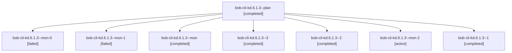

# Session: bob-cli-kd.6.1.3

[Agent Hoods](../README.md) / [bbugyi200](../users/bbugyi200/README.md) / [athena](../users/bbugyi200/machines/athena/README.md) / [bob-cli-kd](../users/bbugyi200/machines/athena/hoods/bob-cli-kd/README.md) / bob-cli-kd.6.1.3

Owner: `bbugyi200.athena` · Hood: `bob-cli-kd` · Members: 8 · Bead: [bob-cli-kd.6.1.3](https://github.com/bobs-org/bob-cli--beads/blob/main/pages/bob-cli-kd/bob-cli-kd.6.1.3.md)

## Lineage



The diagram is an optional enhancement; the ordered table below contains the same lineage in accessible text.

| Role | Agent | State | Model / provider | Timing | Commits | Prompt | Chat |
|---|---|---|---|---|---:|---|---|
| <a id="member-plan"></a>plan | bob-cli-kd.6.1.3--plan | completed | gpt-6-luna / codex | 2026-11-11T20:54:09.573030+00:00 → 2026-11-11T21:55:09.251326+00:00 | 0 | [Prompt](../agents/bbugyi200.athena.bob-cli-kd.6.1.3--plan/prompt.md) | [Chat](../agents/bbugyi200.athena.bob-cli-kd.6.1.3--plan/chat.md) |
| <a id="member-mon-0"></a>mon-0 | bob-cli-kd.6.1.3--mon-0 | failed | gpt-6-luna / codex | 2026-11-11T22:57:18.201032+00:00 → 2026-11-11T23:09:15.634780+00:00 | 0 | — | [Chat](../agents/bbugyi200.athena.bob-cli-kd.6.1.3--mon-0/chat.md) |
| <a id="member-mon-1"></a>mon-1 | bob-cli-kd.6.1.3--mon-1 | failed | gpt-6-luna / codex | 2026-11-11T23:19:46.784227+00:00 → 2026-11-12T00:21:46.202807+00:00 | 0 | — | [Chat](../agents/bbugyi200.athena.bob-cli-kd.6.1.3--mon-1/chat.md) |
| <a id="member-mon"></a>mon | bob-cli-kd.6.1.3--mon | completed | gpt-6-luna / codex | 2026-11-11T21:53:56.539609+00:00 → 2026-11-11T22:32:22.597116+00:00 | 0 | — | [Chat](../agents/bbugyi200.athena.bob-cli-kd.6.1.3--mon/chat.md) |
| <a id="member-3"></a>3 | bob-cli-kd.6.1.3--3 | completed | gpt-6-luna / codex | 2026-11-12T00:24:17.022613+00:00 → 2026-11-12T00:33:31.997829+00:00 | 0 | [Prompt](../agents/bbugyi200.athena.bob-cli-kd.6.1.3--3/prompt.md) | [Chat](../agents/bbugyi200.athena.bob-cli-kd.6.1.3--3/chat.md) |
| <a id="member-2"></a>2 | bob-cli-kd.6.1.3--2 | completed | gpt-6-luna / codex | 2026-11-11T23:11:42.895934+00:00 → 2026-11-11T23:20:24.663480+00:00 | 0 | [Prompt](../agents/bbugyi200.athena.bob-cli-kd.6.1.3--2/prompt.md) | [Chat](../agents/bbugyi200.athena.bob-cli-kd.6.1.3--2/chat.md) |
| <a id="member-mon-2"></a>mon-2 | bob-cli-kd.6.1.3--mon-2 | active | gpt-6-luna / codex | 2026-11-12T00:29:21.329372+00:00 | 0 | — | — |
| <a id="member-1"></a>1 | bob-cli-kd.6.1.3--1 | completed | gpt-6-luna / codex | 2026-11-11T22:48:12.307746+00:00 → 2026-11-11T22:58:33.615351+00:00 | 0 | [Prompt](../agents/bbugyi200.athena.bob-cli-kd.6.1.3--1/prompt.md) | [Chat](../agents/bbugyi200.athena.bob-cli-kd.6.1.3--1/chat.md) |

## Variables

| Role | Variable | Value |
|---|---|---|
| plan | `artifacts` | \[{bead: bob-cli-kd.6.1.3, kind: markdown, label: Bank UI synthetic capture and verification, path: /home/bryan/.sase/artifacts/agents/gh\_bobs-org\_\_bob-cli/20261111142929/bank-ui-proof-f4b65c82ed23.md… |

#### artifacts

**Role:** `plan`

```yaml
- bead: bob-cli-kd.6.1.3
  kind: markdown
  label: Bank UI synthetic capture and verification
  path: /home/bryan/.sase/artifacts/agents/gh_bobs-org__bob-cli/20261111142929/bank-ui-proof-f4b65c82ed23.md
  ref: file:explicit:406f620cf619e73fcdb56669
```

Values are truncated for display; see each member's agent meta.json for the full values.

## Neighbors

| Agent | Relation | State |
|---|---|---|
| [bob-cli-kd.6](bbugyi200.athena.bob-cli-kd.6.md) (session · 3) | ancestor | active 1, completed 2 |
| [bob-cli-kd.6.1.1](../agents/bbugyi200.athena.bob-cli-kd.6.1.1/README.md) | bob-cli-kd.6.1 hood | completed |
| [bob-cli-kd.6.1.2](../agents/bbugyi200.athena.bob-cli-kd.6.1.2/README.md) | bob-cli-kd.6.1 hood | completed |
| [bob-cli-kd.6.1.4](../agents/bbugyi200.athena.bob-cli-kd.6.1.4/README.md) | bob-cli-kd.6.1 hood | waiting |
| [bob-cli-kd.6.1.5](../agents/bbugyi200.athena.bob-cli-kd.6.1.5/README.md) | bob-cli-kd.6.1 hood | waiting |
| [bob-cli-kd.6.1.land](../agents/bbugyi200.athena.bob-cli-kd.6.1.land/README.md) | bob-cli-kd.6.1 hood | waiting |
| [bob-cli-kd.1](../agents/bbugyi200.athena.bob-cli-kd.1/README.md) | bob-cli-kd hood | completed |
| [bob-cli-kd.2](bbugyi200.athena.bob-cli-kd.2.md) (session · 5) | bob-cli-kd hood | completed 4, failed 1 |
| [bob-cli-kd.3](../agents/bbugyi200.athena.bob-cli-kd.3/README.md) | bob-cli-kd hood | completed |
| [bob-cli-kd.4](bbugyi200.athena.bob-cli-kd.4.md) (session · 3) | bob-cli-kd hood | active 1, completed 2 |
| [bob-cli-kd.4.1.1](../agents/bbugyi200.athena.bob-cli-kd.4.1.1/README.md) | bob-cli-kd hood | completed |
| [bob-cli-kd.4.1.2](../agents/bbugyi200.athena.bob-cli-kd.4.1.2/README.md) | bob-cli-kd hood | completed |
| [bob-cli-kd.4.1.3](bbugyi200.athena.bob-cli-kd.4.1.3.md) (session · 7) | bob-cli-kd hood | completed 5, failed 2 |
| [bob-cli-kd.4.1.4](../agents/bbugyi200.athena.bob-cli-kd.4.1.4/README.md) | bob-cli-kd hood | completed |
| [bob-cli-kd.4.1.land](../agents/bbugyi200.athena.bob-cli-kd.4.1.land/README.md) | bob-cli-kd hood | waiting |
| [bob-cli-kd.5](../agents/bbugyi200.athena.bob-cli-kd.5/README.md) | bob-cli-kd hood | waiting |
| [bob-cli-kd.7](../agents/bbugyi200.athena.bob-cli-kd.7/README.md) | bob-cli-kd hood | waiting |
| [bob-cli-kd.land](../agents/bbugyi200.athena.bob-cli-kd.land/README.md) | bob-cli-kd hood | waiting |
