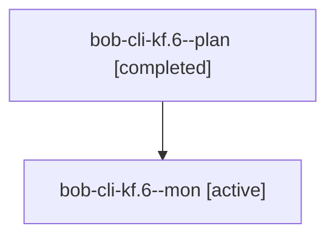

# Session: bob-cli-kf.6

[Agent Hoods](../README.md) / [bbugyi200](../users/bbugyi200/README.md) / [athena](../users/bbugyi200/machines/athena/README.md) / [bob-cli-kf](../users/bbugyi200/machines/athena/hoods/bob-cli-kf/README.md) / bob-cli-kf.6

Owner: `bbugyi200.athena` · Hood: `bob-cli-kf` · Members: 2 · Bead: [bob-cli-kf.6](https://github.com/bobs-org/bob-cli--beads/blob/main/pages/bob-cli-kf/bob-cli-kf.6.md)

## Lineage

The diagram is an optional enhancement; the ordered table below contains the same lineage in accessible text.

| Role | Agent | State | Model / provider | Timing | Commits | Prompt | Chat |
|---|---|---|---|---|---:|---|---|
| plan | bob-cli-kf.6--plan | completed | grok-4.6 / grok | 2026-11-11T18:54:14.341757+00:00 → 2026-11-11T19:09:18.800974+00:00 | 0 | [Prompt](../agents/bbugyi200.athena.bob-cli-kf.6--plan/prompt.md) | [Chat](../agents/bbugyi200.athena.bob-cli-kf.6--plan/chat.md) |
| mon | bob-cli-kf.6--mon | active | grok-4.6 / grok | 2026-11-11T19:08:23.409690+00:00 | 0 | — | — |

## Neighbors

| Agent | Relation | State |
|---|---|---|
| [bob-cli-kf.1](../agents/bbugyi200.athena.bob-cli-kf.1/README.md) | bob-cli-kf hood | completed |
| [bob-cli-kf.2](../agents/bbugyi200.athena.bob-cli-kf.2/README.md) | bob-cli-kf hood | completed |
| [bob-cli-kf.3](../agents/bbugyi200.athena.bob-cli-kf.3/README.md) | bob-cli-kf hood | completed |
| [bob-cli-kf.4](../agents/bbugyi200.athena.bob-cli-kf.4/README.md) | bob-cli-kf hood | completed |
| [bob-cli-kf.5](../agents/bbugyi200.athena.bob-cli-kf.5/README.md) | bob-cli-kf hood | completed |
| [bob-cli-kf.land](../agents/bbugyi200.athena.bob-cli-kf.land/README.md) | bob-cli-kf hood | waiting |
