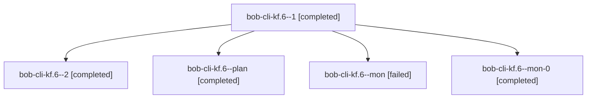

# Session: bob-cli-kf.6

[Agent Hoods](../README.md) / [bbugyi200](../users/bbugyi200/README.md) / [athena](../users/bbugyi200/machines/athena/README.md) / [bob-cli-kf](../users/bbugyi200/machines/athena/hoods/bob-cli-kf/README.md) / bob-cli-kf.6

Owner: `bbugyi200.athena` · Hood: `bob-cli-kf` · Members: 5 · Bead: [bob-cli-kf.6](https://github.com/bobs-org/bob-cli--beads/blob/main/pages/bob-cli-kf/bob-cli-kf.6.md)

## Lineage

The diagram is an optional enhancement; the ordered table below contains the same lineage in accessible text.

| Role | Agent | State | Model / provider | Timing | Commits | Prompt | Chat |
|---|---|---|---|---|---:|---|---|
| 1 | bob-cli-kf.6--1 | completed | grok-4.6 / grok | 2026-11-11T19:23:05.387117+00:00 → 2026-11-11T19:40:49.347811+00:00 | 0 | [Prompt](../agents/bbugyi200.athena.bob-cli-kf.6--1/prompt.md) | [Chat](../agents/bbugyi200.athena.bob-cli-kf.6--1/chat.md) |
| 2 | bob-cli-kf.6--2 | completed | grok-4.6 / grok | 2026-11-11T19:47:30.048759+00:00 → 2026-11-11T20:11:47.534777+00:00 | [1](../agents/bbugyi200.athena.bob-cli-kf.6--2/README.md#commits) | [Prompt](../agents/bbugyi200.athena.bob-cli-kf.6--2/prompt.md) | [Chat](../agents/bbugyi200.athena.bob-cli-kf.6--2/chat.md) |
| plan | bob-cli-kf.6--plan | completed | grok-4.6 / grok | 2026-11-11T18:54:14.341757+00:00 → 2026-11-11T19:09:18.800974+00:00 | 0 | [Prompt](../agents/bbugyi200.athena.bob-cli-kf.6--plan/prompt.md) | [Chat](../agents/bbugyi200.athena.bob-cli-kf.6--plan/chat.md) |
| mon | bob-cli-kf.6--mon | failed | grok-4.6 / grok | 2026-11-11T19:08:23.409690+00:00 → 2026-11-11T19:22:28.720941+00:00 | 0 | — | [Chat](../agents/bbugyi200.athena.bob-cli-kf.6--mon/chat.md) |
| mon-0 | bob-cli-kf.6--mon-0 | completed | grok-4.6 / grok | 2026-11-11T19:39:40.280479+00:00 → 2026-11-11T19:45:13.617808+00:00 | 0 | — | [Chat](../agents/bbugyi200.athena.bob-cli-kf.6--mon-0/chat.md) |

## Commits

| Role | Repo | Commit | Subject | Committed |
|---|---|---|---|---|
| 2 | bob-cli | [`4771047`](https://github.com/bobs-org/bob-cli/commit/4771047e8bcc12a59b9c1dd723d078b5ffbdab84) | fix(scripts): persist notify, harden tracker apply, restore git globs | 2026-11-11 15:10:57 EST |

## Neighbors

| Agent | Relation | State |
|---|---|---|
| [bob-cli-kf.1](../agents/bbugyi200.athena.bob-cli-kf.1/README.md) | bob-cli-kf hood | completed |
| [bob-cli-kf.2](../agents/bbugyi200.athena.bob-cli-kf.2/README.md) | bob-cli-kf hood | completed |
| [bob-cli-kf.3](../agents/bbugyi200.athena.bob-cli-kf.3/README.md) | bob-cli-kf hood | completed |
| [bob-cli-kf.4](../agents/bbugyi200.athena.bob-cli-kf.4/README.md) | bob-cli-kf hood | completed |
| [bob-cli-kf.5](../agents/bbugyi200.athena.bob-cli-kf.5/README.md) | bob-cli-kf hood | completed |
| [bob-cli-kf.land](bbugyi200.athena.bob-cli-kf.land.md) (session · 3) | bob-cli-kf hood | completed 3 |
