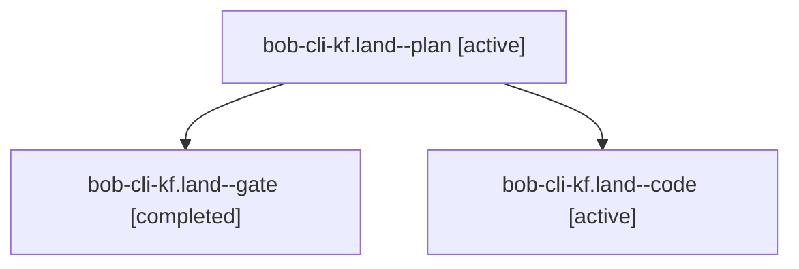

# Session: bob-cli-kf.land

[Agent Hoods](../README.md) / [bbugyi200](../users/bbugyi200/README.md) / [athena](../users/bbugyi200/machines/athena/README.md) / [bob-cli-kf](../users/bbugyi200/machines/athena/hoods/bob-cli-kf/README.md) / bob-cli-kf.land

Owner: `bbugyi200.athena` · Hood: `bob-cli-kf` · Members: 3 · Bead: [bob-cli-kf](https://github.com/bobs-org/bob-cli--beads/blob/main/pages/bob-cli-kf/README.md)

## Lineage

The diagram is an optional enhancement; the ordered table below contains the same lineage in accessible text.

| Role | Agent | State | Model / provider | Timing | Commits | Prompt | Chat |
|---|---|---|---|---|---:|---|---|
| plan | bob-cli-kf.land--plan | active | opus / claude | 2026-11-11T20:13:38.872387+00:00 | [1](../agents/bbugyi200.athena.bob-cli-kf.land--plan/README.md#commits) | [Prompt](../agents/bbugyi200.athena.bob-cli-kf.land--plan/prompt.md) | [Chat](../agents/bbugyi200.athena.bob-cli-kf.land--plan/chat.md) |
| gate | bob-cli-kf.land--gate | completed | opus / claude | 2026-11-11T20:47:12.492637+00:00 → 2026-11-11T20:48:55.017490+00:00 | 0 | — | [Chat](../agents/bbugyi200.athena.bob-cli-kf.land--gate/chat.md) |
| code | bob-cli-kf.land--code | active | muse-spark-1.3-contributor / muse | 2026-11-11T20:49:27.424344+00:00 | 0 | — | — |

## Commits

| Role | Repo | Commit | Subject | Committed |
|---|---|---|---|---|
| plan | bob-cli | [`6e3d883`](https://github.com/bobs-org/bob-cli/commit/6e3d88370351cc416301817fab6dab01761d5bd2) | fix(git): move vault\_git tests after is\_ignored | 2026-11-11 15:46:34 EST |

## Neighbors

| Agent | Relation | State |
|---|---|---|
| [bob-cli-kf.1](../agents/bbugyi200.athena.bob-cli-kf.1/README.md) | bob-cli-kf hood | completed |
| [bob-cli-kf.2](../agents/bbugyi200.athena.bob-cli-kf.2/README.md) | bob-cli-kf hood | completed |
| [bob-cli-kf.3](../agents/bbugyi200.athena.bob-cli-kf.3/README.md) | bob-cli-kf hood | completed |
| [bob-cli-kf.4](../agents/bbugyi200.athena.bob-cli-kf.4/README.md) | bob-cli-kf hood | completed |
| [bob-cli-kf.5](../agents/bbugyi200.athena.bob-cli-kf.5/README.md) | bob-cli-kf hood | completed |
| [bob-cli-kf.6](bbugyi200.athena.bob-cli-kf.6.md) (session · 5) | bob-cli-kf hood | completed 4, failed 1 |
