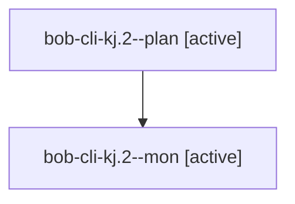

# Session: bob-cli-kj.2

[Agent Hoods](../README.md) / [bbugyi200](../users/bbugyi200/README.md) / [athena](../users/bbugyi200/machines/athena/README.md) / [bob-cli-kj](../users/bbugyi200/machines/athena/hoods/bob-cli-kj/README.md) / bob-cli-kj.2

Owner: `bbugyi200.athena` · Hood: `bob-cli-kj` · Members: 2 · Bead: [bob-cli-kj.2](https://github.com/bobs-org/bob-cli--beads/blob/main/pages/bob-cli-kj/bob-cli-kj.2.md)

## Lineage

The diagram is an optional enhancement; the ordered table below contains the same lineage in accessible text.

| Role | Agent | State | Model / provider | Timing | Commits | Prompt | Chat |
|---|---|---|---|---|---:|---|---|
| plan | bob-cli-kj.2--plan | active | muse-spark-1.3-contributor / muse | 2026-11-11T22:24:37.924668+00:00 | 0 | [Prompt](../agents/bbugyi200.athena.bob-cli-kj.2--plan/prompt.md) | — |
| mon | bob-cli-kj.2--mon | active | muse-spark-1.3-contributor / muse | 2026-11-11T22:58:19.903949+00:00 | 0 | — | — |

## Neighbors

| Agent | Relation | State |
|---|---|---|
| [bob-cli-kj.1](../agents/bbugyi200.athena.bob-cli-kj.1/README.md) | bob-cli-kj hood | completed |
| [bob-cli-kj.3](bbugyi200.athena.bob-cli-kj.3.md) (session · 3) | bob-cli-kj hood | completed 1, failed 1, waiting 1 |
| [bob-cli-kj.4](../agents/bbugyi200.athena.bob-cli-kj.4/README.md) | bob-cli-kj hood | completed |
| [bob-cli-kj.5](bbugyi200.athena.bob-cli-kj.5.md) (session · 5) | bob-cli-kj hood | completed 4, failed 1 |
| [bob-cli-kj.6](bbugyi200.athena.bob-cli-kj.6.md) (session · 3) | bob-cli-kj hood | active 2, completed 1 |
| [bob-cli-kj.land](../agents/bbugyi200.athena.bob-cli-kj.land/README.md) | bob-cli-kj hood | waiting |
