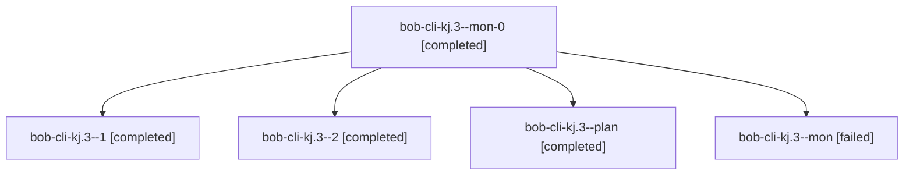

# Session: bob-cli-kj.3

[Agent Hoods](../README.md) / [bbugyi200](../users/bbugyi200/README.md) / [athena](../users/bbugyi200/machines/athena/README.md) / [bob-cli-kj](../users/bbugyi200/machines/athena/hoods/bob-cli-kj/README.md) / bob-cli-kj.3

Owner: `bbugyi200.athena` · Hood: `bob-cli-kj` · Members: 5 · Bead: [bob-cli-kj.3](https://github.com/bobs-org/bob-cli--beads/blob/main/pages/bob-cli-kj/bob-cli-kj.3.md)

## Lineage

The diagram is an optional enhancement; the ordered table below contains the same lineage in accessible text.

| Role | Agent | State | Model / provider | Timing | Commits | Prompt | Chat |
|---|---|---|---|---|---:|---|---|
| mon-0 | bob-cli-kj.3--mon-0 | completed | grok-4.6 / grok | 2026-11-11T23:20:53.427334+00:00 → 2026-11-11T23:32:14.643153+00:00 | 0 | — | [Chat](../agents/bbugyi200.athena.bob-cli-kj.3--mon-0/chat.md) |
| 1 | bob-cli-kj.3--1 | completed | grok-4.6 / grok | 2026-11-11T23:07:57.659800+00:00 → 2026-11-11T23:21:57.076639+00:00 | 0 | [Prompt](../agents/bbugyi200.athena.bob-cli-kj.3--1/prompt.md) | [Chat](../agents/bbugyi200.athena.bob-cli-kj.3--1/chat.md) |
| 2 | bob-cli-kj.3--2 | completed | grok-4.6 / grok | 2026-11-11T23:34:13.921001+00:00 → 2026-11-11T23:42:55.664043+00:00 | [1](../agents/bbugyi200.athena.bob-cli-kj.3--2/README.md#commits) | [Prompt](../agents/bbugyi200.athena.bob-cli-kj.3--2/prompt.md) | [Chat](../agents/bbugyi200.athena.bob-cli-kj.3--2/chat.md) |
| plan | bob-cli-kj.3--plan | completed | grok-4.6 / grok | 2026-11-11T22:26:20.500452+00:00 → 2026-11-11T22:44:34.938757+00:00 | 0 | [Prompt](../agents/bbugyi200.athena.bob-cli-kj.3--plan/prompt.md) | [Chat](../agents/bbugyi200.athena.bob-cli-kj.3--plan/chat.md) |
| mon | bob-cli-kj.3--mon | failed | grok-4.6 / grok | 2026-11-11T22:43:24.590539+00:00 → 2026-11-11T22:54:16.015494+00:00 | 0 | — | [Chat](../agents/bbugyi200.athena.bob-cli-kj.3--mon/chat.md) |

## Commits

| Role | Repo | Commit | Subject | Committed |
|---|---|---|---|---|
| 2 | bob-cli | [`3ba40fc`](https://github.com/bobs-org/bob-cli/commit/3ba40fc5444e0b593f5805d9af6742bfd989b953) | fix(stats): drop HomesEngine resolver borrow before remember | 2026-11-11 18:42:28 EST |

## Neighbors

| Agent | Relation | State |
|---|---|---|
| [bob-cli-kj.1](../agents/bbugyi200.athena.bob-cli-kj.1/README.md) | bob-cli-kj hood | completed |
| [bob-cli-kj.2](bbugyi200.athena.bob-cli-kj.2.md) (session · 3) | bob-cli-kj hood | completed 3 |
| [bob-cli-kj.4](../agents/bbugyi200.athena.bob-cli-kj.4/README.md) | bob-cli-kj hood | completed |
| [bob-cli-kj.5](bbugyi200.athena.bob-cli-kj.5.md) (session · 5) | bob-cli-kj hood | completed 4, failed 1 |
| [bob-cli-kj.6](bbugyi200.athena.bob-cli-kj.6.md) (session · 3) | bob-cli-kj hood | completed 3 |
| [bob-cli-kj.land](bbugyi200.athena.bob-cli-kj.land.md) (session · 3) | bob-cli-kj hood | completed 3 |
