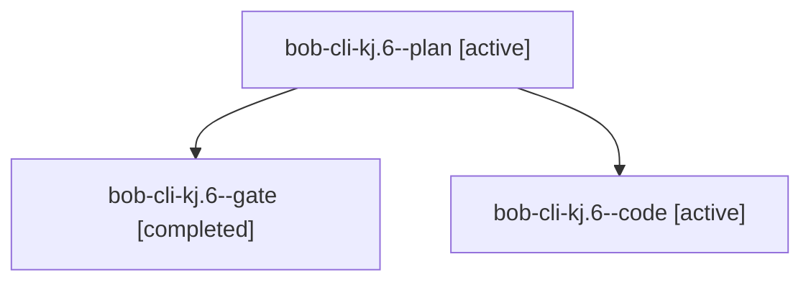

# Session: bob-cli-kj.6

[Agent Hoods](../README.md) / [bbugyi200](../users/bbugyi200/README.md) / [athena](../users/bbugyi200/machines/athena/README.md) / [bob-cli-kj](../users/bbugyi200/machines/athena/hoods/bob-cli-kj/README.md) / bob-cli-kj.6

Owner: `bbugyi200.athena` · Hood: `bob-cli-kj` · Members: 3 · Bead: [bob-cli-kj.6](https://github.com/bobs-org/bob-cli--beads/blob/main/pages/bob-cli-kj/bob-cli-kj.6.md)

## Lineage

The diagram is an optional enhancement; the ordered table below contains the same lineage in accessible text.

| Role | Agent | State | Model / provider | Timing | Commits | Prompt | Chat |
|---|---|---|---|---|---:|---|---|
| plan | bob-cli-kj.6--plan | active | gpt-6-astra / codex | 2026-11-11T22:34:30.366666+00:00 | 0 | [Prompt](../agents/bbugyi200.athena.bob-cli-kj.6--plan/prompt.md) | [Chat](../agents/bbugyi200.athena.bob-cli-kj.6--plan/chat.md) |
| gate | bob-cli-kj.6--gate | completed | gpt-6-astra / codex | 2026-11-11T22:42:26.540638+00:00 → 2026-11-11T22:45:08.768263+00:00 | 0 | — | [Chat](../agents/bbugyi200.athena.bob-cli-kj.6--gate/chat.md) |
| code | bob-cli-kj.6--code | active | grok-4.6 / grok | 2026-11-11T22:45:48.346555+00:00 | 0 | — | — |

## Neighbors

| Agent | Relation | State |
|---|---|---|
| [bob-cli-kj.1](../agents/bbugyi200.athena.bob-cli-kj.1/README.md) | bob-cli-kj hood | completed |
| [bob-cli-kj.2](../agents/bbugyi200.athena.bob-cli-kj.2/README.md) | bob-cli-kj hood | active |
| [bob-cli-kj.3](bbugyi200.athena.bob-cli-kj.3.md) (session · 2) | bob-cli-kj hood | completed 1, failed 1 |
| [bob-cli-kj.4](../agents/bbugyi200.athena.bob-cli-kj.4/README.md) | bob-cli-kj hood | active |
| [bob-cli-kj.5](bbugyi200.athena.bob-cli-kj.5.md) (session · 4) | bob-cli-kj hood | active 1, completed 3 |
| [bob-cli-kj.land](../agents/bbugyi200.athena.bob-cli-kj.land/README.md) | bob-cli-kj hood | waiting |
