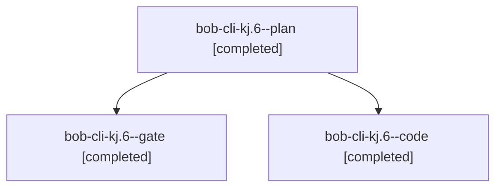

# Session: bob-cli-kj.6

[Agent Hoods](../README.md) / [bbugyi200](../users/bbugyi200/README.md) / [athena](../users/bbugyi200/machines/athena/README.md) / [bob-cli-kj](../users/bbugyi200/machines/athena/hoods/bob-cli-kj/README.md) / bob-cli-kj.6

Owner: `bbugyi200.athena` · Hood: `bob-cli-kj` · Members: 3 · Bead: [bob-cli-kj.6](https://github.com/bobs-org/bob-cli--beads/blob/main/pages/bob-cli-kj/bob-cli-kj.6.md)

## Lineage



The diagram is an optional enhancement; the ordered table below contains the same lineage in accessible text.

| Role | Agent | State | Model / provider | Timing | Commits | Prompt | Chat |
|---|---|---|---|---|---:|---|---|
| <a id="member-plan"></a>plan | bob-cli-kj.6--plan | completed | gpt-6-astra / codex | 2026-11-11T22:34:30.366666+00:00 → 2026-11-11T23:17:10.522136+00:00 | 0 | [Prompt](../agents/bbugyi200.athena.bob-cli-kj.6--plan/prompt.md) | [Chat](../agents/bbugyi200.athena.bob-cli-kj.6--plan/chat.md) |
| <a id="member-gate"></a>gate | bob-cli-kj.6--gate | completed | gpt-6-astra / codex | 2026-11-11T22:42:26.540638+00:00 → 2026-11-11T22:45:08.768263+00:00 | 0 | — | [Chat](../agents/bbugyi200.athena.bob-cli-kj.6--gate/chat.md) |
| <a id="member-code"></a>code | bob-cli-kj.6--code | completed | grok-4.6 / grok | 2026-11-11T22:45:48.346555+00:00 → 2026-11-11T23:17:10.522136+00:00 | 0 | — | [Chat](../agents/bbugyi200.athena.bob-cli-kj.6--code/chat.md) |

## Variables

| Role | Variable | Value |
|---|---|---|
| code | `artifacts` | \[{bead: bob-cli-kj.6, kind: markdown, label: Task-wikilink CPU budget before/after report, path: /home/bryan/.sase/artifacts/agents/gh\_bobs-org\_\_bob-cli/20261111174514/wikilink-cpu-report-cda88efd55a… |

#### artifacts

**Role:** `code`

```yaml
- bead: bob-cli-kj.6
  kind: markdown
  label: Task-wikilink CPU budget before/after report
  path: /home/bryan/.sase/artifacts/agents/gh_bobs-org__bob-cli/20261111174514/wikilink-cpu-report-cda88efd55a1.md
  ref: file:explicit:c96e49fd9445fc49193f339a
  source_path: /tmp/wikilink-cpu-report.md
- bead: bob-cli-kj.6
  kind: file
  label: Task-wikilink CPU budget raw measurements
  path: /home/bryan/.sase/artifacts/agents/gh_bobs-org__bob-cli/20261111174514/wikilink-cpu-measurements.tar-bcf454af24ce.gz
  ref: file:explicit:852c774f2f1b00df676ba605
  source_path: /tmp/wikilink-cpu-measurements.tar.gz
- bead: bob-cli-kj.6
  kind: file
  label: Apollo before diagnostic JSON
  path: /home/bryan/.sase/artifacts/agents/gh_bobs-org__bob-cli/20261111174514/apollo-before-diag-1fc7a335705d.json
  ref: file:explicit:a4eb719bfd4855535901ea2d
  source_path: /tmp/wikilink-cpu-baseline/apollo-before-diag.json
- bead: bob-cli-kj.6
  kind: file
  label: Apollo after diagnostic JSON
  path: /home/bryan/.sase/artifacts/agents/gh_bobs-org__bob-cli/20261111174514/apollo-after-diag-8dbb51977ee1.json
  ref: file:explicit:0fbe7c60257f385fa8ed7df5
  source_path: /tmp/wikilink-cpu-after/apollo-after-diag.json
- bead: bob-cli-kj.6
  kind: file
  label: Athena after diagnostic JSON
  path: /home/bryan/.sase/artifacts/agents/gh_bobs-org__bob-cli/20261111174514/athena-after-diag-fdc75e7fc252.json
  ref: file:explicit:176518f8978d9d148be86a5f
  source_path: /tmp/wikilink-cpu-after/athena-after-diag.json
- bead: bob-cli-kj.6
  kind: file
  label: Athena before diagnostic JSON
  path: /home/bryan/.sase/artifacts/agents/gh_bobs-org__bob-cli/20261111174514/athena-before-diag-f976fadf4eed.json
  ref: file:explicit:8837ecf4a57e2fa55bf54437
  source_path: /tmp/wikilink-cpu-baseline/athena-before-diag.json
```

Values are truncated for display; see each member's agent meta.json for the full values.

## Neighbors

| Agent | Relation | State |
|---|---|---|
| [bob-cli-kj.1](../agents/bbugyi200.athena.bob-cli-kj.1/README.md) | bob-cli-kj hood | completed |
| [bob-cli-kj.2](bbugyi200.athena.bob-cli-kj.2.md) (session · 3) | bob-cli-kj hood | completed 3 |
| [bob-cli-kj.3](bbugyi200.athena.bob-cli-kj.3.md) (session · 5) | bob-cli-kj hood | completed 4, failed 1 |
| [bob-cli-kj.4](../agents/bbugyi200.athena.bob-cli-kj.4/README.md) | bob-cli-kj hood | completed |
| [bob-cli-kj.5](bbugyi200.athena.bob-cli-kj.5.md) (session · 5) | bob-cli-kj hood | completed 4, failed 1 |
| [bob-cli-kj.land](../agents/bbugyi200.athena.bob-cli-kj.land/README.md) | bob-cli-kj hood | waiting |
