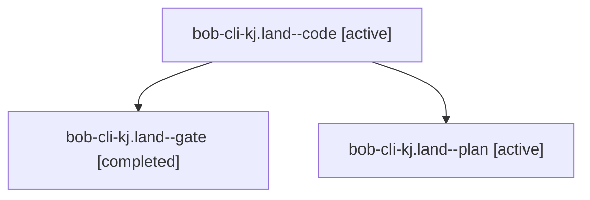

# Session: bob-cli-kj.land

[Agent Hoods](../README.md) / [bbugyi200](../users/bbugyi200/README.md) / [athena](../users/bbugyi200/machines/athena/README.md) / [bob-cli-kj](../users/bbugyi200/machines/athena/hoods/bob-cli-kj/README.md) / bob-cli-kj.land

Owner: `bbugyi200.athena` · Hood: `bob-cli-kj` · Members: 3 · Bead: [bob-cli-kj](https://github.com/bobs-org/bob-cli--beads/blob/main/pages/bob-cli-kj/README.md)

## Lineage



The diagram is an optional enhancement; the ordered table below contains the same lineage in accessible text.

| Role | Agent | State | Model / provider | Timing | Commits | Prompt | Chat |
|---|---|---|---|---|---:|---|---|
| <a id="member-code"></a>code | bob-cli-kj.land--code | active | grok-4.6 / grok | 2026-11-12T00:30:08.102743+00:00 | 0 | — | — |
| <a id="member-gate"></a>gate | bob-cli-kj.land--gate | completed | opus / claude | 2026-11-12T00:28:18.251136+00:00 → 2026-11-12T00:29:37.841866+00:00 | 0 | — | [Chat](../agents/bbugyi200.athena.bob-cli-kj.land--gate/chat.md) |
| <a id="member-plan"></a>plan | bob-cli-kj.land--plan | active | opus / claude | 2026-11-11T23:44:23.331632+00:00 | 0 | [Prompt](../agents/bbugyi200.athena.bob-cli-kj.land--plan/prompt.md) | [Chat](../agents/bbugyi200.athena.bob-cli-kj.land--plan/chat.md) |

## Variables

| Role | Variable | Value |
|---|---|---|
| code | `artifacts` | \[{bead: bob-cli-f8, kind: markdown, label: wikilink full-suite CPU inflation diagnosis, path: /home/bryan/.sase/artifacts/agents/gh\_bobs-org\_\_bob-cli/20261111192942/REPORT-d650a434c177.md, ref: file:… |

#### artifacts

**Role:** `code`

```yaml
- bead: bob-cli-f8
  kind: markdown
  label: wikilink full-suite CPU inflation diagnosis
  path: /home/bryan/.sase/artifacts/agents/gh_bobs-org__bob-cli/20261111192942/REPORT-d650a434c177.md
  ref: file:explicit:3d550e65cc62b734faea3798
  source_path: /tmp/wikilink-perf-diag/REPORT.md
- bead: bob-cli-f8
  kind: file
  label: wikilink full-suite raw clock and TAP measurements
  path: /home/bryan/.sase/artifacts/agents/gh_bobs-org__bob-cli/20261111192942/measurements.tar-ee8442934061.gz
  ref: file:explicit:1e174e03afca3ba6c01d2d2f
  source_path: /tmp/wikilink-perf-diag/measurements.tar.gz
```

Values are truncated for display; see each member's agent meta.json for the full values.

## Neighbors

| Agent | Relation | State |
|---|---|---|
| [bob-cli-kj.1](../agents/bbugyi200.athena.bob-cli-kj.1/README.md) | bob-cli-kj hood | completed |
| [bob-cli-kj.2](bbugyi200.athena.bob-cli-kj.2.md) (session · 3) | bob-cli-kj hood | completed 3 |
| [bob-cli-kj.3](bbugyi200.athena.bob-cli-kj.3.md) (session · 5) | bob-cli-kj hood | completed 4, failed 1 |
| [bob-cli-kj.4](../agents/bbugyi200.athena.bob-cli-kj.4/README.md) | bob-cli-kj hood | completed |
| [bob-cli-kj.5](bbugyi200.athena.bob-cli-kj.5.md) (session · 5) | bob-cli-kj hood | completed 4, failed 1 |
| [bob-cli-kj.6](bbugyi200.athena.bob-cli-kj.6.md) (session · 3) | bob-cli-kj hood | completed 3 |
