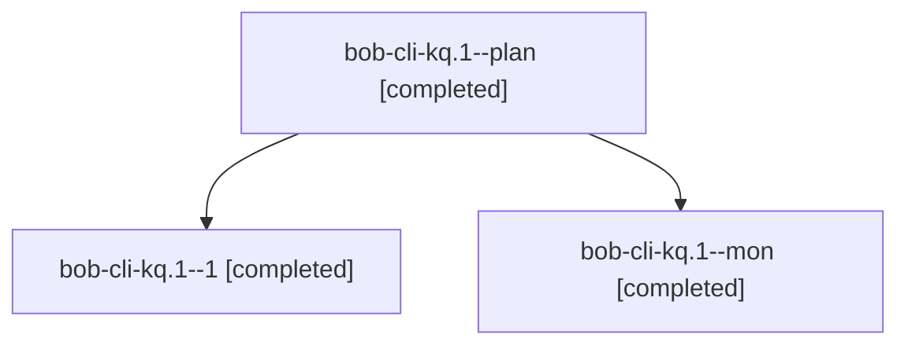

# Session: bob-cli-kq.1

[Agent Hoods](../README.md) / [bbugyi200](../users/bbugyi200/README.md) / [athena](../users/bbugyi200/machines/athena/README.md) / [bob-cli-kq](../users/bbugyi200/machines/athena/hoods/bob-cli-kq/README.md) / bob-cli-kq.1

Owner: `bbugyi200.athena` · Hood: `bob-cli-kq` · Members: 3 · Bead: [bob-cli-kq.1](https://github.com/bobs-org/bob-cli--beads/blob/main/pages/bob-cli-kq/bob-cli-kq.1.md)

## Lineage

The diagram is an optional enhancement; the ordered table below contains the same lineage in accessible text.

| Role | Agent | State | Model / provider | Timing | Commits | Prompt | Chat |
|---|---|---|---|---|---:|---|---|
| plan | bob-cli-kq.1--plan | completed | gpt-6-luna / codex | 2026-11-12T10:29:34.107848+00:00 → 2026-11-12T10:40:30.827140+00:00 | 0 | [Prompt](../agents/bbugyi200.athena.bob-cli-kq.1--plan/prompt.md) | [Chat](../agents/bbugyi200.athena.bob-cli-kq.1--plan/chat.md) |
| 1 | bob-cli-kq.1--1 | completed | gpt-6-luna / codex | 2026-11-12T10:52:49.647863+00:00 → 2026-11-12T11:11:57.354627+00:00 | [1](../agents/bbugyi200.athena.bob-cli-kq.1--1/README.md#commits) | [Prompt](../agents/bbugyi200.athena.bob-cli-kq.1--1/prompt.md) | [Chat](../agents/bbugyi200.athena.bob-cli-kq.1--1/chat.md) |
| mon | bob-cli-kq.1--mon | completed | gpt-6-luna / codex | 2026-11-12T10:39:33.610683+00:00 → 2026-11-12T10:49:02.306581+00:00 | 0 | — | [Chat](../agents/bbugyi200.athena.bob-cli-kq.1--mon/chat.md) |

## Commits

| Role | Repo | Commit | Subject | Committed |
|---|---|---|---|---|
| 1 | bob-cli | [`1920aab`](https://github.com/bobs-org/bob-cli/commit/1920aab661d37310fc58d57790b8a66026054d2c) | fix(git): use literal pathspecs for file mutations | 2026-11-12 06:11:12 EST |

## Neighbors

| Agent | Relation | State |
|---|---|---|
| [bob-cli-kq.2](bbugyi200.athena.bob-cli-kq.2.md) (session · 3) | bob-cli-kq hood | active 1, completed 2 |
| [bob-cli-kq.3](../agents/bbugyi200.athena.bob-cli-kq.3/README.md) | bob-cli-kq hood | completed |
| [bob-cli-kq.4](../agents/bbugyi200.athena.bob-cli-kq.4/README.md) | bob-cli-kq hood | completed |
| [bob-cli-kq.5](bbugyi200.athena.bob-cli-kq.5.md) (session · 3) | bob-cli-kq hood | active 1, completed 1, failed 1 |
