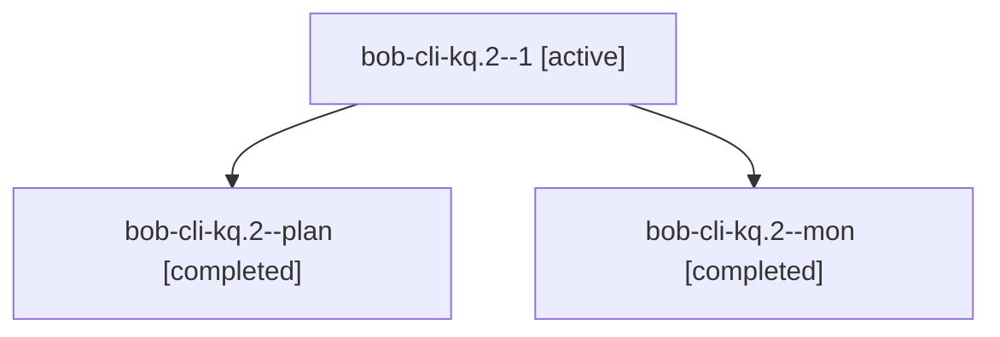

# Session: bob-cli-kq.2

[Agent Hoods](../README.md) / [bbugyi200](../users/bbugyi200/README.md) / [athena](../users/bbugyi200/machines/athena/README.md) / [bob-cli-kq](../users/bbugyi200/machines/athena/hoods/bob-cli-kq/README.md) / bob-cli-kq.2

Owner: `bbugyi200.athena` · Hood: `bob-cli-kq` · Members: 3 · Bead: [bob-cli-kq.2](https://github.com/bobs-org/bob-cli--beads/blob/main/pages/bob-cli-kq/bob-cli-kq.2.md)

## Lineage

The diagram is an optional enhancement; the ordered table below contains the same lineage in accessible text.

| Role | Agent | State | Model / provider | Timing | Commits | Prompt | Chat |
|---|---|---|---|---|---:|---|---|
| 1 | bob-cli-kq.2--1 | active | grok-4.6 / grok | 2026-11-12T11:06:07.156732+00:00 | 0 | [Prompt](../agents/bbugyi200.athena.bob-cli-kq.2--1/prompt.md) | — |
| plan | bob-cli-kq.2--plan | completed | grok-4.6 / grok | 2026-11-12T10:28:55.577235+00:00 → 2026-11-12T10:47:25.786769+00:00 | 0 | [Prompt](../agents/bbugyi200.athena.bob-cli-kq.2--plan/prompt.md) | [Chat](../agents/bbugyi200.athena.bob-cli-kq.2--plan/chat.md) |
| mon | bob-cli-kq.2--mon | completed | grok-4.6 / grok | 2026-11-12T10:45:52.074061+00:00 → 2026-11-12T11:00:33.799197+00:00 | 0 | — | [Chat](../agents/bbugyi200.athena.bob-cli-kq.2--mon/chat.md) |

## Neighbors

| Agent | Relation | State |
|---|---|---|
| [bob-cli-kq.1](bbugyi200.athena.bob-cli-kq.1.md) (session · 3) | bob-cli-kq hood | completed 3 |
| [bob-cli-kq.3](../agents/bbugyi200.athena.bob-cli-kq.3/README.md) | bob-cli-kq hood | completed |
| [bob-cli-kq.4](../agents/bbugyi200.athena.bob-cli-kq.4/README.md) | bob-cli-kq hood | completed |
| [bob-cli-kq.5](bbugyi200.athena.bob-cli-kq.5.md) (session · 3) | bob-cli-kq hood | active 1, completed 1, failed 1 |
