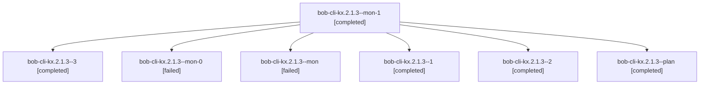

# Session: bob-cli-kx.2.1.3

[Agent Hoods](../README.md) / [bbugyi200](../users/bbugyi200/README.md) / [athena](../users/bbugyi200/machines/athena/README.md) / [bob-cli-kx](../users/bbugyi200/machines/athena/hoods/bob-cli-kx/README.md) / bob-cli-kx.2.1.3

Owner: `bbugyi200.athena` · Hood: `bob-cli-kx` · Members: 7 · Bead: [bob-cli-kx.2.1.3](https://github.com/bobs-org/bob-cli--beads/blob/main/pages/bob-cli-kx/bob-cli-kx.2.1.3.md)

## Lineage

The diagram is an optional enhancement; the ordered table below contains the same lineage in accessible text.

| Role | Agent | State | Model / provider | Timing | Commits | Prompt | Chat |
|---|---|---|---|---|---:|---|---|
| mon-1 | bob-cli-kx.2.1.3--mon-1 | completed | gpt-6-luna / codex | 2026-11-12T20:32:14.177281+00:00 → 2026-11-12T20:43:23.468952+00:00 | 0 | — | [Chat](../agents/bbugyi200.athena.bob-cli-kx.2.1.3--mon-1/chat.md) |
| 3 | bob-cli-kx.2.1.3--3 | completed | gpt-6-luna / codex | 2026-11-12T20:46:01.674489+00:00 → 2026-11-12T20:49:54.577281+00:00 | [1](../agents/bbugyi200.athena.bob-cli-kx.2.1.3--3/README.md#commits) | [Prompt](../agents/bbugyi200.athena.bob-cli-kx.2.1.3--3/prompt.md) | [Chat](../agents/bbugyi200.athena.bob-cli-kx.2.1.3--3/chat.md) |
| mon-0 | bob-cli-kx.2.1.3--mon-0 | failed | gpt-6-luna / codex | 2026-11-12T20:05:04.970165+00:00 → 2026-11-12T20:17:03.216165+00:00 | 0 | — | [Chat](../agents/bbugyi200.athena.bob-cli-kx.2.1.3--mon-0/chat.md) |
| mon | bob-cli-kx.2.1.3--mon | failed | gpt-6-luna / codex | 2026-11-12T19:50:35.444111+00:00 → 2026-11-12T19:57:24.870325+00:00 | 0 | — | [Chat](../agents/bbugyi200.athena.bob-cli-kx.2.1.3--mon/chat.md) |
| 1 | bob-cli-kx.2.1.3--1 | completed | gpt-6-luna / codex | 2026-11-12T20:00:22.675608+00:00 → 2026-11-12T20:06:20.062854+00:00 | 0 | [Prompt](../agents/bbugyi200.athena.bob-cli-kx.2.1.3--1/prompt.md) | [Chat](../agents/bbugyi200.athena.bob-cli-kx.2.1.3--1/chat.md) |
| 2 | bob-cli-kx.2.1.3--2 | completed | gpt-6-luna / codex | 2026-11-12T20:19:25.661539+00:00 → 2026-11-12T20:33:32.841884+00:00 | 0 | [Prompt](../agents/bbugyi200.athena.bob-cli-kx.2.1.3--2/prompt.md) | [Chat](../agents/bbugyi200.athena.bob-cli-kx.2.1.3--2/chat.md) |
| plan | bob-cli-kx.2.1.3--plan | completed | gpt-6-luna / codex | 2026-11-12T19:01:01.137862+00:00 → 2026-11-12T19:52:52.040915+00:00 | 0 | [Prompt](../agents/bbugyi200.athena.bob-cli-kx.2.1.3--plan/prompt.md) | [Chat](../agents/bbugyi200.athena.bob-cli-kx.2.1.3--plan/chat.md) |

## Commits

| Role | Repo | Commit | Subject | Committed |
|---|---|---|---|---|
| 3 | bob-cli | [`4c2cb87`](https://github.com/bobs-org/bob-cli/commit/4c2cb87885f88df245f72243f72a484969fa30dc) | feat(gmail): add archive state journal | 2026-11-12 15:48:06 EST |

## Neighbors

| Agent | Relation | State |
|---|---|---|
| [bob-cli-kx.2](bbugyi200.athena.bob-cli-kx.2.md) (session · 3) | ancestor | active 1, completed 2 |
| [bob-cli-kx.2.1.1](../agents/bbugyi200.athena.bob-cli-kx.2.1.1/README.md) | bob-cli-kx.2.1 hood | completed |
| [bob-cli-kx.2.1.2](../agents/bbugyi200.athena.bob-cli-kx.2.1.2/README.md) | bob-cli-kx.2.1 hood | completed |
| [bob-cli-kx.2.1.4](../agents/bbugyi200.athena.bob-cli-kx.2.1.4/README.md) | bob-cli-kx.2.1 hood | completed |
| [bob-cli-kx.2.1.5](../agents/bbugyi200.athena.bob-cli-kx.2.1.5/README.md) | bob-cli-kx.2.1 hood | completed |
| [bob-cli-kx.2.1.6](../agents/bbugyi200.athena.bob-cli-kx.2.1.6/README.md) | bob-cli-kx.2.1 hood | completed |
| [bob-cli-kx.2.1.7](../agents/bbugyi200.athena.bob-cli-kx.2.1.7/README.md) | bob-cli-kx.2.1 hood | completed |
| [bob-cli-kx.2.1.8.1](bbugyi200.athena.bob-cli-kx.2.1.8.1.md) (session · 9) | bob-cli-kx.2.1 hood | completed 6, failed 3 |
| [bob-cli-kx.2.1.8.2](../agents/bbugyi200.athena.bob-cli-kx.2.1.8.2/README.md) | bob-cli-kx.2.1 hood | completed |
| [bob-cli-kx.2.1.8.3](../agents/bbugyi200.athena.bob-cli-kx.2.1.8.3/README.md) | bob-cli-kx.2.1 hood | completed |
| [bob-cli-kx.2.1.8.4](../agents/bbugyi200.athena.bob-cli-kx.2.1.8.4/README.md) | bob-cli-kx.2.1 hood | completed |
| [bob-cli-kx.2.1.8.land](bbugyi200.athena.bob-cli-kx.2.1.8.land.md) (session · 3) | bob-cli-kx.2.1 hood | completed 3 |
| [bob-cli-kx.2.1.land](bbugyi200.athena.bob-cli-kx.2.1.land.md) (session · 3) | bob-cli-kx.2.1 hood | active 1, completed 2 |
| [bob-cli-kx.1](../agents/bbugyi200.athena.bob-cli-kx.1/README.md) | bob-cli-kx hood | completed |
| [bob-cli-kx.3](bbugyi200.athena.bob-cli-kx.3.md) (session · 3) | bob-cli-kx hood | active 1, completed 2 |
| [bob-cli-kx.3.1.1](../agents/bbugyi200.athena.bob-cli-kx.3.1.1/README.md) | bob-cli-kx hood | completed |
| [bob-cli-kx.3.1.2](../agents/bbugyi200.athena.bob-cli-kx.3.1.2/README.md) | bob-cli-kx hood | waiting |
| [bob-cli-kx.3.1.3](../agents/bbugyi200.athena.bob-cli-kx.3.1.3/README.md) | bob-cli-kx hood | waiting |
| [bob-cli-kx.3.1.4](../agents/bbugyi200.athena.bob-cli-kx.3.1.4/README.md) | bob-cli-kx hood | waiting |
| [bob-cli-kx.3.1.5](../agents/bbugyi200.athena.bob-cli-kx.3.1.5/README.md) | bob-cli-kx hood | waiting |
| [bob-cli-kx.3.1.6](../agents/bbugyi200.athena.bob-cli-kx.3.1.6/README.md) | bob-cli-kx hood | waiting |
| [bob-cli-kx.3.1.land](../agents/bbugyi200.athena.bob-cli-kx.3.1.land/README.md) | bob-cli-kx hood | waiting |
| [bob-cli-kx.4](../agents/bbugyi200.athena.bob-cli-kx.4/README.md) | bob-cli-kx hood | waiting |
| [bob-cli-kx.5](../agents/bbugyi200.athena.bob-cli-kx.5/README.md) | bob-cli-kx hood | waiting |
| [bob-cli-kx.land](../agents/bbugyi200.athena.bob-cli-kx.land/README.md) | bob-cli-kx hood | waiting |
