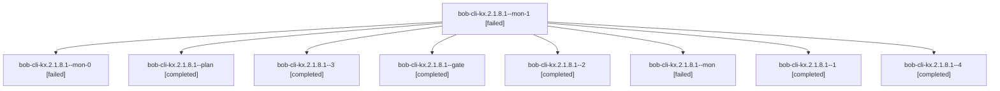

# Session: bob-cli-kx.2.1.8.1

[Agent Hoods](../README.md) / [bbugyi200](../users/bbugyi200/README.md) / [athena](../users/bbugyi200/machines/athena/README.md) / [bob-cli-kx](../users/bbugyi200/machines/athena/hoods/bob-cli-kx/README.md) / bob-cli-kx.2.1.8.1

Owner: `bbugyi200.athena` · Hood: `bob-cli-kx` · Members: 9 · Bead: [bob-cli-kx.2.1.8.1](https://github.com/bobs-org/bob-cli--beads/blob/main/pages/bob-cli-kx/bob-cli-kx.2.1.8.1.md)

## Lineage

The diagram is an optional enhancement; the ordered table below contains the same lineage in accessible text.

| Role | Agent | State | Model / provider | Timing | Commits | Prompt | Chat |
|---|---|---|---|---|---:|---|---|
| mon-1 | bob-cli-kx.2.1.8.1--mon-1 | failed | gpt-6-luna / codex | 2026-11-13T05:39:16.446527+00:00 → 2026-11-13T05:42:00.946303+00:00 | 0 | — | [Chat](../agents/bbugyi200.athena.bob-cli-kx.2.1.8.1--mon-1/chat.md) |
| mon-0 | bob-cli-kx.2.1.8.1--mon-0 | failed | gpt-6-luna / codex | 2026-11-13T05:32:34.000492+00:00 → 2026-11-13T05:35:49.177246+00:00 | 0 | — | [Chat](../agents/bbugyi200.athena.bob-cli-kx.2.1.8.1--mon-0/chat.md) |
| plan | bob-cli-kx.2.1.8.1--plan | completed | gpt-6-luna / codex | 2026-11-13T04:55:26.346074+00:00 → 2026-11-13T05:24:25.570543+00:00 | 0 | [Prompt](../agents/bbugyi200.athena.bob-cli-kx.2.1.8.1--plan/prompt.md) | [Chat](../agents/bbugyi200.athena.bob-cli-kx.2.1.8.1--plan/chat.md) |
| 3 | bob-cli-kx.2.1.8.1--3 | completed | gpt-6-luna / codex | 2026-11-13T05:44:27.206075+00:00 → 2026-11-13T06:06:28.464461+00:00 | 0 | [Prompt](../agents/bbugyi200.athena.bob-cli-kx.2.1.8.1--3/prompt.md) | [Chat](../agents/bbugyi200.athena.bob-cli-kx.2.1.8.1--3/chat.md) |
| gate | bob-cli-kx.2.1.8.1--gate | completed | gpt-6-luna / codex | 2026-11-13T09:17:01.145311+00:00 → 2026-11-13T09:18:08.477969+00:00 | 0 | — | [Chat](../agents/bbugyi200.athena.bob-cli-kx.2.1.8.1--gate/chat.md) |
| 2 | bob-cli-kx.2.1.8.1--2 | completed | gpt-6-luna / codex | 2026-11-13T05:37:52.828153+00:00 → 2026-11-13T05:40:07.538035+00:00 | 0 | [Prompt](../agents/bbugyi200.athena.bob-cli-kx.2.1.8.1--2/prompt.md) | [Chat](../agents/bbugyi200.athena.bob-cli-kx.2.1.8.1--2/chat.md) |
| mon | bob-cli-kx.2.1.8.1--mon | failed | gpt-6-luna / codex | 2026-11-13T05:23:05.711325+00:00 → 2026-11-13T05:28:36.039839+00:00 | 0 | — | [Chat](../agents/bbugyi200.athena.bob-cli-kx.2.1.8.1--mon/chat.md) |
| 1 | bob-cli-kx.2.1.8.1--1 | completed | gpt-6-luna / codex | 2026-11-13T05:31:03.518263+00:00 → 2026-11-13T05:33:41.932864+00:00 | 0 | [Prompt](../agents/bbugyi200.athena.bob-cli-kx.2.1.8.1--1/prompt.md) | [Chat](../agents/bbugyi200.athena.bob-cli-kx.2.1.8.1--1/chat.md) |
| 4 | bob-cli-kx.2.1.8.1--4 | completed | gpt-6-luna / codex | 2026-11-13T09:20:56.670389+00:00 → 2026-11-13T09:24:27.000374+00:00 | [1](../agents/bbugyi200.athena.bob-cli-kx.2.1.8.1--4/README.md#commits) | [Prompt](../agents/bbugyi200.athena.bob-cli-kx.2.1.8.1--4/prompt.md) | [Chat](../agents/bbugyi200.athena.bob-cli-kx.2.1.8.1--4/chat.md) |

## Commits

| Role | Repo | Commit | Subject | Committed |
|---|---|---|---|---|
| 4 | bob-cli | [`dcd908a`](https://github.com/bobs-org/bob-cli/commit/dcd908ab93af5c3150d133a956f1dbdba8de057e) | feat(gmail): add archive apply support | 2026-11-13 04:24:05 EST |

## Neighbors

| Agent | Relation | State |
|---|---|---|
| [bob-cli-kx.2](bbugyi200.athena.bob-cli-kx.2.md) (session · 3) | ancestor | active 1, completed 2 |
| [bob-cli-kx.2.1.8.2](../agents/bbugyi200.athena.bob-cli-kx.2.1.8.2/README.md) | bob-cli-kx.2.1.8 hood | completed |
| [bob-cli-kx.2.1.8.3](../agents/bbugyi200.athena.bob-cli-kx.2.1.8.3/README.md) | bob-cli-kx.2.1.8 hood | completed |
| [bob-cli-kx.2.1.8.4](../agents/bbugyi200.athena.bob-cli-kx.2.1.8.4/README.md) | bob-cli-kx.2.1.8 hood | completed |
| [bob-cli-kx.2.1.8.land](bbugyi200.athena.bob-cli-kx.2.1.8.land.md) (session · 3) | bob-cli-kx.2.1.8 hood | completed 3 |
| [bob-cli-kx.2.1.1](../agents/bbugyi200.athena.bob-cli-kx.2.1.1/README.md) | bob-cli-kx.2.1 hood | completed |
| [bob-cli-kx.2.1.2](../agents/bbugyi200.athena.bob-cli-kx.2.1.2/README.md) | bob-cli-kx.2.1 hood | completed |
| [bob-cli-kx.2.1.3](bbugyi200.athena.bob-cli-kx.2.1.3.md) (session · 7) | bob-cli-kx.2.1 hood | completed 5, failed 2 |
| [bob-cli-kx.2.1.4](../agents/bbugyi200.athena.bob-cli-kx.2.1.4/README.md) | bob-cli-kx.2.1 hood | completed |
| [bob-cli-kx.2.1.5](../agents/bbugyi200.athena.bob-cli-kx.2.1.5/README.md) | bob-cli-kx.2.1 hood | completed |
| [bob-cli-kx.2.1.6](../agents/bbugyi200.athena.bob-cli-kx.2.1.6/README.md) | bob-cli-kx.2.1 hood | completed |
| [bob-cli-kx.2.1.7](../agents/bbugyi200.athena.bob-cli-kx.2.1.7/README.md) | bob-cli-kx.2.1 hood | completed |
| [bob-cli-kx.2.1.land](bbugyi200.athena.bob-cli-kx.2.1.land.md) (session · 3) | bob-cli-kx.2.1 hood | active 1, completed 2 |
| [bob-cli-kx.1](../agents/bbugyi200.athena.bob-cli-kx.1/README.md) | bob-cli-kx hood | completed |
| [bob-cli-kx.3](bbugyi200.athena.bob-cli-kx.3.md) (session · 3) | bob-cli-kx hood | active 1, completed 2 |
| [bob-cli-kx.3.1.1](../agents/bbugyi200.athena.bob-cli-kx.3.1.1/README.md) | bob-cli-kx hood | completed |
| [bob-cli-kx.3.1.2](../agents/bbugyi200.athena.bob-cli-kx.3.1.2/README.md) | bob-cli-kx hood | waiting |
| [bob-cli-kx.3.1.3](../agents/bbugyi200.athena.bob-cli-kx.3.1.3/README.md) | bob-cli-kx hood | waiting |
| [bob-cli-kx.3.1.4](../agents/bbugyi200.athena.bob-cli-kx.3.1.4/README.md) | bob-cli-kx hood | waiting |
| [bob-cli-kx.3.1.5](../agents/bbugyi200.athena.bob-cli-kx.3.1.5/README.md) | bob-cli-kx hood | waiting |
| [bob-cli-kx.3.1.6](../agents/bbugyi200.athena.bob-cli-kx.3.1.6/README.md) | bob-cli-kx hood | waiting |
| [bob-cli-kx.3.1.land](../agents/bbugyi200.athena.bob-cli-kx.3.1.land/README.md) | bob-cli-kx hood | waiting |
| [bob-cli-kx.4](../agents/bbugyi200.athena.bob-cli-kx.4/README.md) | bob-cli-kx hood | waiting |
| [bob-cli-kx.5](../agents/bbugyi200.athena.bob-cli-kx.5/README.md) | bob-cli-kx hood | waiting |
| [bob-cli-kx.land](../agents/bbugyi200.athena.bob-cli-kx.land/README.md) | bob-cli-kx hood | waiting |
