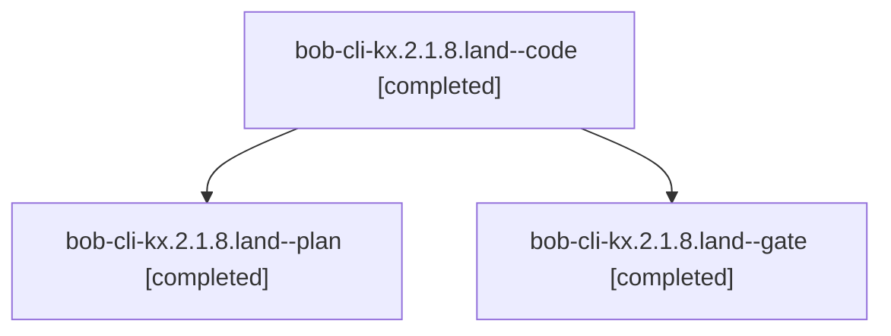

# Session: bob-cli-kx.2.1.8.land

[Agent Hoods](../README.md) / [bbugyi200](../users/bbugyi200/README.md) / [athena](../users/bbugyi200/machines/athena/README.md) / [bob-cli-kx](../users/bbugyi200/machines/athena/hoods/bob-cli-kx/README.md) / bob-cli-kx.2.1.8.land

Owner: `bbugyi200.athena` · Hood: `bob-cli-kx` · Members: 3 · Bead: [bob-cli-kx.2.1.8](https://github.com/bobs-org/bob-cli--beads/blob/main/pages/bob-cli-kx/bob-cli-kx.2.1.8.md)

## Lineage



The diagram is an optional enhancement; the ordered table below contains the same lineage in accessible text.

| Role | Agent | State | Model / provider | Timing | Commits | Prompt | Chat |
|---|---|---|---|---|---:|---|---|
| <a id="member-code"></a>code | bob-cli-kx.2.1.8.land--code | completed | gpt-6-luna / codex | 2026-11-13T12:06:22.530942+00:00 → 2026-11-13T12:57:21.212114+00:00 | [1](../agents/bbugyi200.athena.bob-cli-kx.2.1.8.land--code/README.md#commits) | — | [Chat](../agents/bbugyi200.athena.bob-cli-kx.2.1.8.land--code/chat.md) |
| <a id="member-plan"></a>plan | bob-cli-kx.2.1.8.land--plan | completed | gpt-6-astra / codex | 2026-11-13T11:51:48.510191+00:00 → 2026-11-13T12:57:21.212114+00:00 | 0 | [Prompt](../agents/bbugyi200.athena.bob-cli-kx.2.1.8.land--plan/prompt.md) | [Chat](../agents/bbugyi200.athena.bob-cli-kx.2.1.8.land--plan/chat.md) |
| <a id="member-gate"></a>gate | bob-cli-kx.2.1.8.land--gate | completed | gpt-6-astra / codex | 2026-11-13T12:05:36.468015+00:00 → 2026-11-13T12:05:52.121696+00:00 | 0 | — | [Chat](../agents/bbugyi200.athena.bob-cli-kx.2.1.8.land--gate/chat.md) |

## Commits

| Role | Repo | Commit | Subject | Committed |
|---|---|---|---|---|
| code | bob-cli | [`fada115`](https://github.com/bobs-org/bob-cli/commit/fada115450d2ab8fc55c461c59401014f97ebd35) | fix(gmail)!: fail closed at archive mutation boundaries | 2026-11-13 07:55:31 EST |

## Variables

| Role | Variable | Value |
|---|---|---|
| plan | `artifacts` | \[{bead: bob-cli-kx.2.1.8, kind: file, label: Gmail archive landing property-test failure: generated receipt aliases enrollment, path: /home/bryan/.sase/artifacts/agents/gh\_bobs-org\_\_bob-cli/202611122… |

#### artifacts

**Role:** `plan`

```yaml
- bead: bob-cli-kx.2.1.8
  kind: file
  label: Gmail archive landing property-test failure: generated receipt aliases enrollment
  path: /home/bryan/.sase/artifacts/agents/gh_bobs-org__bob-cli/20261112235334/kx-property-check-618262a897b2.log
  ref: file:explicit:1e7c765d5bd3a77bc9aa19a1
  source_path: /tmp/kx-property-check.log
```

Values are truncated for display; see each member's agent meta.json for the full values.

## Neighbors

| Agent | Relation | State |
|---|---|---|
| [bob-cli-kx.2](bbugyi200.athena.bob-cli-kx.2.md) (session · 3) | ancestor | active 1, completed 2 |
| [bob-cli-kx.2.1.8.1](bbugyi200.athena.bob-cli-kx.2.1.8.1.md) (session · 9) | bob-cli-kx.2.1.8 hood | completed 6, failed 3 |
| [bob-cli-kx.2.1.8.2](../agents/bbugyi200.athena.bob-cli-kx.2.1.8.2/README.md) | bob-cli-kx.2.1.8 hood | completed |
| [bob-cli-kx.2.1.8.3](../agents/bbugyi200.athena.bob-cli-kx.2.1.8.3/README.md) | bob-cli-kx.2.1.8 hood | completed |
| [bob-cli-kx.2.1.8.4](../agents/bbugyi200.athena.bob-cli-kx.2.1.8.4/README.md) | bob-cli-kx.2.1.8 hood | completed |
| [bob-cli-kx.2.1.1](../agents/bbugyi200.athena.bob-cli-kx.2.1.1/README.md) | bob-cli-kx.2.1 hood | completed |
| [bob-cli-kx.2.1.2](../agents/bbugyi200.athena.bob-cli-kx.2.1.2/README.md) | bob-cli-kx.2.1 hood | completed |
| [bob-cli-kx.2.1.3](bbugyi200.athena.bob-cli-kx.2.1.3.md) (session · 7) | bob-cli-kx.2.1 hood | completed 5, failed 2 |
| [bob-cli-kx.2.1.4](../agents/bbugyi200.athena.bob-cli-kx.2.1.4/README.md) | bob-cli-kx.2.1 hood | completed |
| [bob-cli-kx.2.1.5](../agents/bbugyi200.athena.bob-cli-kx.2.1.5/README.md) | bob-cli-kx.2.1 hood | completed |
| [bob-cli-kx.2.1.6](../agents/bbugyi200.athena.bob-cli-kx.2.1.6/README.md) | bob-cli-kx.2.1 hood | completed |
| [bob-cli-kx.2.1.7](../agents/bbugyi200.athena.bob-cli-kx.2.1.7/README.md) | bob-cli-kx.2.1 hood | completed |
| [bob-cli-kx.2.1.land](bbugyi200.athena.bob-cli-kx.2.1.land.md) (session · 3) | bob-cli-kx.2.1 hood | active 1, completed 2 |
| [bob-cli-kx.1](../agents/bbugyi200.athena.bob-cli-kx.1/README.md) | bob-cli-kx hood | completed |
| [bob-cli-kx.3](../agents/bbugyi200.athena.bob-cli-kx.3/README.md) | bob-cli-kx hood | waiting |
| [bob-cli-kx.4](../agents/bbugyi200.athena.bob-cli-kx.4/README.md) | bob-cli-kx hood | waiting |
| [bob-cli-kx.5](../agents/bbugyi200.athena.bob-cli-kx.5/README.md) | bob-cli-kx hood | waiting |
| [bob-cli-kx.land](../agents/bbugyi200.athena.bob-cli-kx.land/README.md) | bob-cli-kx hood | waiting |
