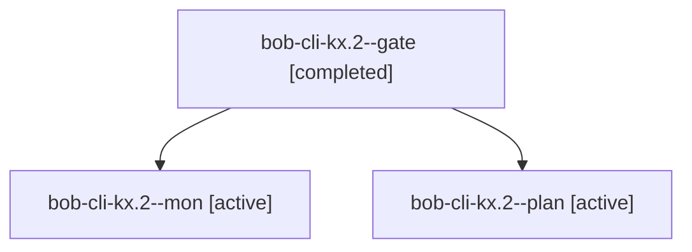

# Session: bob-cli-kx.2

[Agent Hoods](../README.md) / [bbugyi200](../users/bbugyi200/README.md) / [athena](../users/bbugyi200/machines/athena/README.md) / [bob-cli-kx](../users/bbugyi200/machines/athena/hoods/bob-cli-kx/README.md) / bob-cli-kx.2

Owner: `bbugyi200.athena` · Hood: `bob-cli-kx` · Members: 3 · Bead: [bob-cli-kx.2](https://github.com/bobs-org/bob-cli--beads/blob/main/pages/bob-cli-kx/bob-cli-kx.2.md)

## Lineage

The diagram is an optional enhancement; the ordered table below contains the same lineage in accessible text.

| Role | Agent | State | Model / provider | Timing | Commits | Prompt | Chat |
|---|---|---|---|---|---:|---|---|
| gate | bob-cli-kx.2--gate | completed | gpt-6-astra / codex | 2026-11-12T16:36:29.155039+00:00 → 2026-11-12T16:37:37.422216+00:00 | 0 | — | [Chat](../agents/bbugyi200.athena.bob-cli-kx.2--gate/chat.md) |
| mon | bob-cli-kx.2--mon | active | gpt-6-astra / codex | 2026-11-12T16:37:34.147415+00:00 | 0 | — | — |
| plan | bob-cli-kx.2--plan | active | gpt-6-astra / codex | 2026-11-12T16:24:30.088970+00:00 → 2026-11-12T16:37:45.124057+00:00 | 0 | [Prompt](../agents/bbugyi200.athena.bob-cli-kx.2--plan/prompt.md) | [Chat](../agents/bbugyi200.athena.bob-cli-kx.2--plan/chat.md) |

## Neighbors

| Agent | Relation | State |
|---|---|---|
| [bob-cli-kx.1](../agents/bbugyi200.athena.bob-cli-kx.1/README.md) | bob-cli-kx hood | completed |
| [bob-cli-kx.3](../agents/bbugyi200.athena.bob-cli-kx.3/README.md) | bob-cli-kx hood | waiting |
| [bob-cli-kx.4](../agents/bbugyi200.athena.bob-cli-kx.4/README.md) | bob-cli-kx hood | waiting |
| [bob-cli-kx.5](../agents/bbugyi200.athena.bob-cli-kx.5/README.md) | bob-cli-kx hood | waiting |
| [bob-cli-kx.land](../agents/bbugyi200.athena.bob-cli-kx.land/README.md) | bob-cli-kx hood | waiting |
