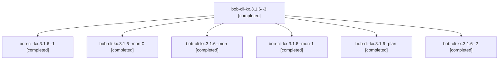

# Session: bob-cli-kx.3.1.6

[Agent Hoods](../README.md) / [bbugyi200](../users/bbugyi200/README.md) / [athena](../users/bbugyi200/machines/athena/README.md) / [bob-cli-kx](../users/bbugyi200/machines/athena/hoods/bob-cli-kx/README.md) / bob-cli-kx.3.1.6

Owner: `bbugyi200.athena` · Hood: `bob-cli-kx` · Members: 7 · Bead: [bob-cli-kx.3.1.6](https://github.com/bobs-org/bob-cli--beads/blob/main/pages/bob-cli-kx/bob-cli-kx.3.1.6.md)

## Lineage

The diagram is an optional enhancement; the ordered table below contains the same lineage in accessible text.

| Role | Agent | State | Model / provider | Timing | Commits | Prompt | Chat |
|---|---|---|---|---|---:|---|---|
| 3 | bob-cli-kx.3.1.6--3 | completed | gpt-6-luna / codex | 2026-11-13T18:46:16.068801+00:00 → 2026-11-13T19:00:12.277284+00:00 | [1](../agents/bbugyi200.athena.bob-cli-kx.3.1.6--3/README.md#commits) | [Prompt](../agents/bbugyi200.athena.bob-cli-kx.3.1.6--3/prompt.md) | [Chat](../agents/bbugyi200.athena.bob-cli-kx.3.1.6--3/chat.md) |
| 1 | bob-cli-kx.3.1.6--1 | completed | gpt-6-luna / codex | 2026-11-13T18:05:37.042744+00:00 → 2026-11-13T18:10:05.479336+00:00 | 0 | [Prompt](../agents/bbugyi200.athena.bob-cli-kx.3.1.6--1/prompt.md) | [Chat](../agents/bbugyi200.athena.bob-cli-kx.3.1.6--1/chat.md) |
| mon-0 | bob-cli-kx.3.1.6--mon-0 | completed | gpt-6-luna / codex | 2026-11-13T18:09:05.086615+00:00 → 2026-11-13T18:13:54.431333+00:00 | 0 | — | [Chat](../agents/bbugyi200.athena.bob-cli-kx.3.1.6--mon-0/chat.md) |
| mon | bob-cli-kx.3.1.6--mon | completed | gpt-6-luna / codex | 2026-11-13T17:58:25.880777+00:00 → 2026-11-13T18:04:56.956953+00:00 | 0 | — | [Chat](../agents/bbugyi200.athena.bob-cli-kx.3.1.6--mon/chat.md) |
| mon-1 | bob-cli-kx.3.1.6--mon-1 | completed | gpt-6-luna / codex | 2026-11-13T18:18:14.966799+00:00 → 2026-11-13T18:45:30.107731+00:00 | 0 | — | [Chat](../agents/bbugyi200.athena.bob-cli-kx.3.1.6--mon-1/chat.md) |
| plan | bob-cli-kx.3.1.6--plan | completed | gpt-6-luna / codex | 2026-11-13T17:10:13.109172+00:00 → 2026-11-13T18:00:06.390894+00:00 | 0 | [Prompt](../agents/bbugyi200.athena.bob-cli-kx.3.1.6--plan/prompt.md) | [Chat](../agents/bbugyi200.athena.bob-cli-kx.3.1.6--plan/chat.md) |
| 2 | bob-cli-kx.3.1.6--2 | completed | gpt-6-luna / codex | 2026-11-13T18:14:41.101419+00:00 → 2026-11-13T18:19:11.705979+00:00 | 0 | [Prompt](../agents/bbugyi200.athena.bob-cli-kx.3.1.6--2/prompt.md) | [Chat](../agents/bbugyi200.athena.bob-cli-kx.3.1.6--2/chat.md) |

## Commits

| Role | Repo | Commit | Subject | Committed |
|---|---|---|---|---|
| 3 | bob-cli | [`01ab076`](https://github.com/bobs-org/bob-cli/commit/01ab0767f85ab3fa3ef2467b505e2ce4f676234b) | docs(gmail): document archive receipt UI | 2026-11-13 13:58:36 EST |

## Neighbors

| Agent | Relation | State |
|---|---|---|
| [bob-cli-kx.3](bbugyi200.athena.bob-cli-kx.3.md) (session · 3) | ancestor | active 1, completed 2 |
| [bob-cli-kx.3.1.1](../agents/bbugyi200.athena.bob-cli-kx.3.1.1/README.md) | bob-cli-kx.3.1 hood | completed |
| [bob-cli-kx.3.1.2](../agents/bbugyi200.athena.bob-cli-kx.3.1.2/README.md) | bob-cli-kx.3.1 hood | completed |
| [bob-cli-kx.3.1.3](../agents/bbugyi200.athena.bob-cli-kx.3.1.3/README.md) | bob-cli-kx.3.1 hood | completed |
| [bob-cli-kx.3.1.4](../agents/bbugyi200.athena.bob-cli-kx.3.1.4/README.md) | bob-cli-kx.3.1 hood | completed |
| [bob-cli-kx.3.1.5](bbugyi200.athena.bob-cli-kx.3.1.5.md) (session · 3) | bob-cli-kx.3.1 hood | completed 3 |
| [bob-cli-kx.3.1.land](bbugyi200.athena.bob-cli-kx.3.1.land.md) (session · 13) | bob-cli-kx.3.1 hood | completed 8, failed 5 |
| [bob-cli-kx.1](../agents/bbugyi200.athena.bob-cli-kx.1/README.md) | bob-cli-kx hood | completed |
| [bob-cli-kx.2](bbugyi200.athena.bob-cli-kx.2.md) (session · 3) | bob-cli-kx hood | active 1, completed 2 |
| [bob-cli-kx.2.1.1](../agents/bbugyi200.athena.bob-cli-kx.2.1.1/README.md) | bob-cli-kx hood | completed |
| [bob-cli-kx.2.1.2](../agents/bbugyi200.athena.bob-cli-kx.2.1.2/README.md) | bob-cli-kx hood | completed |
| [bob-cli-kx.2.1.3](bbugyi200.athena.bob-cli-kx.2.1.3.md) (session · 7) | bob-cli-kx hood | completed 5, failed 2 |
| [bob-cli-kx.2.1.4](../agents/bbugyi200.athena.bob-cli-kx.2.1.4/README.md) | bob-cli-kx hood | completed |
| [bob-cli-kx.2.1.5](../agents/bbugyi200.athena.bob-cli-kx.2.1.5/README.md) | bob-cli-kx hood | completed |
| [bob-cli-kx.2.1.6](../agents/bbugyi200.athena.bob-cli-kx.2.1.6/README.md) | bob-cli-kx hood | completed |
| [bob-cli-kx.2.1.7](../agents/bbugyi200.athena.bob-cli-kx.2.1.7/README.md) | bob-cli-kx hood | completed |
| [bob-cli-kx.2.1.8.1](bbugyi200.athena.bob-cli-kx.2.1.8.1.md) (session · 9) | bob-cli-kx hood | completed 6, failed 3 |
| [bob-cli-kx.2.1.8.2](../agents/bbugyi200.athena.bob-cli-kx.2.1.8.2/README.md) | bob-cli-kx hood | completed |
| [bob-cli-kx.2.1.8.3](../agents/bbugyi200.athena.bob-cli-kx.2.1.8.3/README.md) | bob-cli-kx hood | completed |
| [bob-cli-kx.2.1.8.4](../agents/bbugyi200.athena.bob-cli-kx.2.1.8.4/README.md) | bob-cli-kx hood | completed |
| [bob-cli-kx.2.1.8.land](bbugyi200.athena.bob-cli-kx.2.1.8.land.md) (session · 3) | bob-cli-kx hood | completed 3 |
| [bob-cli-kx.2.1.land](bbugyi200.athena.bob-cli-kx.2.1.land.md) (session · 3) | bob-cli-kx hood | active 1, completed 2 |
| [bob-cli-kx.4](../agents/bbugyi200.athena.bob-cli-kx.4/README.md) | bob-cli-kx hood | waiting |
| [bob-cli-kx.5](../agents/bbugyi200.athena.bob-cli-kx.5/README.md) | bob-cli-kx hood | waiting |
| [bob-cli-kx.land](../agents/bbugyi200.athena.bob-cli-kx.land/README.md) | bob-cli-kx hood | waiting |
