# Session: bob-cli-kx.3.1.land

[Agent Hoods](../README.md) / [bbugyi200](../users/bbugyi200/README.md) / [athena](../users/bbugyi200/machines/athena/README.md) / [bob-cli-kx](../users/bbugyi200/machines/athena/hoods/bob-cli-kx/README.md) / bob-cli-kx.3.1.land

Owner: `bbugyi200.athena` · Hood: `bob-cli-kx` · Members: 13 · Bead: [bob-cli-kx.3.1](https://github.com/bobs-org/bob-cli--beads/blob/main/pages/bob-cli-kx/bob-cli-kx.3.1.md)

## Lineage

```mermaid
flowchart TD
  n0["bob-cli-kx.3.1.land--mon-1 [failed]"]
  n1["bob-cli-kx.3.1.land--2 [completed]"]
  n0 --> n1
  n2["bob-cli-kx.3.1.land--code [completed]"]
  n0 --> n2
  n3["bob-cli-kx.3.1.land--mon-3 [failed]"]
  n0 --> n3
  n4["bob-cli-kx.3.1.land--mon-2 [failed]"]
  n0 --> n4
  n5["bob-cli-kx.3.1.land--5 [completed]"]
  n0 --> n5
  n6["bob-cli-kx.3.1.land--4 [completed]"]
  n0 --> n6
  n7["bob-cli-kx.3.1.land--mon [failed]"]
  n0 --> n7
  n8["bob-cli-kx.3.1.land--plan [completed]"]
  n0 --> n8
  n9["bob-cli-kx.3.1.land--gate [completed]"]
  n0 --> n9
  n10["bob-cli-kx.3.1.land--3 [completed]"]
  n0 --> n10
  n11["bob-cli-kx.3.1.land--mon-0 [failed]"]
  n0 --> n11
  n12["bob-cli-kx.3.1.land--1 [completed]"]
  n0 --> n12
```

The diagram is an optional enhancement; the ordered table below contains the same lineage in accessible text.

| Role | Agent | State | Model / provider | Timing | Commits | Prompt | Chat |
|---|---|---|---|---|---:|---|---|
| mon-1 | bob-cli-kx.3.1.land--mon-1 | failed | gpt-6-luna / codex | 2026-11-13T20:47:19.045573+00:00 → 2026-11-13T21:00:15.624710+00:00 | 0 | — | [Chat](../agents/bbugyi200.athena.bob-cli-kx.3.1.land--mon-1/chat.md) |
| 2 | bob-cli-kx.3.1.land--2 | completed | gpt-6-luna / codex | 2026-11-13T20:44:11.655395+00:00 → 2026-11-13T20:48:12.848279+00:00 | 0 | [Prompt](../agents/bbugyi200.athena.bob-cli-kx.3.1.land--2/prompt.md) | [Chat](../agents/bbugyi200.athena.bob-cli-kx.3.1.land--2/chat.md) |
| code | bob-cli-kx.3.1.land--code | completed | gpt-6-luna / codex | 2026-11-13T19:51:09.566015+00:00 → 2026-11-13T20:15:07.205535+00:00 | 0 | — | [Chat](../agents/bbugyi200.athena.bob-cli-kx.3.1.land--code/chat.md) |
| mon-3 | bob-cli-kx.3.1.land--mon-3 | failed | gpt-6-luna / codex | 2026-11-13T21:18:10.368545+00:00 → 2026-11-13T21:31:22.757064+00:00 | 0 | — | [Chat](../agents/bbugyi200.athena.bob-cli-kx.3.1.land--mon-3/chat.md) |
| mon-2 | bob-cli-kx.3.1.land--mon-2 | failed | gpt-6-luna / codex | 2026-11-13T21:11:02.697692+00:00 → 2026-11-13T21:14:08.368546+00:00 | 0 | — | [Chat](../agents/bbugyi200.athena.bob-cli-kx.3.1.land--mon-2/chat.md) |
| 5 | bob-cli-kx.3.1.land--5 | completed | gpt-6-luna / codex | 2026-11-13T21:32:44.992097+00:00 → 2026-11-13T21:46:31.016466+00:00 | [1](../agents/bbugyi200.athena.bob-cli-kx.3.1.land--5/README.md#commits) | [Prompt](../agents/bbugyi200.athena.bob-cli-kx.3.1.land--5/prompt.md) | [Chat](../agents/bbugyi200.athena.bob-cli-kx.3.1.land--5/chat.md) |
| 4 | bob-cli-kx.3.1.land--4 | completed | gpt-6-luna / codex | 2026-11-13T21:15:03.942937+00:00 → 2026-11-13T21:19:12.422964+00:00 | 0 | [Prompt](../agents/bbugyi200.athena.bob-cli-kx.3.1.land--4/prompt.md) | [Chat](../agents/bbugyi200.athena.bob-cli-kx.3.1.land--4/chat.md) |
| mon | bob-cli-kx.3.1.land--mon | failed | gpt-6-luna / codex | 2026-11-13T20:14:03.739725+00:00 → 2026-11-13T20:17:10.914237+00:00 | 0 | — | [Chat](../agents/bbugyi200.athena.bob-cli-kx.3.1.land--mon/chat.md) |
| plan | bob-cli-kx.3.1.land--plan | completed | opus / claude | 2026-11-13T19:00:18.941395+00:00 → 2026-11-13T20:15:07.205535+00:00 | [1](../agents/bbugyi200.athena.bob-cli-kx.3.1.land--plan/README.md#commits) | [Prompt](../agents/bbugyi200.athena.bob-cli-kx.3.1.land--plan/prompt.md) | [Chat](../agents/bbugyi200.athena.bob-cli-kx.3.1.land--plan/chat.md) |
| gate | bob-cli-kx.3.1.land--gate | completed | opus / claude | 2026-11-13T19:50:14.657832+00:00 → 2026-11-13T19:50:30.527284+00:00 | 0 | — | [Chat](../agents/bbugyi200.athena.bob-cli-kx.3.1.land--gate/chat.md) |
| 3 | bob-cli-kx.3.1.land--3 | completed | gpt-6-luna / codex | 2026-11-13T21:00:15.745310+00:00 → 2026-11-13T21:12:12.596999+00:00 | 0 | [Prompt](../agents/bbugyi200.athena.bob-cli-kx.3.1.land--3/prompt.md) | [Chat](../agents/bbugyi200.athena.bob-cli-kx.3.1.land--3/chat.md) |
| mon-0 | bob-cli-kx.3.1.land--mon-0 | failed | gpt-6-luna / codex | 2026-11-13T20:37:38.397376+00:00 → 2026-11-13T20:43:25.126914+00:00 | 0 | — | [Chat](../agents/bbugyi200.athena.bob-cli-kx.3.1.land--mon-0/chat.md) |
| 1 | bob-cli-kx.3.1.land--1 | completed | gpt-6-luna / codex | 2026-11-13T20:18:16.737439+00:00 → 2026-11-13T20:38:37.147083+00:00 | 0 | [Prompt](../agents/bbugyi200.athena.bob-cli-kx.3.1.land--1/prompt.md) | [Chat](../agents/bbugyi200.athena.bob-cli-kx.3.1.land--1/chat.md) |

## Commits

| Role | Repo | Commit | Subject | Committed |
|---|---|---|---|---|
| plan | bob-cli | [`e245e46`](https://github.com/bobs-org/bob-cli/commit/e245e46281291c02ff3fa93984b1f0ea59b0fd4a) | fix(gmail): land archive receipt integration fixes | 2026-11-13 14:48:44 EST |
| 5 | bob-cli | [`610b809`](https://github.com/bobs-org/bob-cli/commit/610b809f1a38c2d4b4f9792d1642492e5eafe071) | feat(gmail)!: add archive receipts and explicit undo | 2026-11-13 16:45:02 EST |

## Neighbors

| Agent | Relation | State |
|---|---|---|
| [bob-cli-kx.3](bbugyi200.athena.bob-cli-kx.3.md) (session · 3) | ancestor | active 1, completed 2 |
| [bob-cli-kx.3.1.1](../agents/bbugyi200.athena.bob-cli-kx.3.1.1/README.md) | bob-cli-kx.3.1 hood | completed |
| [bob-cli-kx.3.1.2](../agents/bbugyi200.athena.bob-cli-kx.3.1.2/README.md) | bob-cli-kx.3.1 hood | completed |
| [bob-cli-kx.3.1.3](../agents/bbugyi200.athena.bob-cli-kx.3.1.3/README.md) | bob-cli-kx.3.1 hood | completed |
| [bob-cli-kx.3.1.4](../agents/bbugyi200.athena.bob-cli-kx.3.1.4/README.md) | bob-cli-kx.3.1 hood | completed |
| [bob-cli-kx.3.1.5](bbugyi200.athena.bob-cli-kx.3.1.5.md) (session · 3) | bob-cli-kx.3.1 hood | completed 3 |
| [bob-cli-kx.3.1.6](bbugyi200.athena.bob-cli-kx.3.1.6.md) (session · 7) | bob-cli-kx.3.1 hood | completed 7 |
| [bob-cli-kx.1](../agents/bbugyi200.athena.bob-cli-kx.1/README.md) | bob-cli-kx hood | completed |
| [bob-cli-kx.2](bbugyi200.athena.bob-cli-kx.2.md) (session · 3) | bob-cli-kx hood | active 1, completed 2 |
| [bob-cli-kx.2.1.1](../agents/bbugyi200.athena.bob-cli-kx.2.1.1/README.md) | bob-cli-kx hood | completed |
| [bob-cli-kx.2.1.2](../agents/bbugyi200.athena.bob-cli-kx.2.1.2/README.md) | bob-cli-kx hood | completed |
| [bob-cli-kx.2.1.3](bbugyi200.athena.bob-cli-kx.2.1.3.md) (session · 7) | bob-cli-kx hood | completed 5, failed 2 |
| [bob-cli-kx.2.1.4](../agents/bbugyi200.athena.bob-cli-kx.2.1.4/README.md) | bob-cli-kx hood | completed |
| [bob-cli-kx.2.1.5](../agents/bbugyi200.athena.bob-cli-kx.2.1.5/README.md) | bob-cli-kx hood | completed |
| [bob-cli-kx.2.1.6](../agents/bbugyi200.athena.bob-cli-kx.2.1.6/README.md) | bob-cli-kx hood | completed |
| [bob-cli-kx.2.1.7](../agents/bbugyi200.athena.bob-cli-kx.2.1.7/README.md) | bob-cli-kx hood | completed |
| [bob-cli-kx.2.1.8.1](bbugyi200.athena.bob-cli-kx.2.1.8.1.md) (session · 9) | bob-cli-kx hood | completed 6, failed 3 |
| [bob-cli-kx.2.1.8.2](../agents/bbugyi200.athena.bob-cli-kx.2.1.8.2/README.md) | bob-cli-kx hood | completed |
| [bob-cli-kx.2.1.8.3](../agents/bbugyi200.athena.bob-cli-kx.2.1.8.3/README.md) | bob-cli-kx hood | completed |
| [bob-cli-kx.2.1.8.4](../agents/bbugyi200.athena.bob-cli-kx.2.1.8.4/README.md) | bob-cli-kx hood | completed |
| [bob-cli-kx.2.1.8.land](bbugyi200.athena.bob-cli-kx.2.1.8.land.md) (session · 3) | bob-cli-kx hood | completed 3 |
| [bob-cli-kx.2.1.land](bbugyi200.athena.bob-cli-kx.2.1.land.md) (session · 3) | bob-cli-kx hood | active 1, completed 2 |
| [bob-cli-kx.4](../agents/bbugyi200.athena.bob-cli-kx.4/README.md) | bob-cli-kx hood | waiting |
| [bob-cli-kx.5](../agents/bbugyi200.athena.bob-cli-kx.5/README.md) | bob-cli-kx hood | waiting |
| [bob-cli-kx.land](../agents/bbugyi200.athena.bob-cli-kx.land/README.md) | bob-cli-kx hood | waiting |
