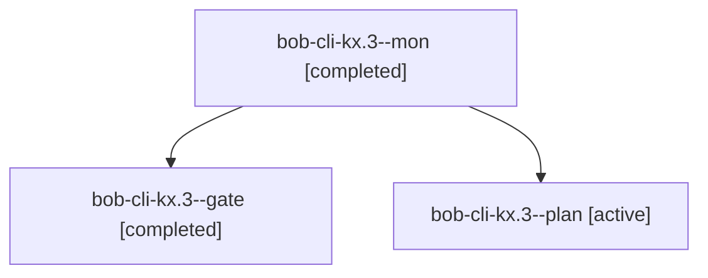

# Session: bob-cli-kx.3

[Agent Hoods](../README.md) / [bbugyi200](../users/bbugyi200/README.md) / [athena](../users/bbugyi200/machines/athena/README.md) / [bob-cli-kx](../users/bbugyi200/machines/athena/hoods/bob-cli-kx/README.md) / bob-cli-kx.3

Owner: `bbugyi200.athena` · Hood: `bob-cli-kx` · Members: 3 · Bead: [bob-cli-kx.3](https://github.com/bobs-org/bob-cli--beads/blob/main/pages/bob-cli-kx/bob-cli-kx.3.md)

## Lineage

The diagram is an optional enhancement; the ordered table below contains the same lineage in accessible text.

| Role | Agent | State | Model / provider | Timing | Commits | Prompt | Chat |
|---|---|---|---|---|---:|---|---|
| mon | bob-cli-kx.3--mon | completed | gpt-6-astra / codex | 2026-11-13T13:02:37.319825+00:00 → 2026-11-13T13:05:35.387414+00:00 | 0 | — | [Chat](../agents/bbugyi200.athena.bob-cli-kx.3--mon/chat.md) |
| gate | bob-cli-kx.3--gate | completed | gpt-6-astra / codex | 2026-11-13T13:02:21.905058+00:00 → 2026-11-13T13:02:40.249988+00:00 | 0 | — | [Chat](../agents/bbugyi200.athena.bob-cli-kx.3--gate/chat.md) |
| plan | bob-cli-kx.3--plan | active | gpt-6-astra / codex | 2026-11-13T12:52:18.962460+00:00 → 2026-11-13T13:02:47.101135+00:00 | 0 | [Prompt](../agents/bbugyi200.athena.bob-cli-kx.3--plan/prompt.md) | [Chat](../agents/bbugyi200.athena.bob-cli-kx.3--plan/chat.md) |

## Neighbors

| Agent | Relation | State |
|---|---|---|
| [bob-cli-kx.3.1.1](../agents/bbugyi200.athena.bob-cli-kx.3.1.1/README.md) | descendant | active |
| [bob-cli-kx.3.1.2](../agents/bbugyi200.athena.bob-cli-kx.3.1.2/README.md) | descendant | waiting |
| [bob-cli-kx.3.1.3](../agents/bbugyi200.athena.bob-cli-kx.3.1.3/README.md) | descendant | waiting |
| [bob-cli-kx.3.1.4](../agents/bbugyi200.athena.bob-cli-kx.3.1.4/README.md) | descendant | waiting |
| [bob-cli-kx.3.1.5](../agents/bbugyi200.athena.bob-cli-kx.3.1.5/README.md) | descendant | waiting |
| [bob-cli-kx.3.1.6](../agents/bbugyi200.athena.bob-cli-kx.3.1.6/README.md) | descendant | waiting |
| [bob-cli-kx.1](../agents/bbugyi200.athena.bob-cli-kx.1/README.md) | bob-cli-kx hood | completed |
| [bob-cli-kx.2](bbugyi200.athena.bob-cli-kx.2.md) (session · 3) | bob-cli-kx hood | active 1, completed 2 |
| [bob-cli-kx.2.1.1](../agents/bbugyi200.athena.bob-cli-kx.2.1.1/README.md) | bob-cli-kx hood | completed |
| [bob-cli-kx.2.1.2](../agents/bbugyi200.athena.bob-cli-kx.2.1.2/README.md) | bob-cli-kx hood | completed |
| [bob-cli-kx.2.1.3](bbugyi200.athena.bob-cli-kx.2.1.3.md) (session · 7) | bob-cli-kx hood | completed 5, failed 2 |
| [bob-cli-kx.2.1.4](../agents/bbugyi200.athena.bob-cli-kx.2.1.4/README.md) | bob-cli-kx hood | completed |
| [bob-cli-kx.2.1.5](../agents/bbugyi200.athena.bob-cli-kx.2.1.5/README.md) | bob-cli-kx hood | completed |
| [bob-cli-kx.2.1.6](../agents/bbugyi200.athena.bob-cli-kx.2.1.6/README.md) | bob-cli-kx hood | completed |
| [bob-cli-kx.2.1.7](../agents/bbugyi200.athena.bob-cli-kx.2.1.7/README.md) | bob-cli-kx hood | completed |
| [bob-cli-kx.2.1.8.1](bbugyi200.athena.bob-cli-kx.2.1.8.1.md) (session · 9) | bob-cli-kx hood | completed 6, failed 3 |
| [bob-cli-kx.2.1.8.2](../agents/bbugyi200.athena.bob-cli-kx.2.1.8.2/README.md) | bob-cli-kx hood | completed |
| [bob-cli-kx.2.1.8.3](../agents/bbugyi200.athena.bob-cli-kx.2.1.8.3/README.md) | bob-cli-kx hood | completed |
| [bob-cli-kx.2.1.8.4](../agents/bbugyi200.athena.bob-cli-kx.2.1.8.4/README.md) | bob-cli-kx hood | completed |
| [bob-cli-kx.2.1.8.land](bbugyi200.athena.bob-cli-kx.2.1.8.land.md) (session · 3) | bob-cli-kx hood | completed 3 |
| [bob-cli-kx.2.1.land](bbugyi200.athena.bob-cli-kx.2.1.land.md) (session · 3) | bob-cli-kx hood | active 1, completed 2 |
| [bob-cli-kx.4](../agents/bbugyi200.athena.bob-cli-kx.4/README.md) | bob-cli-kx hood | waiting |
| [bob-cli-kx.5](../agents/bbugyi200.athena.bob-cli-kx.5/README.md) | bob-cli-kx hood | waiting |
| [bob-cli-kx.land](../agents/bbugyi200.athena.bob-cli-kx.land/README.md) | bob-cli-kx hood | waiting |
