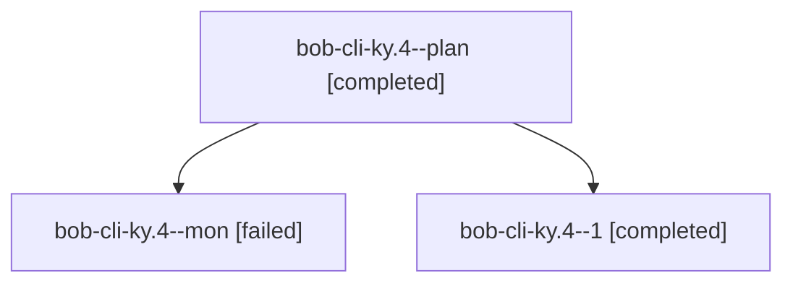

# Session: bob-cli-ky.4

[Agent Hoods](../README.md) / [bbugyi200](../users/bbugyi200/README.md) / [athena](../users/bbugyi200/machines/athena/README.md) / [bob-cli-ky](../users/bbugyi200/machines/athena/hoods/bob-cli-ky/README.md) / bob-cli-ky.4

Owner: `bbugyi200.athena` · Hood: `bob-cli-ky` · Members: 3 · Bead: [bob-cli-ky.4](https://github.com/bobs-org/bob-cli--beads/blob/main/pages/bob-cli-ky/bob-cli-ky.4.md)

## Lineage

The diagram is an optional enhancement; the ordered table below contains the same lineage in accessible text.

| Role | Agent | State | Model / provider | Timing | Commits | Prompt | Chat |
|---|---|---|---|---|---:|---|---|
| plan | bob-cli-ky.4--plan | completed | gpt-6-luna / codex | 2026-11-12T18:59:18.186877+00:00 → 2026-11-12T19:26:57.489657+00:00 | 0 | [Prompt](../agents/bbugyi200.athena.bob-cli-ky.4--plan/prompt.md) | [Chat](../agents/bbugyi200.athena.bob-cli-ky.4--plan/chat.md) |
| mon | bob-cli-ky.4--mon | failed | gpt-6-luna / codex | 2026-11-12T19:25:50.963904+00:00 → 2026-11-12T19:28:48.904653+00:00 | 0 | — | [Chat](../agents/bbugyi200.athena.bob-cli-ky.4--mon/chat.md) |
| 1 | bob-cli-ky.4--1 | completed | gpt-6-luna / codex | 2026-11-12T19:31:27.156394+00:00 → 2026-11-12T19:52:00.944498+00:00 | 0 | [Prompt](../agents/bbugyi200.athena.bob-cli-ky.4--1/prompt.md) | [Chat](../agents/bbugyi200.athena.bob-cli-ky.4--1/chat.md) |

## Neighbors

| Agent | Relation | State |
|---|---|---|
| [bob-cli-ky.1](../agents/bbugyi200.athena.bob-cli-ky.1/README.md) | bob-cli-ky hood | completed |
| [bob-cli-ky.2](../agents/bbugyi200.athena.bob-cli-ky.2/README.md) | bob-cli-ky hood | completed |
| [bob-cli-ky.3](../agents/bbugyi200.athena.bob-cli-ky.3/README.md) | bob-cli-ky hood | completed |
| [bob-cli-ky.5](../agents/bbugyi200.athena.bob-cli-ky.5/README.md) | bob-cli-ky hood | completed |
| [bob-cli-ky.6](../agents/bbugyi200.athena.bob-cli-ky.6/README.md) | bob-cli-ky hood | completed |
| [bob-cli-ky.7](../agents/bbugyi200.athena.bob-cli-ky.7/README.md) | bob-cli-ky hood | completed |
| [bob-cli-ky.land](../agents/bbugyi200.athena.bob-cli-ky.land/README.md) | bob-cli-ky hood | waiting |
