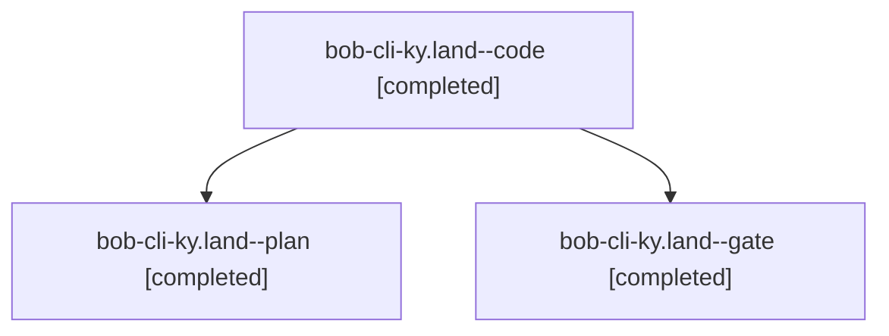

# Session: bob-cli-ky.land

[Agent Hoods](../README.md) / [bbugyi200](../users/bbugyi200/README.md) / [athena](../users/bbugyi200/machines/athena/README.md) / [bob-cli-ky](../users/bbugyi200/machines/athena/hoods/bob-cli-ky/README.md) / bob-cli-ky.land

Owner: `bbugyi200.athena` · Hood: `bob-cli-ky` · Members: 3 · Bead: [bob-cli-ky](https://github.com/bobs-org/bob-cli--beads/blob/main/pages/bob-cli-ky/README.md)

## Lineage

The diagram is an optional enhancement; the ordered table below contains the same lineage in accessible text.

| Role | Agent | State | Model / provider | Timing | Commits | Prompt | Chat |
|---|---|---|---|---|---:|---|---|
| code | bob-cli-ky.land--code | completed | muse-spark-1.3-contributor / muse | 2026-11-12T21:59:00.233406+00:00 → 2026-11-12T22:55:54.077917+00:00 | 0 | — | [Chat](../agents/bbugyi200.athena.bob-cli-ky.land--code/chat.md) |
| plan | bob-cli-ky.land--plan | completed | opus / claude | 2026-11-12T21:29:11.669946+00:00 → 2026-11-12T22:55:54.077917+00:00 | [1](../agents/bbugyi200.athena.bob-cli-ky.land--plan/README.md#commits) | [Prompt](../agents/bbugyi200.athena.bob-cli-ky.land--plan/prompt.md) | [Chat](../agents/bbugyi200.athena.bob-cli-ky.land--plan/chat.md) |
| gate | bob-cli-ky.land--gate | completed | opus / claude | 2026-11-12T21:56:41.142342+00:00 → 2026-11-12T21:58:03.075454+00:00 | 0 | — | [Chat](../agents/bbugyi200.athena.bob-cli-ky.land--gate/chat.md) |

## Commits

| Role | Repo | Commit | Subject | Committed |
|---|---|---|---|---|
| plan | bob-cli | [`6981b04`](https://github.com/bobs-org/bob-cli/commit/6981b04cc0801a836d888f52b6145c24c98fb901) | docs(glossary): regenerate reference glossary for the walker footer | 2026-11-12 16:55:50 EST |

## Neighbors

| Agent | Relation | State |
|---|---|---|
| [bob-cli-ky.1](../agents/bbugyi200.athena.bob-cli-ky.1/README.md) | bob-cli-ky hood | completed |
| [bob-cli-ky.2](../agents/bbugyi200.athena.bob-cli-ky.2/README.md) | bob-cli-ky hood | completed |
| [bob-cli-ky.3](../agents/bbugyi200.athena.bob-cli-ky.3/README.md) | bob-cli-ky hood | completed |
| [bob-cli-ky.4](bbugyi200.athena.bob-cli-ky.4.md) (session · 3) | bob-cli-ky hood | completed 2, failed 1 |
| [bob-cli-ky.5](../agents/bbugyi200.athena.bob-cli-ky.5/README.md) | bob-cli-ky hood | completed |
| [bob-cli-ky.6](../agents/bbugyi200.athena.bob-cli-ky.6/README.md) | bob-cli-ky hood | completed |
| [bob-cli-ky.7](../agents/bbugyi200.athena.bob-cli-ky.7/README.md) | bob-cli-ky hood | completed |
