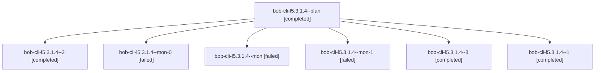

# Session: bob-cli-l5.3.1.4

[Agent Hoods](../README.md) / [bbugyi200](../users/bbugyi200/README.md) / [athena](../users/bbugyi200/machines/athena/README.md) / [bob-cli-l5](../users/bbugyi200/machines/athena/hoods/bob-cli-l5/README.md) / bob-cli-l5.3.1.4

Owner: `bbugyi200.athena` · Hood: `bob-cli-l5` · Members: 7 · Bead: [bob-cli-l5.3.1.4](https://github.com/bobs-org/bob-cli--beads/blob/main/pages/bob-cli-l5/bob-cli-l5.3.1.4.md)

## Lineage

The diagram is an optional enhancement; the ordered table below contains the same lineage in accessible text.

| Role | Agent | State | Model / provider | Timing | Commits | Prompt | Chat |
|---|---|---|---|---|---:|---|---|
| plan | bob-cli-l5.3.1.4--plan | completed | gpt-6-luna / codex | 2026-11-13T05:43:27.866782+00:00 → 2026-11-13T06:11:28.388134+00:00 | 0 | [Prompt](../agents/bbugyi200.athena.bob-cli-l5.3.1.4--plan/prompt.md) | [Chat](../agents/bbugyi200.athena.bob-cli-l5.3.1.4--plan/chat.md) |
| 2 | bob-cli-l5.3.1.4--2 | completed | gpt-6-luna / codex | 2026-11-13T06:39:22.496183+00:00 → 2026-11-13T06:44:50.949047+00:00 | 0 | [Prompt](../agents/bbugyi200.athena.bob-cli-l5.3.1.4--2/prompt.md) | [Chat](../agents/bbugyi200.athena.bob-cli-l5.3.1.4--2/chat.md) |
| mon-0 | bob-cli-l5.3.1.4--mon-0 | failed | gpt-6-luna / codex | 2026-11-13T06:26:28.123310+00:00 → 2026-11-13T06:37:28.391233+00:00 | 0 | — | [Chat](../agents/bbugyi200.athena.bob-cli-l5.3.1.4--mon-0/chat.md) |
| mon | bob-cli-l5.3.1.4--mon | failed | gpt-6-luna / codex | 2026-11-13T06:10:11.553762+00:00 → 2026-11-13T06:16:35.339817+00:00 | 0 | — | [Chat](../agents/bbugyi200.athena.bob-cli-l5.3.1.4--mon/chat.md) |
| mon-1 | bob-cli-l5.3.1.4--mon-1 | failed | gpt-6-luna / codex | 2026-11-13T06:43:48.108712+00:00 → 2026-11-13T06:55:21.717259+00:00 | 0 | — | [Chat](../agents/bbugyi200.athena.bob-cli-l5.3.1.4--mon-1/chat.md) |
| 3 | bob-cli-l5.3.1.4--3 | completed | gpt-6-luna / codex | 2026-11-13T06:57:18.961963+00:00 → 2026-11-13T07:08:48.235946+00:00 | [1](../agents/bbugyi200.athena.bob-cli-l5.3.1.4--3/README.md#commits) | [Prompt](../agents/bbugyi200.athena.bob-cli-l5.3.1.4--3/prompt.md) | [Chat](../agents/bbugyi200.athena.bob-cli-l5.3.1.4--3/chat.md) |
| 1 | bob-cli-l5.3.1.4--1 | completed | gpt-6-luna / codex | 2026-11-13T06:19:00.452112+00:00 → 2026-11-13T06:27:39.713123+00:00 | 0 | [Prompt](../agents/bbugyi200.athena.bob-cli-l5.3.1.4--1/prompt.md) | [Chat](../agents/bbugyi200.athena.bob-cli-l5.3.1.4--1/chat.md) |

## Commits

| Role | Repo | Commit | Subject | Committed |
|---|---|---|---|---|
| 3 | bob-cli | [`6bcc97a`](https://github.com/bobs-org/bob-cli/commit/6bcc97aeae39c13197755e1e482c90d740cc5479) | feat(gcal): add ack diagnostics and stale notices | 2026-11-13 02:07:55 EST |

## Neighbors

| Agent | Relation | State |
|---|---|---|
| [bob-cli-l5.3](bbugyi200.athena.bob-cli-l5.3.md) (session · 3) | ancestor | active 1, completed 2 |
| [bob-cli-l5.3.1.1](../agents/bbugyi200.athena.bob-cli-l5.3.1.1/README.md) | bob-cli-l5.3.1 hood | completed |
| [bob-cli-l5.3.1.2](../agents/bbugyi200.athena.bob-cli-l5.3.1.2/README.md) | bob-cli-l5.3.1 hood | completed |
| [bob-cli-l5.3.1.3](../agents/bbugyi200.athena.bob-cli-l5.3.1.3/README.md) | bob-cli-l5.3.1 hood | completed |
| [bob-cli-l5.3.1.land](../agents/bbugyi200.athena.bob-cli-l5.3.1.land/README.md) | bob-cli-l5.3.1 hood | waiting |
| [bob-cli-l5.1](../agents/bbugyi200.athena.bob-cli-l5.1/README.md) | bob-cli-l5 hood | completed |
| [bob-cli-l5.2](../agents/bbugyi200.athena.bob-cli-l5.2/README.md) | bob-cli-l5 hood | completed |
| [bob-cli-l5.4](../agents/bbugyi200.athena.bob-cli-l5.4/README.md) | bob-cli-l5 hood | waiting |
| [bob-cli-l5.5](../agents/bbugyi200.athena.bob-cli-l5.5/README.md) | bob-cli-l5 hood | waiting |
| [bob-cli-l5.land](../agents/bbugyi200.athena.bob-cli-l5.land/README.md) | bob-cli-l5 hood | waiting |
