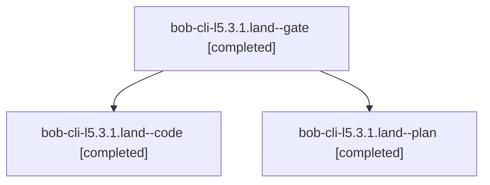

# Session: bob-cli-l5.3.1.land

[Agent Hoods](../README.md) / [bbugyi200](../users/bbugyi200/README.md) / [athena](../users/bbugyi200/machines/athena/README.md) / [bob-cli-l5](../users/bbugyi200/machines/athena/hoods/bob-cli-l5/README.md) / bob-cli-l5.3.1.land

Owner: `bbugyi200.athena` · Hood: `bob-cli-l5` · Members: 3 · Bead: [bob-cli-l5.3.1](https://github.com/bobs-org/bob-cli--beads/blob/main/pages/bob-cli-l5/bob-cli-l5.3.1.md)

## Lineage

The diagram is an optional enhancement; the ordered table below contains the same lineage in accessible text.

| Role | Agent | State | Model / provider | Timing | Commits | Prompt | Chat |
|---|---|---|---|---|---:|---|---|
| gate | bob-cli-l5.3.1.land--gate | completed | gpt-6-astra / codex | 2026-11-13T07:26:53.590642+00:00 → 2026-11-13T07:27:51.117102+00:00 | 0 | — | [Chat](../agents/bbugyi200.athena.bob-cli-l5.3.1.land--gate/chat.md) |
| code | bob-cli-l5.3.1.land--code | completed | gpt-6-luna / codex | 2026-11-13T07:28:25.523310+00:00 → 2026-11-13T08:38:45.446481+00:00 | [1](../agents/bbugyi200.athena.bob-cli-l5.3.1.land--code/README.md#commits) | — | [Chat](../agents/bbugyi200.athena.bob-cli-l5.3.1.land--code/chat.md) |
| plan | bob-cli-l5.3.1.land--plan | completed | gpt-6-astra / codex | 2026-11-13T07:09:34.339902+00:00 → 2026-11-13T08:38:45.446481+00:00 | 0 | [Prompt](../agents/bbugyi200.athena.bob-cli-l5.3.1.land--plan/prompt.md) | [Chat](../agents/bbugyi200.athena.bob-cli-l5.3.1.land--plan/chat.md) |

## Commits

| Role | Repo | Commit | Subject | Committed |
|---|---|---|---|---|
| code | bob-cli | [`cb10892`](https://github.com/bobs-org/bob-cli/commit/cb10892f8fc200272a91db538bb51940981e8961) | fix(gcal): repair ack queue and terminal edge cases | 2026-11-13 03:37:03 EST |

## Neighbors

| Agent | Relation | State |
|---|---|---|
| [bob-cli-l5.3](bbugyi200.athena.bob-cli-l5.3.md) (session · 3) | ancestor | active 1, completed 2 |
| [bob-cli-l5.3.1.1](../agents/bbugyi200.athena.bob-cli-l5.3.1.1/README.md) | bob-cli-l5.3.1 hood | completed |
| [bob-cli-l5.3.1.2](../agents/bbugyi200.athena.bob-cli-l5.3.1.2/README.md) | bob-cli-l5.3.1 hood | completed |
| [bob-cli-l5.3.1.3](../agents/bbugyi200.athena.bob-cli-l5.3.1.3/README.md) | bob-cli-l5.3.1 hood | completed |
| [bob-cli-l5.3.1.4](bbugyi200.athena.bob-cli-l5.3.1.4.md) (session · 7) | bob-cli-l5.3.1 hood | completed 4, failed 3 |
| [bob-cli-l5.1](../agents/bbugyi200.athena.bob-cli-l5.1/README.md) | bob-cli-l5 hood | completed |
| [bob-cli-l5.2](../agents/bbugyi200.athena.bob-cli-l5.2/README.md) | bob-cli-l5 hood | completed |
| [bob-cli-l5.4](../agents/bbugyi200.athena.bob-cli-l5.4/README.md) | bob-cli-l5 hood | completed |
| [bob-cli-l5.5](bbugyi200.athena.bob-cli-l5.5.md) (session · 2) | bob-cli-l5 hood | active 1, completed 1 |
| [bob-cli-l5.land](../agents/bbugyi200.athena.bob-cli-l5.land/README.md) | bob-cli-l5 hood | waiting |
