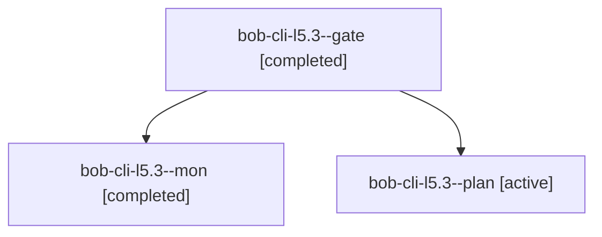

# Session: bob-cli-l5.3

[Agent Hoods](../README.md) / [bbugyi200](../users/bbugyi200/README.md) / [athena](../users/bbugyi200/machines/athena/README.md) / [bob-cli-l5](../users/bbugyi200/machines/athena/hoods/bob-cli-l5/README.md) / bob-cli-l5.3

Owner: `bbugyi200.athena` · Hood: `bob-cli-l5` · Members: 3 · Bead: [bob-cli-l5.3](https://github.com/bobs-org/bob-cli--beads/blob/main/pages/bob-cli-l5/bob-cli-l5.3.md)

## Lineage

The diagram is an optional enhancement; the ordered table below contains the same lineage in accessible text.

| Role | Agent | State | Model / provider | Timing | Commits | Prompt | Chat |
|---|---|---|---|---|---:|---|---|
| gate | bob-cli-l5.3--gate | completed | gpt-6-astra / codex | 2026-11-13T01:42:03.633051+00:00 → 2026-11-13T01:43:16.988894+00:00 | 0 | — | [Chat](../agents/bbugyi200.athena.bob-cli-l5.3--gate/chat.md) |
| mon | bob-cli-l5.3--mon | completed | gpt-6-astra / codex | 2026-11-13T01:43:13.694350+00:00 → 2026-11-13T01:47:15.732258+00:00 | 0 | — | [Chat](../agents/bbugyi200.athena.bob-cli-l5.3--mon/chat.md) |
| plan | bob-cli-l5.3--plan | active | gpt-6-astra / codex | 2026-11-13T01:25:14.248128+00:00 → 2026-11-13T01:43:24.703554+00:00 | 0 | [Prompt](../agents/bbugyi200.athena.bob-cli-l5.3--plan/prompt.md) | [Chat](../agents/bbugyi200.athena.bob-cli-l5.3--plan/chat.md) |

## Neighbors

| Agent | Relation | State |
|---|---|---|
| [bob-cli-l5.3.1.1](../agents/bbugyi200.athena.bob-cli-l5.3.1.1/README.md) | descendant | completed |
| [bob-cli-l5.3.1.2](../agents/bbugyi200.athena.bob-cli-l5.3.1.2/README.md) | descendant | completed |
| [bob-cli-l5.3.1.3](../agents/bbugyi200.athena.bob-cli-l5.3.1.3/README.md) | descendant | completed |
| [bob-cli-l5.3.1.4](bbugyi200.athena.bob-cli-l5.3.1.4.md) (session · 7) | descendant | completed 4, failed 3 |
| [bob-cli-l5.3.1.land](../agents/bbugyi200.athena.bob-cli-l5.3.1.land/README.md) | descendant | waiting |
| [bob-cli-l5.1](../agents/bbugyi200.athena.bob-cli-l5.1/README.md) | bob-cli-l5 hood | completed |
| [bob-cli-l5.2](../agents/bbugyi200.athena.bob-cli-l5.2/README.md) | bob-cli-l5 hood | completed |
| [bob-cli-l5.4](../agents/bbugyi200.athena.bob-cli-l5.4/README.md) | bob-cli-l5 hood | waiting |
| [bob-cli-l5.5](../agents/bbugyi200.athena.bob-cli-l5.5/README.md) | bob-cli-l5 hood | waiting |
| [bob-cli-l5.land](../agents/bbugyi200.athena.bob-cli-l5.land/README.md) | bob-cli-l5 hood | waiting |
