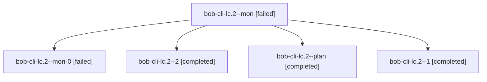

# Session: bob-cli-lc.2

[Agent Hoods](../README.md) / [bbugyi200](../users/bbugyi200/README.md) / [athena](../users/bbugyi200/machines/athena/README.md) / [bob-cli-lc](../users/bbugyi200/machines/athena/hoods/bob-cli-lc/README.md) / bob-cli-lc.2

Owner: `bbugyi200.athena` · Hood: `bob-cli-lc` · Members: 5 · Bead: [bob-cli-lc.2](https://github.com/bobs-org/bob-cli--beads/blob/main/pages/bob-cli-lc/bob-cli-lc.2.md)

## Lineage

The diagram is an optional enhancement; the ordered table below contains the same lineage in accessible text.

| Role | Agent | State | Model / provider | Timing | Commits | Prompt | Chat |
|---|---|---|---|---|---:|---|---|
| mon | bob-cli-lc.2--mon | failed | gpt-6-luna / codex | 2026-11-13T16:44:00.694327+00:00 → 2026-11-13T16:52:06.442354+00:00 | 0 | — | [Chat](../agents/bbugyi200.athena.bob-cli-lc.2--mon/chat.md) |
| mon-0 | bob-cli-lc.2--mon-0 | failed | gpt-6-luna / codex | 2026-11-13T16:57:01.882407+00:00 → 2026-11-13T17:01:58.644896+00:00 | 0 | — | [Chat](../agents/bbugyi200.athena.bob-cli-lc.2--mon-0/chat.md) |
| 2 | bob-cli-lc.2--2 | completed | gpt-6-luna / codex | 2026-11-13T17:02:32.877035+00:00 → 2026-11-13T17:08:53.177905+00:00 | [1](../agents/bbugyi200.athena.bob-cli-lc.2--2/README.md#commits) | [Prompt](../agents/bbugyi200.athena.bob-cli-lc.2--2/prompt.md) | [Chat](../agents/bbugyi200.athena.bob-cli-lc.2--2/chat.md) |
| plan | bob-cli-lc.2--plan | completed | gpt-6-luna / codex | 2026-11-13T15:58:05.124912+00:00 → 2026-11-13T16:47:42.155038+00:00 | 0 | [Prompt](../agents/bbugyi200.athena.bob-cli-lc.2--plan/prompt.md) | [Chat](../agents/bbugyi200.athena.bob-cli-lc.2--plan/chat.md) |
| 1 | bob-cli-lc.2--1 | completed | gpt-6-luna / codex | 2026-11-13T16:52:41.377649+00:00 → 2026-11-13T16:57:55.725401+00:00 | 0 | [Prompt](../agents/bbugyi200.athena.bob-cli-lc.2--1/prompt.md) | [Chat](../agents/bbugyi200.athena.bob-cli-lc.2--1/chat.md) |

## Commits

| Role | Repo | Commit | Subject | Committed |
|---|---|---|---|---|
| 2 | bob-cli | [`d6d755a`](https://github.com/bobs-org/bob-cli/commit/d6d755a1da262080f5a78196a653f5f296017475) | feat(bank): clean QFX payees and merchant keys | 2026-11-13 12:08:10 EST |

## Neighbors

| Agent | Relation | State |
|---|---|---|
| [bob-cli-lc.1](../agents/bbugyi200.athena.bob-cli-lc.1/README.md) | bob-cli-lc hood | completed |
| [bob-cli-lc.3](../agents/bbugyi200.athena.bob-cli-lc.3/README.md) | bob-cli-lc hood | completed |
| [bob-cli-lc.4](../agents/bbugyi200.athena.bob-cli-lc.4/README.md) | bob-cli-lc hood | waiting |
| [bob-cli-lc.5](../agents/bbugyi200.athena.bob-cli-lc.5/README.md) | bob-cli-lc hood | waiting |
| [bob-cli-lc.6](../agents/bbugyi200.athena.bob-cli-lc.6/README.md) | bob-cli-lc hood | waiting |
| [bob-cli-lc.7](../agents/bbugyi200.athena.bob-cli-lc.7/README.md) | bob-cli-lc hood | waiting |
| [bob-cli-lc.8](../agents/bbugyi200.athena.bob-cli-lc.8/README.md) | bob-cli-lc hood | waiting |
| [bob-cli-lc.land](../agents/bbugyi200.athena.bob-cli-lc.land/README.md) | bob-cli-lc hood | waiting |
