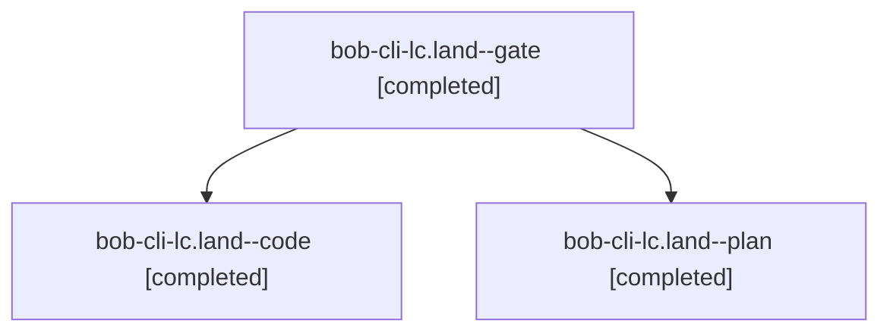

# Session: bob-cli-lc.land

[Agent Hoods](../README.md) / [bbugyi200](../users/bbugyi200/README.md) / [athena](../users/bbugyi200/machines/athena/README.md) / [bob-cli-lc](../users/bbugyi200/machines/athena/hoods/bob-cli-lc/README.md) / bob-cli-lc.land

Owner: `bbugyi200.athena` · Hood: `bob-cli-lc` · Members: 3 · Bead: [bob-cli-lc](https://github.com/bobs-org/bob-cli--beads/blob/main/pages/bob-cli-lc/README.md)

## Lineage

The diagram is an optional enhancement; the ordered table below contains the same lineage in accessible text.

| Role | Agent | State | Model / provider | Timing | Commits | Prompt | Chat |
|---|---|---|---|---|---:|---|---|
| gate | bob-cli-lc.land--gate | completed | opus / claude | 2026-11-13T21:04:22.155173+00:00 → 2026-11-13T21:04:39.201401+00:00 | 0 | — | [Chat](../agents/bbugyi200.athena.bob-cli-lc.land--gate/chat.md) |
| code | bob-cli-lc.land--code | completed | grok-4.6 / grok | 2026-11-13T21:05:19.974903+00:00 → 2026-11-13T21:49:56.982948+00:00 | [1](../agents/bbugyi200.athena.bob-cli-lc.land--code/README.md#commits) | — | [Chat](../agents/bbugyi200.athena.bob-cli-lc.land--code/chat.md) |
| plan | bob-cli-lc.land--plan | completed | opus / claude | 2026-11-13T20:26:42.447527+00:00 → 2026-11-13T21:49:56.982948+00:00 | 0 | [Prompt](../agents/bbugyi200.athena.bob-cli-lc.land--plan/prompt.md) | [Chat](../agents/bbugyi200.athena.bob-cli-lc.land--plan/chat.md) |

## Commits

| Role | Repo | Commit | Subject | Committed |
|---|---|---|---|---|
| code | bob-cli | [`21d12f2`](https://github.com/bobs-org/bob-cli/commit/21d12f23a0738a94b030b2c6a2a2d8b47001bdc4) | docs(bank): keep the Category card open on the next waiting row | 2026-11-13 16:47:53 EST |

## Neighbors

| Agent | Relation | State |
|---|---|---|
| [bob-cli-lc.1](../agents/bbugyi200.athena.bob-cli-lc.1/README.md) | bob-cli-lc hood | completed |
| [bob-cli-lc.2](bbugyi200.athena.bob-cli-lc.2.md) (session · 5) | bob-cli-lc hood | completed 3, failed 2 |
| [bob-cli-lc.3](../agents/bbugyi200.athena.bob-cli-lc.3/README.md) | bob-cli-lc hood | completed |
| [bob-cli-lc.4](../agents/bbugyi200.athena.bob-cli-lc.4/README.md) | bob-cli-lc hood | completed |
| [bob-cli-lc.5](../agents/bbugyi200.athena.bob-cli-lc.5/README.md) | bob-cli-lc hood | completed |
| [bob-cli-lc.6](../agents/bbugyi200.athena.bob-cli-lc.6/README.md) | bob-cli-lc hood | completed |
| [bob-cli-lc.7](../agents/bbugyi200.athena.bob-cli-lc.7/README.md) | bob-cli-lc hood | completed |
| [bob-cli-lc.8](../agents/bbugyi200.athena.bob-cli-lc.8/README.md) | bob-cli-lc hood | completed |
