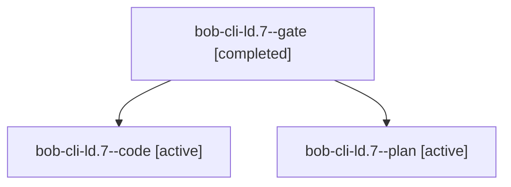

# Session: bob-cli-ld.7

[Agent Hoods](../README.md) / [bbugyi200](../users/bbugyi200/README.md) / [athena](../users/bbugyi200/machines/athena/README.md) / [bob-cli-ld](../users/bbugyi200/machines/athena/hoods/bob-cli-ld/README.md) / bob-cli-ld.7

Owner: `bbugyi200.athena` · Hood: `bob-cli-ld` · Members: 3 · Bead: [bob-cli-ld.7](https://github.com/bobs-org/bob-cli--beads/blob/main/pages/bob-cli-ld/bob-cli-ld.7.md)

## Lineage

The diagram is an optional enhancement; the ordered table below contains the same lineage in accessible text.

| Role | Agent | State | Model / provider | Timing | Commits | Prompt | Chat |
|---|---|---|---|---|---:|---|---|
| gate | bob-cli-ld.7--gate | completed | gpt-6-astra / codex | 2026-11-13T18:12:23.063058+00:00 → 2026-11-13T18:12:39.560885+00:00 | 0 | — | [Chat](../agents/bbugyi200.athena.bob-cli-ld.7--gate/chat.md) |
| code | bob-cli-ld.7--code | active | muse-spark-1.3-contributor / muse | 2026-11-13T18:12:56.987560+00:00 | 0 | — | — |
| plan | bob-cli-ld.7--plan | active | gpt-6-astra / codex | 2026-11-13T18:03:27.690564+00:00 | 0 | [Prompt](../agents/bbugyi200.athena.bob-cli-ld.7--plan/prompt.md) | [Chat](../agents/bbugyi200.athena.bob-cli-ld.7--plan/chat.md) |

## Neighbors

| Agent | Relation | State |
|---|---|---|
| [bob-cli-ld.1](../agents/bbugyi200.athena.bob-cli-ld.1/README.md) | bob-cli-ld hood | completed |
| [bob-cli-ld.10](../agents/bbugyi200.athena.bob-cli-ld.10/README.md) | bob-cli-ld hood | waiting |
| [bob-cli-ld.2](../agents/bbugyi200.athena.bob-cli-ld.2/README.md) | bob-cli-ld hood | completed |
| [bob-cli-ld.3](../agents/bbugyi200.athena.bob-cli-ld.3/README.md) | bob-cli-ld hood | completed |
| [bob-cli-ld.4](../agents/bbugyi200.athena.bob-cli-ld.4/README.md) | bob-cli-ld hood | completed |
| [bob-cli-ld.5](../agents/bbugyi200.athena.bob-cli-ld.5/README.md) | bob-cli-ld hood | completed |
| [bob-cli-ld.6](bbugyi200.athena.bob-cli-ld.6.md) (session · 3) | bob-cli-ld hood | completed 2, failed 1 |
| [bob-cli-ld.8](../agents/bbugyi200.athena.bob-cli-ld.8/README.md) | bob-cli-ld hood | waiting |
| [bob-cli-ld.9](../agents/bbugyi200.athena.bob-cli-ld.9/README.md) | bob-cli-ld hood | waiting |
| [bob-cli-ld.land](../agents/bbugyi200.athena.bob-cli-ld.land/README.md) | bob-cli-ld hood | waiting |
