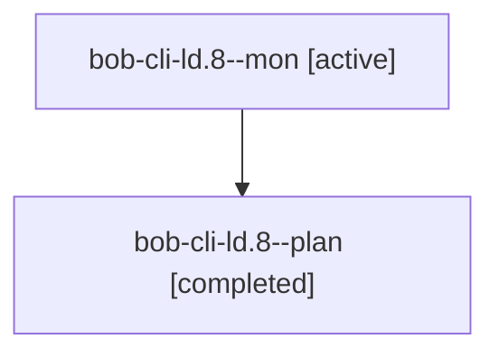

# Session: bob-cli-ld.8

[Agent Hoods](../README.md) / [bbugyi200](../users/bbugyi200/README.md) / [athena](../users/bbugyi200/machines/athena/README.md) / [bob-cli-ld](../users/bbugyi200/machines/athena/hoods/bob-cli-ld/README.md) / bob-cli-ld.8

Owner: `bbugyi200.athena` · Hood: `bob-cli-ld` · Members: 2 · Bead: [bob-cli-ld.8](https://github.com/bobs-org/bob-cli--beads/blob/main/pages/bob-cli-ld/bob-cli-ld.8.md)

## Lineage

The diagram is an optional enhancement; the ordered table below contains the same lineage in accessible text.

| Role | Agent | State | Model / provider | Timing | Commits | Prompt | Chat |
|---|---|---|---|---|---:|---|---|
| mon | bob-cli-ld.8--mon | active | grok-4.6 / grok | 2026-11-13T20:48:56.271406+00:00 | 0 | — | — |
| plan | bob-cli-ld.8--plan | completed | grok-4.6 / grok | 2026-11-13T20:21:15.668020+00:00 → 2026-11-13T20:50:29.325609+00:00 | 0 | [Prompt](../agents/bbugyi200.athena.bob-cli-ld.8--plan/prompt.md) | [Chat](../agents/bbugyi200.athena.bob-cli-ld.8--plan/chat.md) |

## Neighbors

| Agent | Relation | State |
|---|---|---|
| [bob-cli-ld.1](../agents/bbugyi200.athena.bob-cli-ld.1/README.md) | bob-cli-ld hood | completed |
| [bob-cli-ld.10](../agents/bbugyi200.athena.bob-cli-ld.10/README.md) | bob-cli-ld hood | waiting |
| [bob-cli-ld.2](../agents/bbugyi200.athena.bob-cli-ld.2/README.md) | bob-cli-ld hood | completed |
| [bob-cli-ld.3](../agents/bbugyi200.athena.bob-cli-ld.3/README.md) | bob-cli-ld hood | completed |
| [bob-cli-ld.4](../agents/bbugyi200.athena.bob-cli-ld.4/README.md) | bob-cli-ld hood | completed |
| [bob-cli-ld.5](../agents/bbugyi200.athena.bob-cli-ld.5/README.md) | bob-cli-ld hood | completed |
| [bob-cli-ld.6](bbugyi200.athena.bob-cli-ld.6.md) (session · 3) | bob-cli-ld hood | completed 2, failed 1 |
| [bob-cli-ld.7](bbugyi200.athena.bob-cli-ld.7.md) (session · 5) | bob-cli-ld hood | completed 4, failed 1 |
| [bob-cli-ld.9](bbugyi200.athena.bob-cli-ld.9.md) (session · 3) | bob-cli-ld hood | active 1, completed 2 |
| [bob-cli-ld.9.1.1](../agents/bbugyi200.athena.bob-cli-ld.9.1.1/README.md) | bob-cli-ld hood | completed |
| [bob-cli-ld.9.1.2](../agents/bbugyi200.athena.bob-cli-ld.9.1.2/README.md) | bob-cli-ld hood | active |
| [bob-cli-ld.9.1.3](../agents/bbugyi200.athena.bob-cli-ld.9.1.3/README.md) | bob-cli-ld hood | waiting |
| [bob-cli-ld.9.1.land](../agents/bbugyi200.athena.bob-cli-ld.9.1.land/README.md) | bob-cli-ld hood | waiting |
| [bob-cli-ld.land](../agents/bbugyi200.athena.bob-cli-ld.land/README.md) | bob-cli-ld hood | waiting |
