# Session: bob-cli-ld.9.1.3

[Agent Hoods](../README.md) / [bbugyi200](../users/bbugyi200/README.md) / [athena](../users/bbugyi200/machines/athena/README.md) / [bob-cli-ld](../users/bbugyi200/machines/athena/hoods/bob-cli-ld/README.md) / bob-cli-ld.9.1.3

Owner: `bbugyi200.athena` · Hood: `bob-cli-ld` · Members: 13 · Bead: [bob-cli-ld.9.1.3](https://github.com/bobs-org/bob-cli--beads/blob/main/pages/bob-cli-ld/bob-cli-ld.9.1.3.md)

## Lineage

```mermaid
flowchart TD
  n0["bob-cli-ld.9.1.3--mon-4 [failed]"]
  n1["bob-cli-ld.9.1.3--mon-3 [failed]"]
  n0 --> n1
  n2["bob-cli-ld.9.1.3--6 [completed]"]
  n0 --> n2
  n3["bob-cli-ld.9.1.3--1 [completed]"]
  n0 --> n3
  n4["bob-cli-ld.9.1.3--mon [failed]"]
  n0 --> n4
  n5["bob-cli-ld.9.1.3--mon-1 [failed]"]
  n0 --> n5
  n6["bob-cli-ld.9.1.3--5 [completed]"]
  n0 --> n6
  n7["bob-cli-ld.9.1.3--3 [completed]"]
  n0 --> n7
  n8["bob-cli-ld.9.1.3--2 [completed]"]
  n0 --> n8
  n9["bob-cli-ld.9.1.3--plan [completed]"]
  n0 --> n9
  n10["bob-cli-ld.9.1.3--mon-0 [failed]"]
  n0 --> n10
  n11["bob-cli-ld.9.1.3--4 [completed]"]
  n0 --> n11
  n12["bob-cli-ld.9.1.3--mon-2 [failed]"]
  n0 --> n12
```



The diagram is an optional enhancement; the ordered table below contains the same lineage in accessible text.

| Role | Agent | State | Model / provider | Timing | Commits | Prompt | Chat |
|---|---|---|---|---|---:|---|---|
| <a id="member-mon-4"></a>mon-4 | bob-cli-ld.9.1.3--mon-4 | failed | gpt-6-luna / codex | 2026-11-13T23:42:50.337034+00:00 → 2026-11-13T23:45:56.286443+00:00 | 0 | — | [Chat](../agents/bbugyi200.athena.bob-cli-ld.9.1.3--mon-4/chat.md) |
| <a id="member-mon-3"></a>mon-3 | bob-cli-ld.9.1.3--mon-3 | failed | gpt-6-luna / codex | 2026-11-13T22:48:46.621207+00:00 → 2026-11-13T22:52:26.582004+00:00 | 0 | — | [Chat](../agents/bbugyi200.athena.bob-cli-ld.9.1.3--mon-3/chat.md) |
| <a id="member-6"></a>6 | bob-cli-ld.9.1.3--6 | completed | gpt-6-luna / codex | 2026-11-13T23:46:35.453911+00:00 → 2026-11-14T00:55:17.224571+00:00 | 0 | [Prompt](../agents/bbugyi200.athena.bob-cli-ld.9.1.3--6/prompt.md) | [Chat](../agents/bbugyi200.athena.bob-cli-ld.9.1.3--6/chat.md) |
| <a id="member-1"></a>1 | bob-cli-ld.9.1.3--1 | completed | gpt-6-luna / codex | 2026-11-13T22:14:34.820160+00:00 → 2026-11-13T22:21:04.622147+00:00 | 0 | [Prompt](../agents/bbugyi200.athena.bob-cli-ld.9.1.3--1/prompt.md) | [Chat](../agents/bbugyi200.athena.bob-cli-ld.9.1.3--1/chat.md) |
| <a id="member-mon"></a>mon | bob-cli-ld.9.1.3--mon | failed | gpt-6-luna / codex | 2026-11-13T22:10:27.857690+00:00 → 2026-11-13T22:13:52.907788+00:00 | 0 | — | [Chat](../agents/bbugyi200.athena.bob-cli-ld.9.1.3--mon/chat.md) |
| <a id="member-mon-1"></a>mon-1 | bob-cli-ld.9.1.3--mon-1 | failed | gpt-6-luna / codex | 2026-11-13T22:27:03.438455+00:00 → 2026-11-13T22:32:08.604262+00:00 | 0 | — | [Chat](../agents/bbugyi200.athena.bob-cli-ld.9.1.3--mon-1/chat.md) |
| <a id="member-5"></a>5 | bob-cli-ld.9.1.3--5 | completed | gpt-6-luna / codex | 2026-11-13T22:52:58.662588+00:00 → 2026-11-13T23:43:42.021123+00:00 | 0 | [Prompt](../agents/bbugyi200.athena.bob-cli-ld.9.1.3--5/prompt.md) | [Chat](../agents/bbugyi200.athena.bob-cli-ld.9.1.3--5/chat.md) |
| <a id="member-3"></a>3 | bob-cli-ld.9.1.3--3 | completed | gpt-6-luna / codex | 2026-11-13T22:32:59.574188+00:00 → 2026-11-13T22:36:47.666312+00:00 | 0 | [Prompt](../agents/bbugyi200.athena.bob-cli-ld.9.1.3--3/prompt.md) | [Chat](../agents/bbugyi200.athena.bob-cli-ld.9.1.3--3/chat.md) |
| <a id="member-2"></a>2 | bob-cli-ld.9.1.3--2 | completed | gpt-6-luna / codex | 2026-11-13T22:23:28.475050+00:00 → 2026-11-13T22:27:54.906383+00:00 | 0 | [Prompt](../agents/bbugyi200.athena.bob-cli-ld.9.1.3--2/prompt.md) | [Chat](../agents/bbugyi200.athena.bob-cli-ld.9.1.3--2/chat.md) |
| <a id="member-plan"></a>plan | bob-cli-ld.9.1.3--plan | completed | gpt-6-luna / codex | 2026-11-13T21:33:26.809531+00:00 → 2026-11-13T22:12:08.944924+00:00 | 0 | [Prompt](../agents/bbugyi200.athena.bob-cli-ld.9.1.3--plan/prompt.md) | [Chat](../agents/bbugyi200.athena.bob-cli-ld.9.1.3--plan/chat.md) |
| <a id="member-mon-0"></a>mon-0 | bob-cli-ld.9.1.3--mon-0 | failed | gpt-6-luna / codex | 2026-11-13T22:20:21.080386+00:00 → 2026-11-13T22:22:50.223446+00:00 | 0 | — | [Chat](../agents/bbugyi200.athena.bob-cli-ld.9.1.3--mon-0/chat.md) |
| <a id="member-4"></a>4 | bob-cli-ld.9.1.3--4 | completed | gpt-6-luna / codex | 2026-11-13T22:42:14.545698+00:00 → 2026-11-13T22:49:38.488422+00:00 | 0 | [Prompt](../agents/bbugyi200.athena.bob-cli-ld.9.1.3--4/prompt.md) | [Chat](../agents/bbugyi200.athena.bob-cli-ld.9.1.3--4/chat.md) |
| <a id="member-mon-2"></a>mon-2 | bob-cli-ld.9.1.3--mon-2 | failed | gpt-6-luna / codex | 2026-11-13T22:35:59.887222+00:00 → 2026-11-13T22:41:08.057744+00:00 | 0 | — | [Chat](../agents/bbugyi200.athena.bob-cli-ld.9.1.3--mon-2/chat.md) |

## Variables

| Role | Variable | Value |
|---|---|---|
| 6 | `artifacts` | \[{bead: bob-cli-ld.9.1.3, kind: file, label: acceptance-report, path: /home/bryan/.sase/artifacts/agents/gh\_bobs-org\_\_bob-cli/20261113184455/projects-ui-e2e-060078ef1194.json, ref: file:explicit:1f31… |

#### artifacts

**Role:** `6`

```yaml
- bead: bob-cli-ld.9.1.3
  kind: file
  label: acceptance-report
  path: /home/bryan/.sase/artifacts/agents/gh_bobs-org__bob-cli/20261113184455/projects-ui-e2e-060078ef1194.json
  ref: file:explicit:1f31d6f0e705190a94a38046
  source_path: /tmp/projects-ui-e2e.json
- bead: bob-cli-ld.9.1.3
  kind: file
  label: projects-ui-acceptance-report
  path: /home/bryan/.sase/artifacts/agents/gh_bobs-org__bob-cli/20261113184455/projects-ui-e2e-060078ef1194.json
  ref: file:explicit:a82786253010f6aaf7592fb4
  source_path: /tmp/projects-ui-e2e.json
- bead: bob-cli-ld.9.1.3
  kind: file
  label: projects-ui-screenshot-evidence
  path: /home/bryan/.sase/artifacts/agents/gh_bobs-org__bob-cli/20261113184455/projects-ui-screenshot-evidence-68275256a431.zip
  ref: file:explicit:c3b273cf00b5beffe099ebd8
  source_path: /tmp/projects-ui-screenshot-evidence.zip
```

Values are truncated for display; see each member's agent meta.json for the full values.

## Neighbors

| Agent | Relation | State |
|---|---|---|
| [bob-cli-ld.9](bbugyi200.athena.bob-cli-ld.9.md) (session · 3) | ancestor | active 1, completed 2 |
| [bob-cli-ld.9.1.1](../agents/bbugyi200.athena.bob-cli-ld.9.1.1/README.md) | bob-cli-ld.9.1 hood | completed |
| [bob-cli-ld.9.1.2](../agents/bbugyi200.athena.bob-cli-ld.9.1.2/README.md) | bob-cli-ld.9.1 hood | completed |
| [bob-cli-ld.9.1.land](../agents/bbugyi200.athena.bob-cli-ld.9.1.land/README.md) | bob-cli-ld.9.1 hood | waiting |
| [bob-cli-ld.1](../agents/bbugyi200.athena.bob-cli-ld.1/README.md) | bob-cli-ld hood | completed |
| [bob-cli-ld.10](../agents/bbugyi200.athena.bob-cli-ld.10/README.md) | bob-cli-ld hood | waiting |
| [bob-cli-ld.2](../agents/bbugyi200.athena.bob-cli-ld.2/README.md) | bob-cli-ld hood | completed |
| [bob-cli-ld.3](../agents/bbugyi200.athena.bob-cli-ld.3/README.md) | bob-cli-ld hood | completed |
| [bob-cli-ld.4](../agents/bbugyi200.athena.bob-cli-ld.4/README.md) | bob-cli-ld hood | completed |
| [bob-cli-ld.5](../agents/bbugyi200.athena.bob-cli-ld.5/README.md) | bob-cli-ld hood | completed |
| [bob-cli-ld.6](bbugyi200.athena.bob-cli-ld.6.md) (session · 3) | bob-cli-ld hood | completed 2, failed 1 |
| [bob-cli-ld.7](bbugyi200.athena.bob-cli-ld.7.md) (session · 5) | bob-cli-ld hood | completed 4, failed 1 |
| [bob-cli-ld.8](bbugyi200.athena.bob-cli-ld.8.md) (session · 3) | bob-cli-ld hood | completed 2, failed 1 |
| [bob-cli-ld.land](../agents/bbugyi200.athena.bob-cli-ld.land/README.md) | bob-cli-ld hood | waiting |
